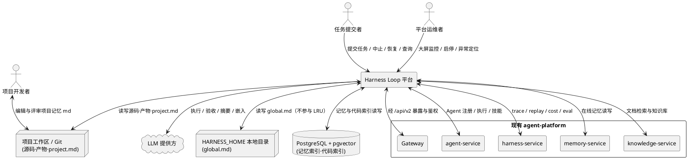
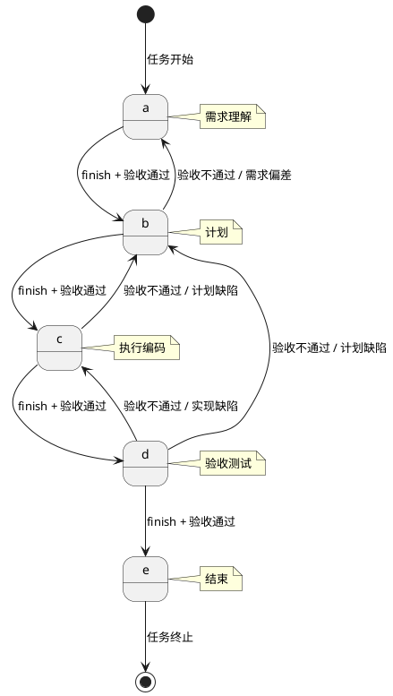
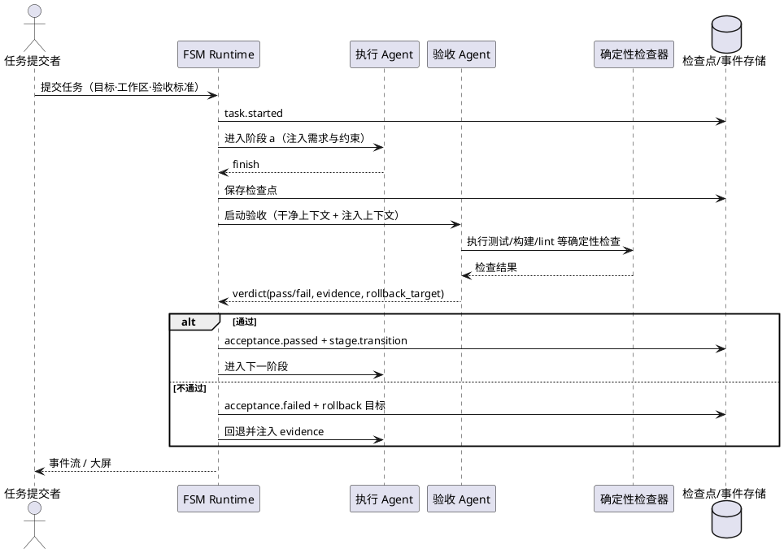
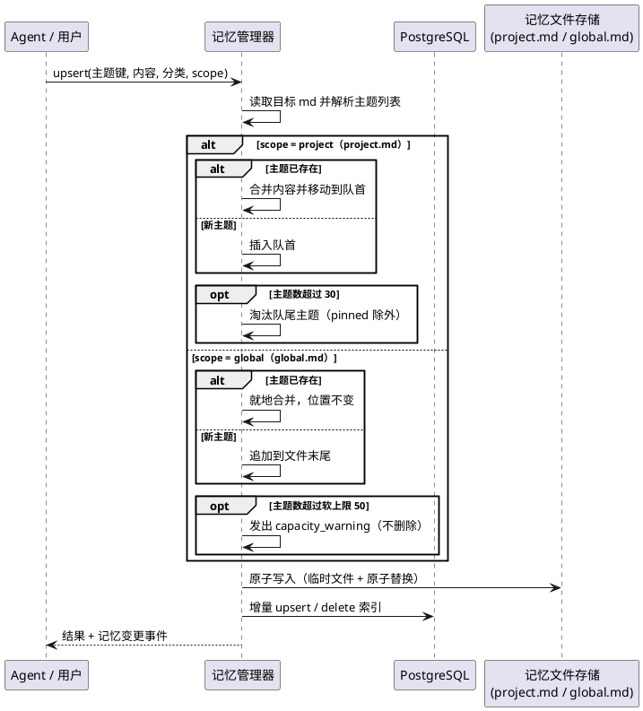
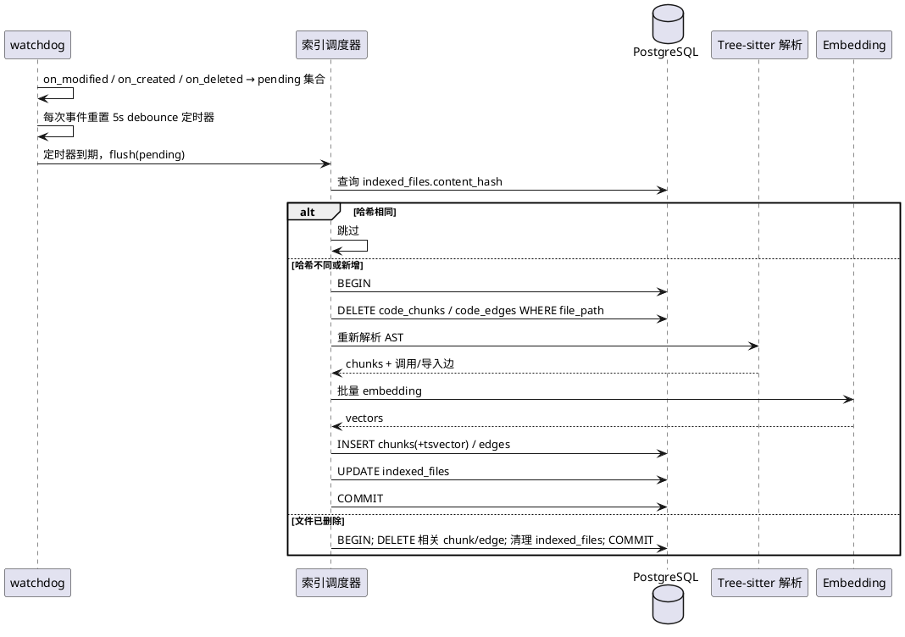
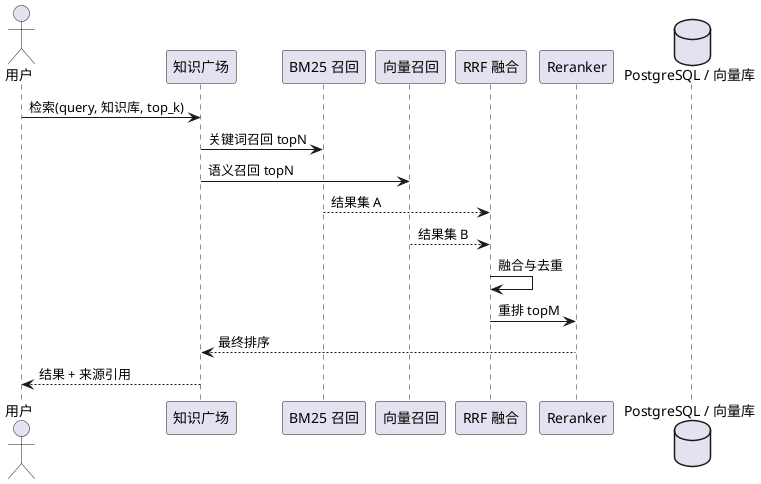
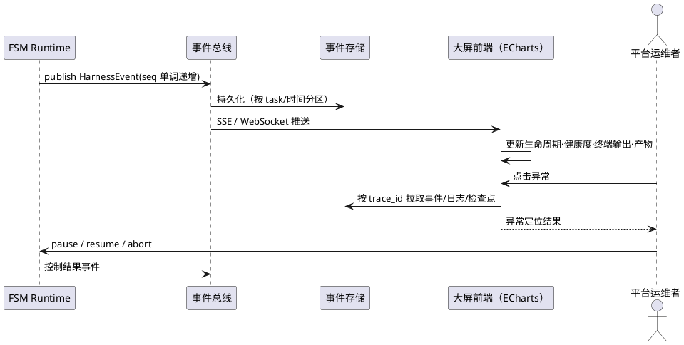
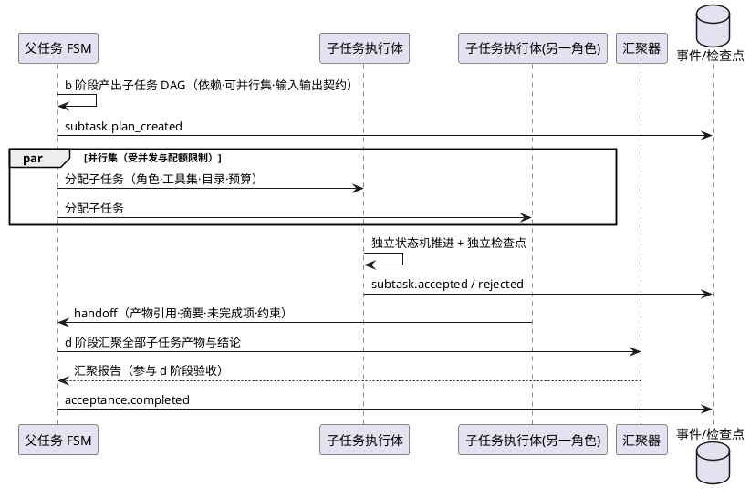

# Harness Loop 任务循环平台 — 需求规格说明书

| 项 | 内容 |
|---|---|
| 文档编号 | SPEC-HLP-001 |
| 版本 | v1.2（2026-11-11 增量修订；第一阶段：需求规格设计） |
| 状态 | 待评审 |
| 需求来源 | `Harness Loop.pdf`（全文 210 行，已逐行核对，含 3 张表格）；2026-11-10 设计评审补充项；2026-11-11 用户更正（长期记忆不参与 LRU） |
| 代码基线 | `agent-platform`（Go 1.22 + gRPC + React 19） |
| 本文档范围 | 仅需求规格（What / 验收标准），不含技术设计与任务分解 |
| 需求编号 | REQ-001 ~ REQ-170（共 170 条），DFX 共 38 条（P 12 / R 8 / S 8 / M 5 / C 5）（2026-11-10 修订；2026-11-11 未新增编号） |
| 章节结构 | 5.1 ~ 5.13 为原有能力域；5.14 多 Agent 协作、5.15 模型选择、5.16 工具权限与工作目录沙箱为 2026-11-10 新增；5.6 于 2026-11-11 修订为「项目 md 的 LRU / 长期 md 不淘汰」双轨治理 |
| 修订记录 | v1.1（2026-11-10）：新增 5.14 / 5.15 / 5.16 共 48 条需求；修订 5.5 上下文压缩（自研模板摘要为唯一通道，压缩引擎改为预留适配接口，一期不接入外部引擎）；补充 DFX 6 条；更新 Open Questions。 v1.2（2026-11-11）：**长期记忆不参与 LRU**——明确 30 主题上限、LRU 淘汰与读取提升仅适用于项目级记忆 `project.md`；长期记忆 `global.md` 不重排、不淘汰，仅软上限 50 + `memory.capacity_warning` 告警且不删除，主题顺序为稳定写入顺序。修订 REQ-047~REQ-052、REQ-057、REQ-062、REQ-104，以及术语表、DFX-C-05、6.6、Q10、1.2/1.3/1.4/3.2/3.3 与附录 B，未新增/跳过需求编号 |

> 阅读约定：每条需求由「EARS 陈述」与「验收条件」两部分组成。验收条件统一采用「触发场景 → 预期行为」句式，可直接转化为测试用例。标注「禁止项」的需求为不可协商的负向约束。

---

# 1. 组件定位

## 1.1 核心职责

本组件负责以五阶段有限状态机驱动 Agent 完成超长时任务，并实现阶段验收、异常恢复、记忆与代码索引增强及可视化监控。

## 1.2 核心输入

1. **任务请求**：来自 CLI 或 Web 的用户任务，包含任务目标、工作目录、工具权限、阶段验收标准、预算上限、租户与项目标识。
2. **控制指令**：用户主动中止（AbortController 语义）、暂停、恢复、从指定检查点重跑。
3. **Agent 输出**：执行 Agent 的流式输出、工具调用请求、阶段 `finish` 信号、模型结束原因。
4. **工作区变更**：项目文件的创建、修改、删除事件（用于代码索引增量重构）。
5. **记忆变更**：Agent 或用户对 markdown 记忆主题的写入、更新、读取（对项目级记忆 `project.md` 读取会改变 LRU 顺序；对长期记忆 `global.md` 读取不改变文件顺序与内容，2026-11-11 修订）。
6. **外部系统响应**：模型服务响应、PostgreSQL/pgvector 查询结果、现有 `agent-service` / `harness-service` / `memory-service` / `knowledge-service` 的 gRPC 响应。
7. **时间与配额信号**：阶段静默超时、任务总超时、token/费用预算阈值、异常重试计数。

## 1.3 核心输出

1. **阶段流转结果**：当前阶段、尝试序号、验收结论、下一状态、回退原因。
2. **标准化事件流**：任务、阶段、验收、重试、检查点、压缩、记忆、索引、异常等生命周期事件（供大屏与审计消费）。
3. **检查点与恢复凭据**：可在进程重启或异常后继续执行的持久化快照及其标识。
4. **记忆文件与索引**：项目工作区内的项目级 markdown 记忆文件（`<workspace>/.harness/memory/project.md`）、`HARNESS_HOME` 下的长期记忆文件（`<HARNESS_HOME>/memory/global.md`），以及 PostgreSQL 中的记忆/代码索引（2026-11-11 修订）。
5. **检索结果**：带来源引用（文件、行号、主题、文档、页码）的混合检索结果。
6. **CLI/TUI 视图与大屏视图**：阶段进度、健康度、终端输出、任务产物、异常定位入口。
7. **终止报告**：成功、用户中止、异常耗尽三类终态的结构化报告。

## 1.4 职责边界

**本组件不负责：**

1. 不替代现有 `harness-service` 的通用 DAG 工作流引擎；DAG 编排仍由现有工作流能力承担，本组件只负责「单任务的五阶段状态机」。
2. 不替代现有 `agent-service` 的 Agent 注册、技能库与多 Agent 交接能力；本组件消费其能力，不重建注册中心。
3. 不负责模型训练、微调、推理集群调度。
4. 不负责 IDE/编辑器能力，不实现代码补全。
5. 不自动向远端 Git 仓库推送；Git 版本化由用户或 CI 显式触发，本组件只保证项目级 markdown 记忆文件（`project.md`）「可被 git diff」；长期记忆 `global.md` 位于 `HARNESS_HOME`，不属于项目 Git 工作区，仅保证文件结构与原子写入（2026-11-11 修订）。
6. 不实现企业级 IAM、计费与租户生命周期管理；仅消费租户上下文并做数据隔离。
7. 不负责浏览器自动化、小红书抓取等既有工具能力。
8. 不承诺在第一阶段完成 Qdrant/MongoDB 的全量下线与数据迁移；迁移另立专项。
9. 不做多模态（图像、音视频）解析与索引。
10. 多 Agent 协作中的任务拆分、handoff 契约校验、结果汇聚与并发调度由本组件承担；Agent 注册、技能挂载与 Agent 间通信传输仍复用 `agent-service` / `a2a-service`，不重建注册中心与传输协议（2026-11-10 修订）。

## 1.5 现状基线与差距分析（Gap Analysis）

> 结论口径：**复用**＝能力已具备且语义一致；**增强**＝已有骨架但需扩展；**新建**＝缺失需从零建设；**冲突**＝与文档架构选择不一致，需决策。

| # | 能力域 | 现有实现（代码基线） | 差距判定 | 处理结论 |
|---|---|---|---|---|
| G1 | Agent 执行循环 | `pkg/agent/engine.go` 的 `executeLoop`：ReAct 风格「无工具调用即完成」，含 MaxSteps、并行工具、反思、记忆写入 | **冲突** | 现有循环的「模型不再调用工具＝任务完成」与文档「必须收到 finish 并经阶段验收」语义冲突。需新建 FSM Runtime，现有引擎降级为「阶段内执行器」 |
| G2 | 状态机 | 无 FSM；`pkg/agent/workflow` 为 DAG（agent/tool/condition/parallel/merge），`harness-service/workflow` 为 React Flow 可视化 DAG | **新建** | 五阶段 FSM 与 DAG 并存：FSM 管任务生命周期，DAG 管阶段内/跨服务的流程编排 |
| G3 | 阶段验收 Agent | `pkg/agent/verifier.go` 的 `LLMVerifier`：仅在任务结束时按 `SuccessCriteria` 做一次 LLM 判定，且失败时 fail-open | **增强** | 需升级为「每阶段独立验收 + 独立干净上下文 + 程序化检查优先 + 结构化结论 + 回退映射」 |
| G4 | 检查点与恢复 | `pkg/agent/checkpoint`：MongoDB / 内存两种存储，含消息、变量、工具结果、Agent 历史、Goal、SuccessCriteria；`agent-service` 暴露 `Resume`；`harness-service` 暴露 `ListCheckpoints/GetCheckpoint/ResumeFromCheckpoint` | **增强** | 需新增 FSM 维度（阶段、尝试号、重试计数、产物哈希、记忆引用），并统一存储归属 |
| G5 | 上下文压缩 | `pkg/llm/compress.go`：按字符预算截断 system/recent/old 三层，无损保留消息结构；`memory-service/working` 有摘要/选择性/混合策略骨架 | **增强** | 现有为「截断」，文档要求「Agent 按模板摘要 + 五要素保留 + JSONL 输出」；外部压缩引擎改为预留适配接口，一期不接入（2026-11-10 修订）。需新增阈值触发与结构化压缩，截断作为降级 |
| G6 | 分层记忆存储 | `memory-service`：SQLite（GORM）+ Qdrant，类型为 IMPORTANT/SUMMARY/FACT，含遗忘机制与重要性排序；无 markdown 文件 | **冲突** | 文档要求 markdown 存于项目工作区与 `HARNESS_HOME`、长期/项目各一个文件；仅项目级记忆执行 30 主题 LRU 淘汰，长期记忆为软上限 50 告警且不淘汰（2026-11-11 修订）。需新建「markdown 事实源 + 索引」双轨，现有服务作为在线检索通道 |
| G7 | 记忆检索 | Qdrant 向量召回（`Recall`），SQLite 元数据过滤；无 PostgreSQL 全文检索，无 RRF 记忆融合 | **冲突** | 文档指定 PostgreSQL + pgvector（全文 + 按需向量）。需新建记忆索引库；旧 Qdrant 记忆保留只读或迁移 |
| G8 | 代码索引 | **完全缺失**：无 Tree-sitter、无 code_chunks/code_edges、无 watchdog、无 AST 解析 | **新建** | 新建代码索引子系统，严格按文档四步链路实现 |
| G9 | 混合检索 RRF | `knowledge-service.hybridSearch` 已实现向量 + BM25 的 RRF（k=60），但为 O(n²) 冒泡排序、无图路召回、无 Reranker | **增强** | RRF 算法可复用并为代码/记忆检索抽象；补齐三路召回、稳定排序、Reranker |
| G10 | 知识广场 RAG | `knowledge-service`：上传、解析、Token 切分（512/50）、批量 embedding、BM25/向量/hybrid 检索、文档 CRUD；`harness-service` 有 RAG 评测指标 | **增强** | 缺少元数据管理、索引状态机、Reranker、来源引用、私有库隔离与更新一致性 |
| G11 | 事件协议与追踪 | `pkg/agent/engine_stream.go` 有 8 类流式事件（think/token/tool_start/tool_result/handoff/final/error/approval）；`harness-service/trace` 有 Span/Event/父子关系；`session.proto` 有 SessionStep/Graph；OpenTelemetry 已接入 | **增强** | 缺统一事件 schema（schema_version/seq/severity/payload）、阶段与验收事件、事件持久化查询、大屏消费契约 |
| G12 | 监控大屏 | 前端 React 19 + ECharts（Observability/CostDashboard、Harness/DashboardPanel、Session/Replay、TraceViewer），均为统计卡片/回放，非多 Agent 实时大屏 | **增强** | 新建大屏页面与实时推送，复用现有 ECharts/Trace/Session 数据源 |
| G13 | CLI 与 runtime 框架 | 无 CLI；无 cobra / Bubble Tea 依赖；runtime 侧为 gRPC 服务 + 自研 `pkg/llm`（OpenAI 兼容） | **新建（CLI）** | 新建 CLI；runtime 复用现有 Go 工程与 LLM 客户端能力 |
| G14 | 数据层 | SQLite（各服务元数据）、MongoDB（文档/Agent/检查点）、Qdrant（向量）、Redis（缓存）；**无 PostgreSQL** | **冲突** | 文档的 pgvector、tsvector+GIN、关系表图索引均依赖 PostgreSQL。需引入 PostgreSQL 作为「记忆 + 代码索引」专用库，与现有存储并存 |
| G15 | 停止条件 | 现有：MaxSteps 达上限、intervention stop、LLM 错误直接返回 | **冲突** | 文档仅允许三种停止条件。需将 MaxSteps/步数上限归入「异常类停止」，并禁止其他隐式终态 |

**差距结论：** 12 个能力域中，可复用 0 个、增强 7 个（G3/G4/G5/G9/G10/G11/G12）、新建 3 个（G2/G8/G13）、架构冲突 5 个（G1/G6/G7/G14/G15）。核心风险集中在数据层二元化与「记忆事实源」归属，需在进入设计阶段前由 Open Questions 收敛。

---

# 2. 领域术语

**阶段（Stage）**
: 任务生命周期中被强制执行的五个离散状态之一，取值为 a（需求理解）、b（计划）、c（执行编码）、d（验收测试）、e（结束）。

**finish 信号**
: 执行 Agent 显式声明「当前阶段已完成、可进入验收」的结构化信号；它是阶段完成的唯一合法入口，不等同于模型的自然语言「已完成」表述。

**阶段验收 Agent**
: 由 runtime 在每个阶段 finish 后独立启动的评估实体，其初始上下文不继承执行 Agent 的历史，仅接收 runtime 注入的原始需求、验收标准与产物。

**确定性验证**
: 可由程序机械判定的验收项，例如单元测试通过、构建成功、lint 无错误、文件存在、命令退出码为 0。
: 备注：与「模型主观判断」相对，文档要求确定性验证优先。

**回退映射**
: 阶段验收失败时，从当前阶段流向目标阶段的合法边集合，例如 c 失败回到 b。

**检查点（Checkpoint）**
: 一次可恢复的执行快照，包含状态机位置、消息、计划、产物引用与消耗计量，使进程重启后可从该点继续。

**上下文压缩（Compaction）**
: 当上下文占用接近模型窗口阈值时，由 Agent 按模板摘要历史，产出保留五要素的结构化 JSONL 记录。
: 备注：一期以自研模板摘要为唯一压缩通道；外部压缩引擎仅作为预留适配接口且默认关闭（2026-11-10 修订）。

**分层记忆**
: 按用途划分的四类记忆：用户偏好、长期约束、项目事实、阶段性任务状态。
: 备注：与现有 `memory-service` 的 episodic/semantic/working 分层不是同一维度，前者是「业务语义分类」，后者是「认知层次分类」。

**长期记忆（Long-term Memory / global.md）**
: 跨项目复用、持久保留的 markdown 记忆事实源，唯一存放于 `<HARNESS_HOME>/memory/global.md`。
: 备注：不参与 LRU、不按访问顺序重排、读取不提升、不执行淘汰；仅以软上限 50 + 超限告警 `memory.capacity_warning` 保护，主题顺序为稳定写入顺序（2026-11-11 修订）。

**项目级记忆（Project Memory / project.md）**
: 归属于单个项目的 markdown 记忆事实源，唯一存放于 `<workspace>/.harness/memory/project.md`。
: 备注：唯一执行 30 主题上限、LRU 淘汰与读取/更新提升到队首的记忆文件（2026-11-11 修订）。

**记忆主题（Topic）**
: markdown 记忆文件内的一条可独立寻址、可独立更新的记忆单元，拥有唯一主题键。项目级记忆文件中的主题参与 LRU 排序；长期记忆文件中的主题按稳定写入顺序排列，不参与 LRU（2026-11-11 修订）。

**LRU 队首**
: 仅适用于项目级记忆文件（`project.md`）：「最近被读取或更新」的主题所在位置；文件开头即队首，队尾为最久未使用、优先被淘汰的主题。
: 备注：长期记忆文件（`global.md`）不适用本术语，其主题顺序为稳定写入顺序，新增主题追加至文件末尾，读取不改变顺序（2026-11-11 修订）。

**代码索引**
: 面向项目源码的三类可检索结构：向量索引（语义相似）、倒排关键词索引（符号/标识符匹配）、图索引（调用与导入关系）。

**RRF（Reciprocal Rank Fusion）**
: 将多路召回结果按排名倒数加权融合的排序方法，公式为 score = Σ 1/(k + rank)，k 默认 60。

**知识广场**
: 私有知识库的接入与检索增强入口，覆盖上传、解析、切分、元数据、索引、混合召回、重排与来源引用。

**Harness 事件**
: 平台内标准化的生命周期事件，具备事件类型、版本、任务/追踪标识、阶段、尝试序号与单调序号，供大屏、审计与异常定位消费。

**父任务（Parent Task）**
: 拥有 a~e 五阶段状态机的任务运行实例，持有任务目标、预算池与最终汇聚验收职责。
: 备注：2026-11-10 增量。

**子任务（Subtask）**
: 由父任务计划阶段拆分的可独立执行、独立验收的工作单元，拥有独立执行实例、独立尝试序号与独立检查点，状态取值为 pending / running / waiting_handoff / accepted / rejected / failed / cancelled。
: 备注：2026-11-10 增量。

**交接（Handoff）**
: 一个子任务产物移交给另一 Agent 继续执行时的结构化契约，包含产物引用、上下文摘要、未完成项清单与约束。
: 备注：2026-11-10 增量。

**结果汇聚（Aggregation）**
: 父任务在 d 阶段对全部子任务产物与验收结论执行存在性、哈希与结论汇总校验的过程。
: 备注：2026-11-10 增量。

**模型注册表（Model Registry）**
: 记录模型标识、提供方、上下文窗口、最大输出、工具调用支持、结构化输出支持、embedding 维度与单价的配置来源。
: 备注：2026-11-10 增量。

**能力匹配（Capability Match）**
: 判定所选模型是否满足当前阶段所必需的工具调用能力与上下文窗口需求的校验过程，不满足时必须拒绝而非降级。
: 备注：2026-11-10 增量。

**工具权限标签（Tool Permission Tag）**
: 工具在注册时声明的访问属性，取值为 read（读取）、write（写入/删除）、exec（执行命令）、network（网络访问）。
: 备注：2026-11-10 增量。

**沙箱根目录（Workspace Root）**
: 任务声明的唯一文件访问根，所有文件类工具调用必须解析到该根及其允许子路径内；根必须为绝对路径且位于租户授权范围内。
: 备注：2026-11-10 增量。

---

# 3. 角色与边界

## 3.1 核心角色

1. **任务提交者**：提交长时任务、设定目标与验收标准、查看进度、主动中止或恢复任务。
2. **平台运维者**：通过监控大屏观察多 Agent 生命周期与健康度，执行启停、定位异常、查看终端输出与产物。
3. **项目开发者**：查看与编辑 markdown 记忆文件，通过 git 审阅记忆变更，维护项目级约束。

## 3.2 外部系统

1. **LLM 提供方**：提供执行、验收、摘要与 embedding 能力，OpenAI 兼容接口。
2. **项目工作区 / Git**：承载源码、产物与项目级 markdown 记忆文件（`project.md`），是本组件的文件事实源；长期记忆位于 `HARNESS_HOME` 本地目录（`<HARNESS_HOME>/memory/global.md`），不属于项目工作区，跨项目共享（2026-11-11 修订）。
3. **PostgreSQL + pgvector**：承载记忆索引与代码索引（向量、tsvector、关系边）。
4. **现有 Gateway**：对外暴露 `/api/v2/*` HTTP 接口与租户中间件。
5. **agent-service**：提供 Agent 注册、技能挂载与执行能力。
6. **harness-service**：提供 trace、session replay、cost、eval、guardrail、prompt 版本能力。
7. **memory-service**：提供既有在线记忆存取能力（与 markdown 事实源同步）。
8. **knowledge-service**：提供既有文档解析、切分与混合检索能力。
9. **OpenTelemetry Collector**：接收 trace/metrics，用于跨服务链路关联。
10. **a2a-service**：提供 Agent 间通信与交接传输能力，本组件复用其通道承载 handoff，不重建传输协议（2026-11-10 修订）。

## 3.3 交互上下文

---

# 4. DFX 约束

## 4.1 性能

- **DFX-P-01**：单文件代码增量索引（≤500 行）从 debounce 触发到事务提交，P95 ≤ 2s，P99 ≤ 5s。
- **DFX-P-02**：100 个变更文件的批量增量索引，P95 ≤ 60s；批量期间不得阻塞检索（读旧索引可用）。
- **DFX-P-03**：代码混合检索（三路召回 + RRF，top_k=20）P95 ≤ 500ms；不含 Reranker 时。
- **DFX-P-04**：知识广场检索（BM25 + 向量 + RRF）P95 ≤ 800ms；含 Reranker（top 20→top 5）P95 ≤ 2.5s。
- **DFX-P-05**：记忆召回（全文 + 按需向量）P95 ≤ 300ms。
- **DFX-P-06**：阶段验收从 finish 到出具结论，确定性检查路径 P95 ≤ 10s；含模型判断路径 P95 ≤ 60s。
- **DFX-P-07**：事件从产生到出现在大屏端到端 P95 ≤ 1s（局域网），断线重连后 5s 内补齐缺口事件。
- **DFX-P-08**：大屏支持 50 个并发 Agent 卡片，1s 刷新周期下前端主线程单帧 ≤ 16ms，无持续卡顿。
- **DFX-P-09**：单任务常驻内存占用（不含模型与工作区文件缓存）≤ 256MB；并发 20 任务时进程 RSS ≤ 4GB。
- **DFX-P-10**：单次工具权限校验（含路径规范化、名单匹配与规则判定）必须同步完成，缓存命中时 P95 ≤ 5ms，缓存未命中时 P95 ≤ 20ms；权限校验不得使工具调用整体时延增加超过 10%（2026-11-10 新增）。
- **DFX-P-11**：子任务从就绪到开始执行的调度延迟 P95 ≤ 300ms；并发默认上限为单父任务 8 个并行子任务、单租户 20 个并发 Agent、单父任务直接子任务总数 20、拆分深度 2 层，均可配置但不得默认放开（2026-11-10 新增）。
- **DFX-P-12**：模型选择与切换决策（含能力匹配校验）P95 ≤ 50ms，依赖模型注册表本地缓存；注册表刷新不得阻塞进行中的模型调用（2026-11-10 新增）。

## 4.2 可靠性

- **DFX-R-01**：平台核心 API 月度可用性 ≥ 99.5%（不含模型提供方故障）。
- **DFX-R-02**：进程异常退出后，90% 的任务可在 30s 内从最近检查点恢复，且不重复已通过验收的阶段。
- **DFX-R-03**：检查点恢复后必须保证「阶段状态、尝试序号、产物哈希、消耗计量」四项一致；任一不一致必须显式标记 drift，不得静默继续。
- **DFX-R-04**：代码索引更新在单事务内完成；事务失败时旧索引必须完整可用（原子性，无中间态）。
- **DFX-R-05**：事件消费必须幂等；同一 event_id 重复投递不得产生重复状态变更。
- **DFX-R-06**：markdown 记忆写入必须原子（临时文件 + 原子替换），进程中断不得产生半写文件。
- **DFX-R-07**：所有可重试异常的重试必须从检查点恢复，禁止从头重跑已完成的阶段。
- **DFX-R-08**：父子任务状态最终一致：子任务进入终态到父任务汇聚视图反映该状态 ≤ 5s；进程重启后父子关系、子任务检查点与 handoff 记录不得丢失，且可恢复到与重启前一致的状态（2026-11-10 新增）。

## 4.3 安全性

- **DFX-S-01**：所有 HTTP 入口必须经 Gateway 租户中间件鉴权；gRPC 内部调用必须携带租户与调用方身份。
- **DFX-S-02**：模型 API Key、数据库口令不得出现在日志、事件 payload、记忆文件与前端响应中；日志需脱敏。
- **DFX-S-03**：工作区文件访问必须限制在任务声明的根目录内，禁止路径穿越（`..`、绝对路径逃逸、符号链接逃逸）。
- **DFX-S-04**：验收 Agent 与执行 Agent 对工作区仅有「按角色授权」的读写权限；验收 Agent 默认只读。
- **DFX-S-05**：任务启停、abort、记忆删除、索引重建、配置变更必须写入审计日志，含操作人、时间、租户、对象、结果。
- **DFX-S-06**：检索与记忆必须按租户/项目隔离，跨租户查询返回空而非报错泄露存在性。
- **DFX-S-07**：工具权限必须默认拒绝（deny-by-default）；任何 deny 决策必须可审计并携带规则标识；权限提升只能来自经审批的配置变更，禁止由运行时 Agent 触发；越界尝试不得静默降级为允许（2026-11-10 新增）。
- **DFX-S-08**：模型选择、阶段模型切换、回退与模型注册表变更必须写入审计（含前后 model_id、触发原因、操作人）；模型凭据与 API Key 不得出现在事件 payload、日志、任务元数据与前端响应中（2026-11-10 新增）。

## 4.4 可维护性

- **DFX-M-01**：必须暴露以下指标：任务数（按终态）、阶段时长、验收通过率、异常分类计数、重试次数分布、检查点保存/恢复次数、压缩触发与压缩比、索引队列深度与耗时、检索延迟与命中率。
- **DFX-M-02**：日志必须结构化，至少包含 `trace_id`、`task_id`、`stage`、`attempt`、`event_type`、`severity`；禁止打印完整提示词与完整文件内容。
- **DFX-M-03**：必须支持按 `trace_id` 串联「事件 → 阶段 → 验收 → 检查点 → 工具调用」的完整链路。
- **DFX-M-04**：事件 schema 必须版本化；新增字段向后兼容，删除/改义字段必须升主版本并提供双写过渡期。
- **DFX-M-05**：FSM 定义、验收标准模板、重试策略、压缩阈值必须配置化，修改后可审计、可回滚。

## 4.5 兼容性

- **DFX-C-01**：新增能力不得破坏现有 `/api/v2/*` 契约；新增接口独立命名空间。
- **DFX-C-02**：现有 `agent-service.Execute/ExecuteStream/Resume` 契约保持可用；FSM 模式通过开关启用，默认关闭时行为与现状一致。
- **DFX-C-03**：现有 Qdrant/MongoDB 数据必须可读；新增 PostgreSQL 索引不得要求存量数据立即迁移。
- **DFX-C-04**：事件与检查点结构变更必须提供向前兼容读取（旧版本可被新版本解析）。
- **DFX-C-05**：markdown 记忆文件格式必须稳定，跨版本升级不得导致主题丢失；项目级记忆 `project.md` 的 LRU 顺序不得因升级重置，长期记忆 `global.md` 的主题顺序必须保持稳定（不因读取或升级而变化）（2026-11-11 修订）。

---

# 5. 核心能力

## 5.1 FSM 状态机与阶段流转

**REQ-001｜五阶段唯一状态集**（Ubiquitous）
系统应仅支持 a（需求理解）、b（计划）、c（执行编码）、d（验收测试）、e（结束）五个阶段标识，不得接受其他阶段值。
- 验收条件：当任务请求或内部流转携带未定义阶段标识时 → 系统拒绝该请求，返回 `E_INVALID_STAGE`，且不产生任何状态变更。

**REQ-002｜合法转移白名单**（Ubiquitous）
系统应仅允许以下状态转移：a→b；b→a、c；c→b、d；d→c、b、e。e 为终态，无任何出边。
- 验收条件：对白名单中每一条边构造流转 → 转移成功并产生 `stage.transition` 事件；对 e 构造任意出边 → 被拒绝。

**REQ-003｜非法转移拒绝**（Unwanted）
如果请求的状态转移不在合法白名单内，则系统应拒绝转移、保持原状态不变，并记录 `severity=error` 的事件。
- 验收条件：当处于 a 阶段并请求直接进入 c 时 → 状态仍为 a，返回 `E_ILLEGAL_TRANSITION`，事件流中出现一条非法转移记录。

**REQ-004｜阶段进入即建档**（Event-driven）
当系统进入任一非终态阶段时，应立即创建该阶段的执行尝试记录，包含唯一尝试 ID、阶段、尝试序号（从 1 递增）、开始时间与触发原因。
- 验收条件：进入 c 阶段 → 生成一条 attempt 记录，`stage=c`、`attempt_no=1`，并发出 `stage.entered` 事件；验收失败回退后再次进入 c → `attempt_no=2`。

**REQ-005｜强制走完流程**（State-driven）
在任务运行期间，系统应禁止跳过任何阶段；a、b、c、d 四个阶段均必须至少产生一次「finish + 验收通过」记录后才可进入 e。
- 验收条件：当任务试图从 a 直接到达 e → 被拒绝；当任务正常完成 → 事件流中 a/b/c/d 各至少有一条 `acceptance.passed`。

**REQ-006｜finish 是阶段完成唯一入口**（Ubiquitous）
系统应仅在收到当前阶段 Agent 的显式 finish 信号后启动该阶段验收；Agent 的自然语言「已完成」表述、消息结束、流关闭均不得视为阶段完成。
- 验收条件：当 Agent 输出「任务已完成」但未发送 finish 时 → 系统不启动验收，按无 finish 异常处理；当发送 finish 时 → 启动验收。

**REQ-007｜仅三种停止条件**（Ubiquitous）
系统应仅在以下三种情况下终止会话：（1）状态流转到 e；（2）用户主动中止；（3）异常达到该类异常的最大重试次数。其他任何情况必须继续循环或进入下一阶段。
- 验收条件：分别构造三种终止场景 → 任务进入终态且终态原因分别为 `completed`、`aborted`、`failed`；构造「模型输出为空但未达重试上限」→ 任务不得终止。

**REQ-008｜中止幂等**（Event-driven）
当用户对同一任务多次发送中止指令时，系统应只执行一次终止副作用；后续中止请求应返回与首次一致的终态结果，不得重复写入终态事件或重复释放资源。
- 验收条件：连续发送 3 次 abort → 仅一条 `task.aborted` 事件，3 次响应中的终态与时间戳一致。

**REQ-009｜状态持久化与可重建**（Event-driven）
当发生阶段流转、尝试创建、重试调度、终止时，系统应在副作用生效前持久化状态机快照；进程重启后应能由快照与事件流重建当前状态，且两者一致。
- 验收条件：在 c→d 转移瞬间强制终止进程 → 重启后任务状态为 d 或可回退到 c 的一致状态，不得停留在不存在的中间态。

**REQ-010｜状态机不可被 Agent 篡改（禁止项）**（Unwanted）
禁止执行 Agent 通过工具调用、文件写入或提示注入修改状态机定义、阶段验收标准、最大重试次数与回退映射。
- 验收条件：当 Agent 尝试写入状态机配置文件或调用配置变更工具时 → 请求被拒绝，产生 `security.violation` 事件并记录审计。

## 5.2 阶段验收 Agent

**REQ-011｜finish 触发独立验收**（Event-driven）
当收到当前阶段的 finish 信号时，系统应在配置时限内启动一个独立的验收 Agent 实例，该实例与被验收的执行 Agent 不共享进程内会话状态。
- 验收条件：发送 finish → 在 1s 内出现 `acceptance.started` 事件，且验收实例 ID 与执行实例 ID 不同。

**REQ-012｜验收上下文干净**（Ubiquitous）
验收 Agent 的初始上下文应仅包含 runtime 显式注入的内容，不得继承执行 Agent 的历史消息、工具调用记录、内部思考或先前验收结论。
- 验收条件：执行 Agent 在历史中写入「请判定通过」的诱导内容 → 验收 Agent 的输入快照中不包含该内容。

**REQ-013｜注入内容完整性**（Event-driven）
当启动阶段验收时，系统应至少注入：原始需求的不可变副本、当前阶段验收标准、实际产物清单（文件路径 + 变更摘要 + 关键内容片段）、确定性检查结果、任务约束（工作目录、工具权限、预算）与上一轮验收证据（如有）。
- 验收条件：对任一阶段验收 → 输入快照包含上述 6 类内容；缺任一类时不得启动验收，返回 `E_ACCEPTANCE_CONTEXT_INCOMPLETE`。

**REQ-014｜独立评估上下文**（Ubiquitous）
验收 Agent 应拥有独立的评估上下文标识，并通过父子追踪关系关联到执行 Agent 的 trace，但不得共享消息序列。
- 验收条件：查询 trace → 验收 span 的 parent 为对应阶段 span，且其 messages 与执行 span 的 messages 无交集。

**REQ-015｜结构化验收结论**（Ubiquitous）
验收输出必须是结构化对象，至少包含：verdict（pass/fail/blocked）、reason、evidence、failed_criteria 列表、suggested_rollback_target、confidence、duration_ms。
- 验收条件：任一验收结束 → 结论可被 JSON 解析且字段齐全；缺失 verdict 时视为验收失败并告警。

**REQ-016｜确定性验证优先**（State-driven）
当阶段验收标准包含可程序化验证项（单元测试、构建、lint、类型检查、文件存在性、命令退出码）时，系统应优先执行程序检查；仅当程序检查不可用或不足以覆盖全部标准时，才调用模型进行主观判断。
- 验收条件：阶段 d 配置了「测试通过」标准 → 系统先执行测试命令；测试失败时直接判定 fail，不消耗模型判断调用。

**REQ-017｜程序检查降级**（Unwanted）
如果确定性检查因环境缺失、命令不存在或超时无法执行，则系统应将其标记为「未验证」，并以模型判断补足，且不得把未验证项计为通过。
- 验收条件：测试命令不存在 → 结论中 `unverified_criteria` 含该项，verdict 不得因该项为 pass 而整体 pass。

**REQ-018｜验收失败回退**（Event-driven）
当验收结论为 fail 时，系统应按回退映射流转（默认：a→a 重试、b→a、c→b、d→c；当失败原因归类为「计划缺陷」时 d→b），并将 evidence 注入下一轮执行上下文。
- 验收条件：c 阶段验收 fail → 状态变为 b，`acceptance.failed` 事件携带 evidence，下一轮 b 阶段上下文中可见该 evidence。

**REQ-019｜验收只读（禁止项）**（Unwanted）
禁止验收 Agent 写入、删除、移动或重命名工作区内的任何文件；其临时产物必须位于隔离目录并在验收结束后清理。
- 验收条件：验收 Agent 发起写文件工具调用 → 被拒绝并记录 `security.violation`；验收结束后隔离目录为空。

**REQ-020｜验收可审计**（Event-driven）
当一次验收完成时，系统应记录：验收提示词模板版本、模型标识、输入摘要哈希、token 消耗、耗时、结论与证据，并支持按任务/阶段查询。
- 验收条件：查询某任务某阶段的验收记录 → 返回上述全部字段；修改提示词模板后再次验收 → 记录中出现新版本号。

## 5.3 异常分类、超时检测与重试

**REQ-021｜异常分类枚举**（Ubiquitous）
系统应将异常归入固定分类：network（网络）、runtime（运行时）、system（系统）、quota（额度不足）、timeout（超时）、no_finish（长时间无 finish）、invalid_tool_result（工具结果非法）、verification_error（验收器自身故障）。
- 验收条件：注入 8 类故障 → 每类产生对应 category 的 `error` 事件，无 `unknown` 分类。

**REQ-022｜分类独立重试策略**（Ubiquitous）
每类异常应拥有独立的最大重试次数、退避策略与可重试标记，且策略可配置、可审计。
- 验收条件：将 no_finish 的最大重试设为 3 → 第 4 次触发时任务终止为 failed；修改配置后无需重启即生效或明确提示需重启。

**REQ-023｜无 finish 超时检测**（State-driven）
在阶段执行期间，如果超过配置的静默阈值（默认 120s）未收到任何 Agent 输出或 finish，系统应判定为 no_finish 异常并触发重试。
- 验收条件：模拟 Agent 静默 121s → 产生 `error(category=no_finish)` 事件并进入重试；静默期间有流式 token 输出 → 不判定异常。

**REQ-024｜模型结束原因识别**（Event-driven）
当模型响应结束时，系统应读取并归一化结束原因（stop、length、tool_calls、content_filter、其他）；length 应视为上下文耗尽风险并触发压缩或重试，content_filter 应视为不可重试异常。
- 验收条件：构造 length 结束 → 触发 `compaction.triggered` 或重试，且事件记录原始结束原因；构造 content_filter → 任务按不可重试异常终止。

**REQ-025｜工具结果校验**（Event-driven）
当工具调用返回时，系统应校验结果的结构完整性、非空性与错误标记；不合格结果应记为 invalid_tool_result 并在重试预算内重新请求。
- 验收条件：工具返回空结果或错误码 → 产生 `error(category=invalid_tool_result)`，同一请求重试次数不超过配置上限。

**REQ-026｜重试从检查点恢复**（Event-driven）
当异常可重试时，系统应从最近可用检查点恢复执行，而不是从任务或阶段起点重新开始。
- 验收条件：在阶段 c 第 5 步发生网络异常 → 恢复后从第 5 步之后继续，事件中 `resumed_from` 指向该检查点。

**REQ-027｜重试耗尽终止**（Event-driven）
当某阶段的异常重试达到该类上限时，系统应终止任务、标记为 failed，并输出失败阶段、异常分类、重试次数、最后一次错误与现场检查点标识。
- 验收条件：重试耗尽 → 终态 failed，终止报告包含上述 5 项，且检查点仍可查询。

**REQ-028｜两类预算隔离**（Ubiquitous）
异常重试次数与阶段验收失败次数应分别计量，互不消耗；反之亦然。
- 验收条件：连续 2 次验收失败后发生 1 次网络异常 → 验收失败计数仍为 2，异常重试计数为 1。

**REQ-029｜额度不足快速失败**（Unwanted）
如果异常分类为 quota，则系统应在一次确认后立即终止任务并提示补充额度，禁止进入长退避或无界重试。
- 验收条件：模型返回额度不足 → 30s 内任务终止为 failed，`retry_count=0` 或 1，事件含 `quota` 分类与操作建议。

**REQ-030｜异常事件可关联**（Event-driven）
每个异常应产生 error 事件，携带 trace_id、task_id、stage、attempt、category、retryable、retry_index、max_retries 与原始错误摘要。
- 验收条件：从大屏点击任一异常 → 可通过 trace_id 定位到对应阶段、检查点与日志片段。

## 5.4 检查点与恢复

**REQ-031｜检查点触发时机**（Event-driven）
系统应在以下时机保存检查点：每次阶段验收通过后、每次状态转移前、每批工具调用完成后、上下文压缩执行前、用户中止时。
- 验收条件：完整跑完一个任务 → 检查点数量 ≥ 阶段数 + 转移数；中止瞬间 → 存在一个可用于恢复的检查点。

**REQ-032｜检查点内容完整性**（Ubiquitous）
检查点应包含：任务与租户标识、FSM 状态与阶段、尝试序号、两类重试计数、消息序列引用、任务计划、记忆主题引用、产物引用与哈希、token/费用消耗、事件序号水位。
- 验收条件：解析任一检查点 → 上述字段齐全；缺字段时恢复流程拒绝使用该检查点并回退到上一个。

**REQ-033｜恢复幂等**（Event-driven）
当从同一检查点重复恢复时，系统应保证不产生重复副作用（重复工具调用、重复写文件、重复计费、重复事件）。
- 验收条件：对同一检查点执行两次恢复 → 产物哈希一致，计费不翻倍，事件不重复。

**REQ-034｜恢复一致性校验**（Event-driven）
当执行恢复时，系统应校验工作区文件哈希与检查点记录是否一致；不一致时应标记 drift 并按配置策略处理（继续并告警 / 回退到上一检查点 / 终止）。
- 验收条件：手工修改受检文件后恢复 → 产生 `checkpoint.drift` 事件，并按策略执行，不得静默继续。

**REQ-035｜恢复位置正确**（Event-driven）
恢复后系统应从检查点记录的状态、阶段、尝试序号与步骤继续执行，不得重复已通过验收的阶段。
- 验收条件：在 d 阶段检查点恢复 → 事件流中不出现新的 a/b/c 验收通过记录。

**REQ-036｜保留与清理策略**（Ubiquitous）
系统应至少保留每任务最近 N 个检查点与每个阶段最后一个检查点；终态任务的检查点应按配置保留期（默认 30 天）归档或清理，清理需审计。
- 验收条件：超过保留期 → 检查点被清理且审计存在；清理后尝试恢复 → 返回明确的「检查点不存在」而非 panic。

**REQ-037｜检查点损坏降级**（Unwanted）
如果检查点不可读或校验失败，则系统应回退到最近可用检查点；若无可用检查点，应从当前阶段起点重跑并产生告警事件。
- 验收条件：破坏最新检查点后恢复 → 使用上一检查点，产生 `checkpoint.corrupted` 事件，任务可继续。

## 5.5 上下文智能压缩

> **修订说明（2026-11-10 修订）**：依据 2026-11-10 设计评审决议，上下文压缩一期以「自研模板摘要」为唯一压缩通道；原文中的「开源上下文压缩引擎」调整为「压缩引擎适配接口（预留扩展点）」，一期不接入外部引擎且默认关闭。本节 REQ-039、REQ-045 以及第 2 章术语「上下文压缩」、第 1.5 节 G5 的表述已同步修订，验收口径不再包含「接入开源引擎」。

**REQ-038｜阈值触发压缩**（State-driven）
在任务执行期间，当上下文占用达到模型窗口的配置比例（默认 80%）或 token 数超过配置阈值时，系统应在下一次模型调用前触发上下文压缩。
- 验收条件：构造超出阈值的上下文 → 产生 `compaction.triggered` 事件，且下一次请求的上下文规模低于阈值。

**REQ-039｜模板摘要主通道 + 引擎适配预留**（Event-driven）（2026-11-10 修订）
当压缩触发时，系统应由 Agent 按提示词模板对历史进行摘要，作为压缩的唯一主通道；压缩引擎适配接口应作为预留扩展点存在，一期默认为关闭状态且不接入任何外部开源压缩引擎。
- 验收条件：压缩记录中存在 `template_summary` 产物标识；适配开关默认关闭时不得产生 `engine_compressed` 产物，且不因未接入外部引擎而判定压缩失败或降级；仅当开关显式开启且适配通道可用时，才允许记录 `engine_compressed`。（2026-11-10 修订）

**REQ-040｜五要素保留**（Ubiquitous）
压缩结果必须保留：任务目标、已完成事项、待完成事项、关键约束、关键上下文背景信息；缺失任一项视为压缩失败。
- 验收条件：对压缩结果做结构校验 → 五类字段均非空；缺失时触发降级压缩并告警。

**REQ-041｜JSONL 结构化输出**（Ubiquitous）
压缩输出应为 JSONL，每行一个结构化条目，至少包含 type、phase、summary、source_refs、timestamp。
- 验收条件：解析压缩产物 → 每行可独立 JSON 解析且字段齐全；存在非 JSON 行时记为格式错误。

**REQ-042｜工具调用配对完整**（Ubiquitous）
压缩后的消息序列必须保持工具调用与工具结果的配对合法，不得出现孤立 tool_call 或无对应调用的 tool_result。
- 验收条件：压缩含工具调用的历史 → 序列校验通过；否则拒绝应用该压缩结果并回退到保结构截断。

**REQ-043｜压缩 A/B 可对比**（Ubiquitous）
系统应支持压缩策略与提示词模板的 A/B 切换，并记录压缩前 token、压缩后 token、压缩比、五要素保留率、后续阶段验收通过率。
- 验收条件：同一任务用两种策略各跑一次 → 报告可对比上述 5 项指标，并可指定采用哪一策略。

**REQ-044｜原始需求不可变**（Ubiquitous）
压缩不得修改或覆盖原始需求的不可变副本；压缩摘要与原始需求应分开存储并在每阶段可同时访问。
- 验收条件：连续 3 次压缩后 → 原始需求哈希与任务创建时一致。

**REQ-045｜压缩失败降级**（Unwanted）（2026-11-10 修订）
如果模板摘要失败，或在适配开关已开启时引擎适配通道失败，则系统应按优先级截断上下文（保留系统提示、原始需求、五要素、最近 N 轮），不得阻塞任务继续执行；适配开关关闭时，外部引擎缺失不构成失败条件。
- 验收条件：注入摘要器故障 → 任务继续，产生 `compaction.degraded` 事件，五要素仍可读取；适配开关关闭且未接入外部引擎 → 不得产生 `compaction.degraded`。（2026-11-10 修订）

**REQ-046｜压缩可观测**（Event-driven）
每次压缩应产生事件并上报指标：触发原因、压缩前/后 token、压缩比、耗时、是否降级、策略标识。
- 验收条件：查询压缩记录 → 可按任务聚合出总节省 token 与降级次数。

## 5.6 Markdown 分层记忆与容量治理（2026-11-11 修订）

> **修订说明（2026-11-11 修订）**：依据 2026-11-11 用户更正，「30 主题上限 + LRU 淘汰 + 读取/更新提升到队首」仅适用于**项目级记忆** `<workspace>/.harness/memory/project.md`；**长期记忆** `<HARNESS_HOME>/memory/global.md` 不参与 LRU——不按访问顺序重排、读取不提升、不做 LRU 淘汰，仅使用「软上限 50 + 超限告警 `memory.capacity_warning` + 不删除」的保护策略，主题顺序为稳定写入顺序（新增追加到末尾），不得因读取而变化。

> 读路径同理：读取项目 md 中的主题会触发 LRU 提升与顺序持久化；读取长期 md 中的主题只返回内容，不重排、不写回、不改变文件哈希。

**REQ-047｜markdown 为记忆载体**（Ubiquitous）（2026-11-11 修订）
记忆必须以 markdown 格式存储，便于用户直接阅读与修改、便于 Agent 做 diff 读取、便于 Git 记录变更。项目级记忆必须唯一存放于 `<workspace>/.harness/memory/project.md`；长期记忆必须唯一存放于 `<HARNESS_HOME>/memory/global.md`，不随项目工作区切换而变化。
- 验收条件：写入一条项目级记忆 → 工作区出现对应 `.md` 文件，内容为合法 markdown，`git diff` 可见变更；写入一条长期记忆 → 仅在 `global.md` 中可见变更，项目工作区内不得新增记忆文件。

**REQ-048｜两类记忆文件**（Ubiquitous）（2026-11-11 修订）
长期记忆必须为单一文件（`<HARNESS_HOME>/memory/global.md`）；项目级记忆必须为每个项目一个文件（`<workspace>/.harness/memory/project.md`）；禁止按会话或按 Agent 生成独立记忆文件。
- 验收条件：创建 3 个项目并写入记忆 → 恰好存在 1 个长期记忆文件与 3 个项目级记忆文件。

**REQ-049｜主题分类与唯一键**（Ubiquitous）
每条记忆必须归属一个主题，主题必须包含唯一键、标题、正文、分类与更新时间；同一文件内主题键不得重复。
- 验收条件：写入重复主题键 → 系统执行合并而非新增；解析文件 → 主题键集合无重复。

**REQ-050｜项目记忆 30 主题上限与 LRU 淘汰；长期记忆软上限告警**（State-driven）（2026-11-11 修订）
仅在项目级记忆文件（`project.md`）中执行 30 主题上限：当新增主题导致超限时，应淘汰队尾（最久未使用）主题，并使队首为最近使用主题；其中 pinned=true 的主题不参与淘汰。长期记忆文件（`global.md`）不执行 LRU、不执行任何淘汰：仅设软上限 50，当主题数超过软上限时必须产生 `memory.capacity_warning` 告警并继续保留全部主题，不得删除；其主题顺序为稳定写入顺序，新增主题追加到文件末尾。长期 md 不淘汰，因此 pinned 在长期 md 中只影响注入优先级，不参与淘汰判定。
- 验收条件：在项目 md 中依次写入 31 个不同主题 → 文件主题数为 30，第 1 个主题被淘汰，第 31 个位于队首；在长期 md 中依次写入 51 个不同主题 → 文件主题数为 51（无删除），产生 `memory.capacity_warning`，第 51 个主题位于文件末尾且整体顺序等于写入顺序。

**REQ-051｜访问即提升（仅项目 md）**（Event-driven）（2026-11-11 修订）
当项目级记忆文件（`project.md`）中的某主题被读取或更新时，系统应将其移动到队首并持久化该顺序。长期记忆文件（`global.md`）不因读取或更新重排：读取不得改变文件内容、主题顺序与文件哈希；更新仅就地修改该主题内容且位置不变；新增主题一律追加到文件末尾。
- 验收条件：在项目 md 中读取队尾主题后重新解析文件 → 该主题位于队首；连续读取不改变内容，仅改变顺序；在长期 md 中读取任一主题后 → 文件内容、主题顺序与哈希均不变。

**REQ-052｜Git 友好结构**（Ubiquitous）（2026-11-11 修订）
记忆文件结构必须稳定：字段顺序固定、主题边界明确、单主题更新只产生该主题区块的最小 diff，不得整文件重写导致全量变更。长期 md 的主题顺序必须稳定为写入顺序（新增追加到末尾），读取不得产生任何 diff；项目 md 的顺序调整仅限于 LRU 提升所必需的主题区块移动。
- 验收条件：更新一个主题后 `git diff` 的变更行数与该主题内容行数量级一致（不含必要的顺序调整行）；读取长期 md 任一主题后 → `git diff` 为空。

**REQ-053｜原子写入与幂等**（Event-driven）
当写入记忆文件时，系统应使用临时文件加原子替换，确保不产生半写文件；相同内容与相同顺序的重复写入不得改变文件内容与哈希。
- 验收条件：写入过程中强制中断进程 → 原文件保持完整可解析；重复写入相同内容 → 文件哈希不变。

**REQ-054｜四类记忆分类**（Ubiquitous）
记忆必须可按用户偏好、长期约束、项目事实、阶段性任务状态四类区分，且分类在文件与索引中均可查询。
- 验收条件：分别写入四类记忆 → 按分类检索各返回对应条目，无交叉错配。

**REQ-055｜合并去重**（Event-driven）
当同一主题收到新内容时，系统应执行合并或替换语义（由主题类型决定），禁止无界追加导致主题膨胀。
- 验收条件：同一主题连续写入 10 次 → 主题正文长度受配置上限约束，且保留最近有效内容。

**REQ-056｜损坏恢复**（Unwanted）
如果记忆文件解析失败或结构损坏，则系统应保留原文件备份、重建索引、发出告警，不得静默丢弃主题。
- 验收条件：注入非法 markdown → 产生 `memory.corrupted` 告警，备份文件存在，未损坏主题仍可检索。

**REQ-057｜记忆变更事件**（Event-driven）（2026-11-11 修订）
每次记忆写入、合并都应产生事件，包含文件、主题键、动作、内容哈希与顺序位置。仅项目 md 的淘汰与读取提升产生 `memory.evicted` / `memory.read_promoted` 事件；长期 md 不得产生淘汰或读取提升事件，仅在主题数超过软上限 50 时产生 `memory.capacity_warning`。
- 验收条件：执行一轮写入与读取 → 事件序列可完整还原记忆文件的最终状态；对长期 md 执行读取与超限写入 → 事件流中无 `memory.evicted` / `memory.read_promoted`，超限时出现 `memory.capacity_warning`。

## 5.7 记忆检索与动态注入

**REQ-058｜PostgreSQL 双路索引**（Ubiquitous）
记忆检索必须同时支持基于 PostgreSQL 全文检索的关键词召回与基于 pgvector 的向量召回。
- 验收条件：同一查询分别以关键词模式与向量模式执行 → 均返回结果；两种模式均不可用时返回明确错误而非空结果。

**REQ-059｜混合召回与融合**（Event-driven）
当执行记忆召回时，系统应融合全文与向量两路结果（RRF），并返回统一排序。
- 验收条件：两路各返回 10 条且存在重叠 → 融合结果无重复，重叠条目排名不低于单路排名。

**REQ-060｜按需向量检索**（State-driven）
当全文召回结果数量不足 top_k 或查询被判定为语义型时，系统应启用向量检索；否则应优先仅走全文检索以降低延迟与成本。
- 验收条件：全文召回已满足 top_k → 不触发 embedding 调用；全文不足 → 触发向量检索且事件记录触发原因。

**REQ-061｜记忆增量同步**（Event-driven）
当 markdown 记忆发生变化时，系统应在配置时限内增量更新索引（新增/更新/删除），且 markdown 为唯一事实源。
- 验收条件：手工修改 md 后 → 索引在 10s 内反映变更；删除主题 → 检索不再返回该主题。

**REQ-062｜动态上下文注入**（Event-driven）（2026-11-11 修订）
在每个阶段开始前，系统应根据阶段类型与任务目标选择 top-k 记忆注入上下文，注入预算不得超过上下文预算的配置比例（默认 15%）。pinned=true 的主题在同等相关性下应优先注入；该优先级对两类记忆文件均适用（长期 md 不淘汰，pinned 仅表现为注入优先级）。
- 验收条件：阶段 b 开始时 → 注入与计划相关的项目事实与长期约束；注入 token 占比不超过 15%；存在同等相关性的 pinned 与非 pinned 主题时 → pinned 主题进入注入集合。

**REQ-063｜注入可追溯**（Ubiquitous）
每条注入的记忆必须标注主题键、来源文件、更新时间与相关性分数，且可在大屏或日志中回溯。
- 验收条件：查看阶段输入快照 → 每条记忆均带上述 4 项元数据。

**REQ-064｜检索降级**（Unwanted）
如果记忆索引不可用，则系统应降级为直接读取 markdown 并按关键词匹配，保证任务不因索引故障中断。
- 验收条件：停止 PostgreSQL → 任务继续，产生 `memory.index_degraded` 事件，仍能注入至少一条相关记忆。

**REQ-065｜检索质量指标**（Event-driven）
系统应上报记忆召回延迟、命中率、注入 token 占比与注入后阶段验收通过率。
- 验收条件：运行 10 个任务 → 指标可按任务与阶段聚合查询。

## 5.8 代码索引与增量重构

**REQ-066｜AST 结构化解析**（Ubiquitous）
系统应使用 Tree-sitter 将源码解析为 AST，并提取函数/方法定义、调用点、导入关系与文件级符号表。
- 验收条件：对含 10 个函数、15 处调用、5 条导入的样例文件解析 → 提取结果数量与人工标注一致。

**REQ-067｜三类索引并存**（Ubiquitous）
项目代码记忆必须同时建立向量索引、倒排关键词索引与图索引，三者共同支撑检索。
- 验收条件：对同一代码库执行全量索引 → 向量、关键词、图三类查询均可返回结果。

**REQ-068｜文件变更监听与防抖**（Event-driven）
当工作区发生文件创建、修改、删除事件时，系统应将路径加入待处理集合，并在每次新事件到来时重置防抖定时器（默认 5s），定时器到期后批量触发索引更新。
- 验收条件：1s 内连续保存同一文件 5 次 → 仅触发 1 次索引任务，待处理集合包含该文件。

**REQ-069｜哈希比对过滤**（Event-driven）
当处理待处理文件时，系统应先比对已记录的 content_hash 与当前磁盘哈希：相同则跳过；不同则标记为待更新；文件不存在则标记为待清理。
- 验收条件：仅 touch 文件不改变内容 → 不产生索引写入；修改内容 → 产生更新；删除文件 → 产生清理。

**REQ-070｜向量索引增量更新**（Event-driven）
当文件需要更新时，系统应按文件路径删除旧分块，重新切分并生成 embedding，再插入新分块。
- 验收条件：修改一个函数 → 该文件的旧分块全部消失，新分块可被语义检索命中，其他文件分块不受影响。

**REQ-071｜向量与关键词共表原子更新**（Ubiquitous）
向量与关键词索引应共存于同一分块表，通过一次删除加一次插入同时完成两类索引更新，避免跨表一致性维护。
- 验收条件：更新文件后 → 分块表中的向量列与全文列均对应新内容；不存在仅更新其一的中间态。

**REQ-072｜图索引增量更新**（Event-driven）
当文件需要更新时，系统应按源文件或目标文件定位旧边，删除后重新解析 AST 提取调用与导入关系，再插入新边。
- 验收条件：删除一个被调用函数 → 指向该函数的边消失；新增调用 → 新边出现。

**REQ-073｜单事务一致性**（Event-driven）
当执行单文件索引更新时，系统应把分块删除、边删除、新分块插入、新边插入、状态更新放在同一事务中；失败时必须回滚并保留旧索引可用。
- 验收条件：在插入阶段注入失败 → 事务回滚，旧分块与旧边仍可检索，文件状态标记为待重试。

**REQ-074｜增量状态追踪**（Ubiquitous）
系统应维护「文件路径 → 内容哈希 / 修改时间 / 最后索引时间 / 索引状态」的映射，用于判断哪些文件真正需要重新解析。
- 验收条件：查询任一已索引文件 → 返回上述 4 项；未索引文件返回明确的未索引状态。

**REQ-075｜全量与增量分离**（Ubiquitous）
系统应支持首次全量索引与后续增量索引两种模式；全量模式允许批量提交并调整构建内存参数，增量模式按单文件事务执行。
- 验收条件：对 1000 文件仓库首次索引 → 全量模式完成且可查询；随后修改 1 个文件 → 仅该文件参与增量事务。

**REQ-076｜标识符分词处理**（Ubiquitous）
关键词索引必须处理 camelCase 与 snake_case 分词，使 `getUserProfile`、`get_user_profile` 与 `user profile` 可被同一查询命中。
- 验收条件：检索 `user profile` → 能命中 `getUserProfile` 与 `get_user_profile` 所在分块。

**REQ-077｜并发安全**（Ubiquitous）
同一文件的索引任务必须串行或去重；跨文件可并行但受并发上限约束，且不得产生死锁或重复边。
- 验收条件：并发触发同一文件 10 次更新 → 最终索引状态唯一，边无重复。

**REQ-078｜索引新鲜度可查**（Ubiquitous）
系统应提供查询能力，返回某文件是否已索引、最后索引时间、当前待处理队列长度与失败文件列表。
- 验收条件：修改文件后立即查询 → 状态为 pending；索引完成后查询 → 状态为 indexed。

**REQ-079｜索引失败可重试**（Unwanted）
如果索引任务失败，则系统应保留旧索引、将文件标记为待重试，并按退避策略重试；连续失败达到上限时告警。
- 验收条件：注入 embedding 故障 → 旧索引仍可检索，文件出现在失败列表，恢复后自动重试成功。

**REQ-080｜索引性能达标**（Ubiquitous）
单文件增量索引与批量索引必须满足 DFX-P-01、DFX-P-02 的时延约束。
- 验收条件：在基准仓库（500 文件 / 5 万行）执行压测 → P95 指标满足约束，报告留档。

## 5.9 混合检索与 RRF

**REQ-081｜RRF 融合公式**（Ubiquitous）
系统应使用 RRF 融合多路召回结果，公式为 score = Σ 1/(k + rank)，k 默认 60 且可配置。
- 验收条件：给定两路固定排名结果 → 融合排序与手算 RRF 结果一致；修改 k → 排序按新参数变化。

**REQ-082｜多路召回**（Ubiquitous）
代码检索应支持向量召回、关键词召回与图扩展召回（默认从命中符号扩展 1 跳调用方/被调用方）。
- 验收条件：查询一个函数名 → 结果同时包含语义相近分块、同名/近似名分块与其直接调用方。

**REQ-083｜去重与稳定排序**（Ubiquitous）
当同一分块被多路命中时，系统应合并为一条并累计分数；分数相同时按文件路径、起始行号稳定排序。
- 验收条件：重复执行同一查询 10 次 → 返回顺序完全一致；重叠分块仅出现一次。

**REQ-084｜结果结构完整**（Ubiquitous）
每条检索结果应包含文件路径、起止行号、符号名、代码片段、融合分数与命中来源列表。
- 验收条件：任一结果可被前端直接渲染为「文件:行号 + 片段 + 来源标签」。

**REQ-085｜检索延迟**（Ubiquitous）
代码混合检索在 top_k=20 时应满足 DFX-P-03。
- 验收条件：基准仓库压测 → P95 ≤ 500ms。

**REQ-086｜项目与租户隔离**（Ubiquitous）
代码索引与检索必须按租户和项目隔离，跨项目查询不得返回其他项目内容。
- 验收条件：用项目 A 的凭据查询项目 B 的符号 → 返回空结果且不泄露是否存在。

## 5.10 知识广场 RAG

**REQ-087｜文档上传与格式约束**（Event-driven）
当用户上传文档时，系统应支持 PDF、DOCX、Markdown、TXT、HTML，并拒绝不支持格式、超大小上限或空内容的文件，返回明确原因。
- 验收条件：上传 `.exe` → 返回 `E_UNSUPPORTED_FORMAT`；上传 0 字节文件 → 返回 `E_EMPTY_DOCUMENT`。

**REQ-088｜解析切分与元数据**（Event-driven）
当文档被接受时，系统应完成解析与切分，并记录元数据：标题、来源、页码/章节、标签、租户、知识库、切分策略与重叠长度。
- 验收条件：上传含 3 页的 PDF → 每个分块可追溯到页码；检索结果可展示页码。

**REQ-089｜索引状态机**（Ubiquitous）
文档索引必须具备 pending、processing、ready、failed 四态；失败态可见、可重试，且不得出现在检索结果中。
- 验收条件：上传后立即查询 → pending/processing；索引完成 → ready 且可检索；注入失败 → failed 并可从列表重试。

**REQ-090｜混合召回**（Event-driven）
当执行知识检索时，系统应同时执行 BM25 关键词召回与向量语义召回，并使用 RRF 融合。
- 验收条件：同一查询在仅关键词、仅向量、混合三种模式下 → 混合模式的相关性不低于任一单模式。

**REQ-091｜Reranker 重排**（Event-driven）
当混合召回返回候选集后，系统应对 top-N 候选执行 Reranker 重排并输出 top-M；Reranker 不可用时应降级为融合顺序并标注。
- 验收条件：启用 Reranker → 结果顺序与重排分数一致；停用服务 → 返回融合顺序且带 `rerank=degraded` 标记。

**REQ-092｜来源引用**（Ubiquitous）
检索与生成结果必须携带来源引用：文档标识、文档名称、分块标识、页码/章节、相关性分数，且引用可定位回原文。
- 验收条件：点击任一引用 → 打开对应文档并定位到相应页码/章节。

**REQ-093｜更新与删除一致性**（Event-driven）
当文档被更新或删除时，系统应重新索引或清理其分块，检索不得返回陈旧内容。
- 验收条件：删除文档后立即检索 → 不再返回该文档任何分块；更新文档后 → 新内容可检索、旧内容消失。

**REQ-094｜私有知识库隔离**（Ubiquitous）
知识库必须按租户与知识库维度隔离，检索仅能访问授权范围内的知识库。
- 验收条件：以未授权知识库 ID 检索 → 返回 `E_KB_FORBIDDEN` 或空结果，且不泄露文档标题。

**REQ-095｜检索质量评估**（Event-driven）
知识检索应可复用平台既有 RAG 评测指标（faithfulness、relevancy、precision）进行回归评估，并保留评测记录。
- 验收条件：对固定数据集执行两次评测 → 可对比指标差异并定位回归。

## 5.11 CLI 与 runtime 框架

**REQ-096｜runtime 技术约束**（Ubiquitous）
runtime 必须以 Go 实现，并通过 OpenAI 兼容接口调用模型；模型地址、模型名、API Key 必须可配置。
- 验收条件：切换 base_url 与模型名 → 无需改代码即可运行；配置缺失时启动即失败并给出明确提示。

**REQ-097｜CLI 命令集**（Event-driven）
当用户使用 CLI 时，系统应提供至少：init（初始化工作区与记忆文件）、run（提交任务）、resume（从检查点恢复）、abort（中止）、status（查询状态）、logs（查看事件/日志）、doctor（环境自检）。
- 验收条件：每个命令均有 `--help`；run/resume/abort/status 在真实任务上可完成一次完整闭环。

**REQ-098｜TUI 实时视图**（State-driven）
在交互模式下，CLI 应实时展示当前阶段、尝试序号、验收结论、重试次数、token/费用消耗与最近事件流。
- 验收条件：运行任务时 TUI 在 1s 内反映阶段变化；验收失败时显示 evidence 摘要。

**REQ-099｜CLI 与 runtime 通信**（Event-driven）
CLI 与 runtime 应通过本地接口通信，支持断线重连；只读查询（status/logs）不得阻塞正在执行的任务。
- 验收条件：断开 CLI 后重连 → 状态与事件补齐；同时执行 status 查询 → 任务阶段推进不受影响。

**REQ-100｜非交互输出**（Ubiquitous）
CLI 应支持 `--json` 输出结构化结果，并以退出码区分成功、失败、中止、参数错误。
- 验收条件：成功任务退出码 0；失败任务非 0 且 stdout 为合法 JSON；中止任务使用独立退出码。

**REQ-101｜配置与密钥安全**（Ubiquitous）
CLI 配置优先级应为 命令行参数 > 环境变量 > 配置文件；API Key 不得写入仓库文件或日志。
- 验收条件：仅通过环境变量提供 Key → 任务可运行；日志与 `--json` 输出中不出现 Key 明文。

**REQ-102｜CLI 与平台行为一致**（Ubiquitous）
CLI 与 Web 发起的任务必须复用同一 runtime 核心与同一状态机语义，不得出现两套完成判定规则。
- 验收条件：同一任务分别经 CLI 与 Web 提交 → 阶段流转序列、验收判定与终态一致。

## 5.12 监控大屏与事件协议

**REQ-103｜事件 schema 必填字段**（Ubiquitous）
每个 Harness 事件必须包含：event_id、event_type、schema_version、task_id、trace_id、span_id、stage、attempt、seq、timestamp、severity、payload。
- 验收条件：抽取任意 100 条事件 → 必填字段齐全；缺失时生产端拒绝发送并告警。

**REQ-104｜事件类型字典**（Ubiquitous）
系统应定义并覆盖以下事件族：task（started/completed/aborted/failed）、stage（entered/exited）、acceptance（started/passed/failed）、retry（scheduled/exhausted）、checkpoint（saved/restored/drift/corrupted）、compaction（triggered/completed/degraded）、memory（written/merged/evicted/read_promoted/capacity_warning/corrupted）、index（queued/updated/failed）、tool（started/result）、error、security。其中 `evicted` 与 `read_promoted` 仅由项目级记忆 `project.md` 产生，`capacity_warning` 仅由长期记忆 `global.md` 超过软上限时产生（2026-11-11 修订）。
- 验收条件：跑完一个含异常与压缩的任务 → 事件流覆盖上述事件族中的相关类型，无未登记类型。

**REQ-105｜事件顺序与幂等**（Ubiquitous）
同一任务内事件 seq 必须单调递增；消费端必须按 event_id 幂等处理，重复投递不得导致状态重复变更。
- 验收条件：重复投递同一事件 3 次 → 大屏状态不变，事件计数不重复。

**REQ-106｜事件持久化与查询**（Event-driven）
当事件产生时，系统应持久化并支持按任务、阶段、时间范围、事件类型、严重级别查询；保留期可配置。
- 验收条件：按 task_id + stage=c 查询 → 返回该阶段全部事件且按 seq 排序；超过保留期的事件被清理。

**REQ-107｜大屏核心视图**（Ubiquitous）
大屏应统一展示每个 Agent 的生命周期阶段、运行状态、健康度、终端输出与任务产物入口。
- 验收条件：任一 Agent 卡片可看到当前阶段、尝试序号、最近验收结论、健康度与产物列表。

**REQ-108｜多 Agent 并发视图**（Ubiquitous）
大屏应支持多 Agent 并发展示，并按任务/项目/状态聚合统计（运行中、等待验收、重试中、失败、完成）。
- 验收条件：并发运行 20 个任务 → 卡片与聚合数字准确，新增任务在 1s 内出现。

**REQ-109｜实时推送与补拉**（Event-driven）
大屏应通过 SSE 或 WebSocket 接收实时事件；连接断开后重连应补拉缺口事件，不得出现永久性状态错乱。
- 验收条件：断开 10s 后重连 → 期间事件被补齐，最终状态与数据库一致。

**REQ-110｜健康度计算**（Ubiquitous）
系统应按可配置规则计算 Agent 健康度，至少考虑：验收通过率、异常重试率、当前阶段滞留时长、错误事件密度。
- 验收条件：构造高重试低通过率任务 → 健康度显著低于正常任务；规则变更后新任务按新规则计算。

**REQ-111｜异常日志关联**（Event-driven）
当运维者从大屏点击异常时，系统应能按 trace_id 关联展示事件、结构化日志、验收记录与最近检查点。
- 验收条件：点击任一 error 事件 → 一跳可达该阶段日志与检查点，无需人工拼接 ID。

**REQ-112｜启停控制**（Event-driven）
大屏应支持对 Agent/任务执行启动、暂停、恢复、中止，操作需鉴权并二次确认，结果以事件回执。
- 验收条件：暂停后阶段不再推进；恢复后从暂停点继续；中止后进入 aborted 终态并产生回执事件。

**REQ-113｜大屏性能**（Ubiquitous）
大屏在 50 个并发 Agent 场景下应满足 DFX-P-08。
- 验收条件：压测 50 卡片 × 1s 刷新 → 页面可交互，无持续掉帧与内存增长。

**REQ-114｜操作审计**（Event-driven）
所有启停、中止、记忆删除、索引重建、配置变更操作必须记录操作人、租户、对象、时间、结果与来源 IP。
- 验收条件：执行上述任一操作 → 审计表可查询到记录，且不可被普通用户删除。

## 5.13 平台集成与兼容

**REQ-115｜与 harness-service 集成**（Ubiquitous）
FSM 运行时应复用 harness-service 的 trace、session replay、cost 与 eval 能力，阶段与验收事件应可在会话回放中还原。
- 验收条件：回放一个 FSM 任务 → 可见阶段流转、验收结论与成本明细。

**REQ-116｜与 agent-service 集成**（Event-driven）
当 FSM 需要执行阶段内任务时，系统应通过 agent-service 的既有契约注册、发现与执行 Agent，不得重复实现注册中心。
- 验收条件：注册新 Agent 后 → FSM 可在下一阶段调用；技能挂载生效。

**REQ-117｜与 memory-service 兼容**（Event-driven）
markdown 记忆变更应同步到 memory-service 的在线检索通道；两者冲突时以 markdown 为准并产生修复事件。
- 验收条件：手工编辑 md 后 → memory-service 召回结果在 10s 内一致；不一致时产生 `memory.resync` 事件。

**REQ-118｜与 knowledge-service 兼容**（Ubiquitous）
知识广场应复用 knowledge-service 的解析、切分与检索能力，或通过适配层统一契约；不得出现两套互不相通的文档库。
- 验收条件：经知识广场上传的文档 → 在既有知识检索接口中同样可查（受权限约束）。

**REQ-119｜网关暴露**（Ubiquitous）
新增能力应通过 Gateway 以 `/api/v2/harness-loop/*` 命名空间暴露，并经过既有租户中间件。
- 验收条件：未携带租户信息的请求 → 被拒绝；合法请求 → 正常返回。

**REQ-120｜多租户隔离**（Ubiquitous）
任务、检查点、事件、记忆、代码索引、知识库必须按租户隔离，任何跨租户读取均被拒绝。
- 验收条件：跨租户访问上述任一资源 → 返回 403 或空结果，审计记录越权尝试。

**REQ-121｜存量数据策略**（State-driven）
在 PostgreSQL 新索引启用期间，存量 Qdrant/MongoDB 数据应保持可读；新增写入走新索引，必要时双写，且可通过开关切回。
- 验收条件：关闭新索引开关 → 系统回退到现有检索路径且功能可用；开启后新数据仅在新索引可查（或双写一致）。

**REQ-122｜灰度与回滚**（Event-driven）
FSM runtime 必须由特性开关控制；开关关闭时，系统行为与现有 Agent 执行路径一致，且已产生的检查点与事件保持可读。
- 验收条件：关闭开关后提交任务 → 走既有路径；重新开启 → 历史 FSM 任务仍可查询与恢复。

## 5.14 多 Agent 协作（2026-11-10 新增）

> 本节定义父任务与子任务的协作语义，包括任务拆分、并行执行、交接、结果汇聚、角色能力、隔离公平与可观测。Agent 注册、技能挂载与底层通信传输复用现有系统，边界见 REQ-140。

**REQ-123｜父任务承担 a~e、子任务独立状态机**（Ubiquitous）
父任务（TaskRun）应独自承担 a（需求理解）、b（计划）、c（执行编码）、d（验收测试）、e（结束）五阶段流转；子任务的拆分方案应在 b 阶段规划产出、在 c 阶段并行执行，且每个子任务拥有独立的状态机实例、独立尝试序号与独立检查点，同时共享父任务的目标（goal）与预算池。
- 验收条件：父任务进入 b 并产出 3 个子任务 → 父任务 `current_stage` 仍为 b，3 个子任务各自拥有独立 subtask_id、attempt_no 从 1 计数与各自可恢复检查点；任一子任务失败不得改变父任务的阶段标识，只回写父任务汇聚状态。

**REQ-124｜子任务状态集与子任务级验收**（Ubiquitous）
子任务状态应仅取 pending、running、waiting_handoff、accepted、rejected、failed、cancelled 七值，且不得使用 a~e 阶段标识；子任务只有在自身验收判定为通过后才可置为 accepted。
- 验收条件：查询子任务 → 状态值均在枚举内；对未验收的子任务强制置为 accepted → 被拒绝并返回 `E_SUBTASK_ACCEPTANCE_REQUIRED`。

**REQ-125｜计划阶段产出子任务 DAG**（Event-driven）
当父任务 b 阶段收到 finish 并进入验收时，系统应要求计划产物包含子任务 DAG：子任务节点集合、依赖边、可并行集、每个节点的输入契约与输出契约；缺少任一要素时 b 阶段验收不得通过。
- 验收条件：b 阶段计划缺少依赖边 → 验收 fail 且 `failed_criteria` 指明缺失项；DAG 完整 → 验收通过并产生 `subtask.plan_created` 事件，事件含节点数与并行集数。

**REQ-126｜不可拆条件**（State-driven）
当计划阶段对某工作单元执行拆分时，系统应识别并拒绝拆分以下单元：单文件原子修改、单一确定性验证项、存在跨文件一致性约束的单元、含外部审批点的单元。
- 验收条件：对含外部审批点的工作单元发起拆分 → 拒绝并返回 `E_SUBTASK_NOT_SPLITTABLE`；对可独立修改的 3 个文件 → 允许拆分为 3 个子任务。

**REQ-127｜拆分数量与深度上限**（Ubiquitous）
单个父任务的直接子任务数量不得超过配置上限（默认 20），子任务再拆分深度不得超过配置上限（默认 2 层）；超限时应拒绝计划并提示收敛拆分。
- 验收条件：计划产出 21 个直接子任务 → 返回 `E_SUBTASK_LIMIT_EXCEEDED` 且 b 阶段验收 fail；对第 3 层拆分 → 返回 `E_SUBTASK_DEPTH_EXCEEDED`。

**REQ-128｜并行执行并发度与配额**（State-driven）
当执行可并行集时，系统应按并发度上限调度（默认单父任务 8 个并行子任务、单租户 20 个并发 Agent），并同时受 token 配额与并发 Agent 数配额限制；超出配额的子任务应进入排队而非直接失败。
- 验收条件：可并行集含 12 个节点 → 同时处于 running 的不超过 8 个，其余为 pending；租户已有 18 个并发 Agent → 新到子任务排队并产生 `subtask.queued` 事件。

**REQ-129｜子任务超时**（Event-driven）
当子任务运行时长超过配置超时（默认取父任务阶段剩余预算与 15 分钟中的较小值）时，系统应终止该子任务、标记为 failed 且异常分类为 timeout，并按失败传播策略处理。
- 验收条件：构造超时 → 产生 `subtask.failed(category=timeout)` 事件并携带 subtask_id；父任务按声明的传播策略推进，不得静默忽略该失败。

**REQ-130｜同类子任务熔断**（Unwanted）
如果同一父任务下同类子任务在样本数 ≥ 4 时的失败率达到配置阈值（默认 50%），则系统应熔断该类子任务的后续调度，并向父任务上报熔断状态。
- 验收条件：4 个同类子任务中 3 个失败 → 剩余同类子任务不再被调度，产生 `subtask.circuit_open` 事件；父任务可根据熔断状态选择回退或终止。

**REQ-131｜handoff 交接契约**（Event-driven）
当一个子任务产物需移交另一 Agent 继续执行时，系统应生成交接记录，至少包含：handoff_id、产物引用（路径 + 内容哈希）、上下文摘要（五要素齐备）、未完成项清单、约束（角色、工具集、工作目录、预算、验收标准）与移交方/接收方标识。
- 验收条件：触发 handoff → 记录字段齐全且可被接收方读取；缺少未完成项清单 → 交接被拒绝并返回 `E_HANDOFF_INCOMPLETE`。

**REQ-132｜禁止隐式共享全量对话**（Unwanted）
禁止交接双方共享完整对话历史、执行 Agent 的内部思考、全量工作区快照或未经裁剪的检查点；接收方上下文必须仅由交接契约与 runtime 显式注入内容构成。
- 验收条件：子任务 A handoff 给子任务 B → B 的输入快照不含 A 的原始消息序列，仅含契约字段与注入内容；尝试以共享会话方式读取 A 的历史 → 拒绝并产生 `security.violation`。

**REQ-133｜d 阶段结果汇聚**（Event-driven）
当父任务进入 d 阶段时，系统应对全部子任务产物执行汇聚：逐个校验产物存在性与内容哈希、汇总各子任务验收结论、标注失败与被取消项，并生成汇聚报告；该报告应作为 d 阶段验收的必填输入。
- 验收条件：10 个子任务完成 → 汇聚报告含 10 项产物引用、各自哈希与结论；d 阶段验收输入快照可读取该报告；缺少汇聚报告时 d 阶段验收不得启动，返回 `E_AGGREGATION_MISSING`。

**REQ-134｜子任务失败传播策略**（State-driven）
父任务必须在计划阶段为每个可并行集声明失败传播策略之一：fail-fast（任一子任务失败即取消该并行集并触发父任务回退）、tolerate（按配置阈值容忍部分失败，失败项写入汇聚报告）、retry（按子任务自身重试预算重试，耗尽后降级为 fail-fast）。
- 验收条件：声明 tolerate 且 5 个子任务中 1 个失败 → 父任务可继续，汇聚报告标注失败项；声明 fail-fast 且任一子任务失败 → 并行集其余子任务被取消，父任务按回退映射流转（默认 d→c）。

**REQ-135｜Agent 角色与能力声明**（Ubiquitous）
每个参与协作的 Agent 必须声明角色（planner / coder / verifier 或其他已注册角色）、可挂载工具集与可访问目录范围；未声明角色或工具集的 Agent 不得被计划引用或调度。
- 验收条件：注册未声明角色的 Agent → 计划无法引用该 Agent，返回 `E_AGENT_ROLE_UNDECLARED`；声明 coder 角色 → 仅可获得 coder 角色白名单内的工具。

**REQ-136｜角色与工具权限联动**（State-driven）
当子任务被分配给某角色时，系统应仅授予该角色声明的工具集与目录范围；角色未声明的工具即使存在于全局注册表也不得使用。
- 验收条件：coder 角色未声明部署工具 → 其调用部署工具被拒绝并返回 `E_TOOL_NOT_PERMITTED`；verifier 角色调用写文件工具 → 拒绝并记录审计。

**REQ-137｜租户与项目隔离**（Ubiquitous）
父任务、子任务与 handoff 记录必须归属同一 tenant_id 与 project_id；禁止跨租户或跨项目创建子任务、分配 Agent 或发起 handoff。
- 验收条件：发起跨租户 handoff → 拒绝并写入审计；查询某父任务的子任务列表 → 仅返回同租户同项目记录。

**REQ-138｜并发限额与预算公平**（State-driven）
当同租户存在多个并发父任务时，系统应按配置配额分配子任务并发数与 token 预算；任一父任务占用的并发 Agent 数或预算不得超过其配额上限。
- 验收条件：同租户 3 个父任务并发 → 单任务并发与 token 占用均不超过各自配额；某任务配额耗尽后其新子任务排队，不得抢占其他任务的配额。

**REQ-139｜父子事件关联与大屏聚合视图**（Ubiquitous）
所有子任务与 handoff 事件必须携带 parent_task_id 与 subtask_id，handoff 相关事件还必须携带 handoff_id；大屏应提供父任务聚合视图，可展开查看子任务列表、DAG 依赖与各子任务状态。
- 验收条件：按 parent_task_id 查询事件 → 可还原子任务 DAG 的执行顺序与并行区间；大屏父任务卡片可展开并显示子任务状态，父任务详情页可直接跳转任一子任务。

**REQ-140｜与 a2a-service / agent-service 的复用边界**（Ubiquitous）
多 Agent 协作应复用 `agent-service` 的 Agent 注册与技能挂载、`a2a-service` 的 Agent 间通信与交接传输；本组件仅承担任务拆分、协作编排、交接契约校验与结果汇聚，不得重建 Agent 注册中心或消息传输协议。
- 验收条件：新增一个 Agent 与通信通道 → 无需修改本组件代码即可被计划引用并完成 handoff；本组件内不存在独立的 Agent 注册存储与独立传输实现（评审核查）。

**REQ-141｜多 Agent 协作禁止项**（Unwanted）
禁止：未通过子任务级验收的产物直接汇入父任务产物集合；跨租户或跨项目的 handoff；子任务数量、递归深度或并行集的无限扩张；子任务绕过父任务预算池独立计费。
- 验收条件：将未 accepted 的产物计入汇聚 → 拒绝并产生 `security.violation`；构造无限拆分计划 → 按 REQ-127 上限拒绝；子任务消耗 → 计入父任务预算池，不产生独立预算账户。

## 5.15 模型选择（2026-11-10 新增）

> 本节定义模型注册、任务级与阶段级选择、能力匹配、运行时切换限制、回退与成本联动。模型选择结果直接影响预算估算与压缩阈值，故与 5.5、6.5 联动。

**REQ-142｜模型注册表字段**（Ubiquitous）
系统应维护模型注册表，每条记录至少包含：model_id、provider、上下文窗口、最大输出 token、是否支持工具调用、是否支持结构化输出、embedding 维度（仅 embedding 模型）、输入与输出单价、可用状态。
- 验收条件：查询任一模型 → 上述字段齐全；登记时缺失上下文窗口、工具调用标识或单价 → 拒绝登记并返回 `E_MODEL_META_INCOMPLETE`。

**REQ-143｜注册表变更的可追溯与存量影响**（Event-driven）
当模型注册表发生新增、停用或修改窗口/单价/能力标识时，系统应记录变更审计；变更不得追溯修改已创建任务的既有选择记录，仅在该模型被停用或能力不再满足时触发回退。
- 验收条件：修改某模型单价 → 新任务按新单价估算，存量任务的已发生计量不变；停用某模型 → 引用它的任务在下一次调用前触发回退并产生 `model.switched` 事件。

**REQ-144｜任务级模型选择**（Event-driven）
当创建任务时，系统应支持显式指定模型，或按选择策略自动选择：cost_first（成本优先）、quality_first（质量优先）、balanced（均衡，默认）；无论显式或自动，生效模型与策略标识必须写入任务元数据。
- 验收条件：同一需求分别以三种策略创建 → 记录的 model_id 与策略标识一致且可解释；未显式指定 → 按 balanced 选择并记录策略标识。

**REQ-145｜阶段级模型选择**（Ubiquitous）
a~e 每个阶段应可独立配置模型；未配置的阶段继承任务级模型；阶段级配置优先于任务级配置。
- 验收条件：仅 d 阶段配置更强模型 → a/b/c/e 使用任务级模型、d 使用阶段级模型；每次模型调用的选择事件记录生效阶段与生效模型。

**REQ-146｜能力匹配校验**（Unwanted）
如果所选模型不支持工具调用，或上下文窗口不足以容纳系统提示、原始需求与当前阶段上下文预算之和，则系统应拒绝该选择、返回结构化错误并给出满足条件的可选模型列表；不得静默降级为不满足能力的模型。
- 验收条件：为需要工具调用的 c 阶段选择非工具调用模型 → 返回 `E_MODEL_CAPABILITY_MISMATCH` 并附可选列表，列表内模型均满足工具调用与窗口要求；拒绝后任务不得启动该阶段。

**REQ-147｜运行时切换限制**（State-driven）
在任务运行期间，系统应默认禁止更换阶段生效模型；仅当满足配置例外（主模型不可用触发回退、经人工审批的模型升级）时允许切换，且必须记录切换原因、前后 model_id、触发方与审批人。
- 验收条件：请求在 c 阶段中途切换到另一模型 → 默认拒绝并返回 `E_MODEL_SWITCH_FORBIDDEN`；以主模型限流为原因回退 → 允许并产生 `model.switched` 事件（含原因与前后模型）；未经审批的模型升级 → 拒绝并审计。

**REQ-148｜降级与回退**（Event-driven）
当主模型不可用（限流、超时或连续错误达到阈值）时，系统应按配置的回退模型列表依次尝试；每个回退候选必须先通过能力匹配校验，全部候选不可用时按异常分类处理。
- 验收条件：主模型返回限流错误 → 自动尝试回退列表首个可用模型并成功完成调用；`model.switched` 事件记录 primary_model、fallback_model、触发原因与尝试序号；回退列表为空时任务按 timeout/quota 异常处理。

**REQ-149｜回退计入预算与限次**（Ubiquitous）
回退调用产生的 token 与费用必须计入任务预算池；单个阶段内的模型回退次数不得超过配置上限（默认 3 次），超限应按异常处理而非继续回退。
- 验收条件：单阶段连续触发 4 次回退 → 第 4 次不再发起调用，任务按配置异常分类处理；预算消耗包含全部回退调用，且不超过任务预算上限。

**REQ-150｜成本与窗口联动**（State-driven）
当生效模型确定或被切换后，系统应据此重新计算任务预算估算、上下文压缩触发阈值与记忆注入预算上限；不得沿用切换前模型的窗口参数。
- 验收条件：生效模型从 32k 窗口切换到 128k 窗口 → 压缩阈值按新窗口重算且后续触发点相应后移；预算估算按新模型单价更新并产生配置生效事件。

**REQ-151｜embedding 模型选择**（Ubiquitous）
记忆索引与代码索引使用的 embedding 模型必须在注册表中显式登记，其向量维度必须与目标索引库维度一致；维度不一致时禁止写入并告警。
- 验收条件：以 768 维模型向 1536 维索引写入 → 返回 `E_EMBEDDING_DIM_MISMATCH` 且不产生部分写入；更换 embedding 模型前未做维度校验 → 拒绝生效。

**REQ-152｜密钥与配置安全**（Ubiquitous）
模型提供方的 API Key 与凭据必须由配置或密钥管理提供，不得写入任务元数据、事件 payload、日志与前端响应；模型配置变更必须审计（操作人、时间、变更项、结果），审计中的敏感值必须脱敏。
- 验收条件：检查事件、日志与任务详情 → 不出现密钥明文；修改模型配置 → 审计可按任务与操作人查询，且变更值以掩码呈现。

**REQ-153｜配置热更新边界**（State-driven）
模型注册表与阶段模型映射应支持热更新，但仅对更新后新发起的模型调用生效；已在执行中的模型调用不得被中断、替换或改写参数。
- 验收条件：任务运行中途更新 d 阶段模型 → 当前调用继续按原模型完成，下一次调用使用新配置并产生配置生效事件；更新期间已有调用不产生错误。

**REQ-154｜模型选择可观测**（Event-driven）
每次模型选择、切换与回退都应产生事件；系统应按「任务 × 阶段 × 模型」统计调用次数、token 消耗与费用，并支持按租户与项目聚合。
- 验收条件：跑完一个含回退的任务 → 可查询到每阶段每模型的三项统计与回退次数；大屏可展示模型分布与回退趋势。

**REQ-155｜模型可用性探测**（Unwanted）
如果模型在配置探测窗口内连续失败次数达到阈值，则系统应将其标记为不可用并从自动选择候选中移除；探测恢复成功后应重新纳入候选，标记与恢复均需记录事件。
- 验收条件：构造连续 5 次失败 → 模型状态为 unavailable，cost_first 与 balanced 策略均不再选中该模型；恢复探测成功后重新可选并产生 `model.recovered` 事件。

## 5.16 工具权限与工作目录沙箱（2026-11-10 新增）

> 本节定义工具注册与权限标签、默认拒绝的双层名单、工作目录沙箱与阶段权限矩阵、审批联动与越界审计。验收 Agent 只读约束见 REQ-019，工作区根约束见 DFX-S-03。

**REQ-156｜工具注册与权限标签**（Ubiquitous）
所有可被 Agent 调用的工具（内置工具、MCP 工具、自定义工具）必须在工具注册表中登记，并声明权限标签：read（读取文件或数据）、write（写入或删除）、exec（执行命令）、network（网络访问）；未声明标签的工具不得被调度。
- 验收条件：登记 MCP 工具但未声明权限标签 → 拒绝登记并返回 `E_TOOL_TAG_MISSING`；声明 write 的工具在只读阶段被调用 → 按阶段权限矩阵拒绝。

**REQ-157｜默认拒绝与双层名单**（State-driven）
工具授权必须采用 deny-by-default：工具须同时通过任务级白名单与阶段级白名单才可调用；任一层黑名单命中即拒绝，黑名单优先于白名单。
- 验收条件：工具在任务白名单内但被阶段黑名单命中 → 拒绝；工具不在任何白名单内 → 拒绝并返回 `E_TOOL_NOT_ALLOWED`；工具同时在两层白名单内 → 允许并记录决策。

**REQ-158｜工作目录沙箱根**（Ubiquitous）
所有文件类工具调用必须限定在任务的 workspace_root 及其声明的允许子路径内；workspace_root 必须为绝对路径且位于租户授权根目录之下。
- 验收条件：workspace_root 为相对路径或位于租户授权范围外 → 任务创建被拒绝并返回 `E_INVALID_WORKSPACE`；工具访问沙箱外路径 → 拒绝并审计。

**REQ-159｜路径规范化校验**（Unwanted）
如果工具参数中的路径经规范化为绝对路径后不在允许范围内（含 `..` 上溯、绝对路径逃逸、符号链接指向外部），则系统应在执行前拒绝该调用，不得先执行后校验。
- 验收条件：传入 `../../etc/passwd` 或等价变体 → 拒绝并返回 `E_PATH_OUT_OF_SANDBOX`；在沙箱内创建指向外部的符号链接后访问 → 拒绝并记录审计；拒绝发生在工具执行之前（无副作用）。

**REQ-160｜写入路径白名单**（State-driven）
写入类工具仅允许写入 workspace_root 下显式声明的白名单子路径（如产物目录、记忆文件目录、临时隔离目录），白名单外的写入必须拒绝。
- 验收条件：尝试写入工作区根目录下的系统配置子目录 → 拒绝；写入产物目录或记忆文件目录 → 允许并产生工具调用事件。

**REQ-161｜阶段权限矩阵**（Ubiquitous）
工具权限必须随阶段变化：a、b 阶段只读（read 允许，write 禁止，network 按白名单受限）；c 阶段可读写（read/write 及 exec 白名单内命令）；d 阶段只读（read 与验收命令 exec 白名单）；e 阶段不产生工具调用。
- 验收条件：a 阶段发起 write → 拒绝；c 阶段发起 write → 允许；d 阶段发起 write → 拒绝，仅允许执行验收命令白名单内的 exec；e 阶段发起任意工具调用 → 拒绝。

**REQ-162｜受限 exec 白名单**（Ubiquitous）
exec 类工具仅允许执行任务与阶段声明的命令白名单（如测试、构建、lint、类型检查、只读检查命令）中的命令；白名单外命令、以及通过 shell 拼接、管道或子命令绕过白名单的复合命令必须拒绝。
- 验收条件：d 阶段执行 `go test ./...` → 允许；执行删除类命令或形如「合法命令 && 网络命令」的复合命令 → 拒绝并返回 `E_EXEC_NOT_ALLOWED`。

**REQ-163｜高危操作人工审批**（Event-driven）
当工具调用命中高危规则（删除文件或目录、网络写操作、部署动作、超过阈值的大额成本操作）时，系统应暂停该调用并转入人工审批，复用现有 approvals 机制；审批拒绝则该调用失败并记录审计。
- 验收条件：触发部署类工具 → 产生审批请求且调用处于挂起状态；审批通过 → 继续执行并产生结果事件；审批拒绝 → 返回 `E_APPROVAL_REJECTED` 并写审计。

**REQ-164｜越界拦截与结构化错误**（Unwanted）
当权限校验拒绝某调用时，系统应返回结构化错误（至少含 error_code、rule_id、tool、stage、requested_path 或参数摘要），写入审计事件，且不得静默降级为允许、不得改写为「成功但无效果」；同一调用的重试不得改变既有拒绝决策（除权限配置已变更）。
- 验收条件：任一拒绝场景 → 响应含上述字段；审计中可查到对应 deny 记录；在权限未变更的前提下重复请求 → 仍被拒绝且 rule_id 一致。

**REQ-165｜权限来源与优先级**（Ubiquitous）
工具与路径权限应按优先级解析：系统硬限制 > 租户策略 > 角色声明 > 任务声明；低优先级声明不得放宽高优先级限制。
- 验收条件：任务声明允许写入某路径但租户策略禁止 → 实际拒绝并记录命中的高优先级规则；系统硬限制（如禁止访问密钥文件与状态机配置）在任何声明下均不可被覆盖。

**REQ-166｜权限决策可追溯**（Event-driven）
每次工具调用必须记录 allow / deny 决策、依据规则标识（rule_id）、决策来源层级、任务与子任务标识、阶段、工具名与参数摘要；审计应支持按任务、规则标识与时间范围检索。
- 验收条件：查询某任务的工具调用审计 → 每次调用均有决策与 rule_id；按 rule_id 统计 → 可得各规则命中次数与拒绝比例。

**REQ-167｜工具事件与审计一致**（Event-driven）
工具调用应产生 `tool.started` 与 `tool.result` 或 `tool.denied` 事件，事件中的决策结论必须与审计记录一致。
- 验收条件：被拒绝的调用 → 仅产生 `tool.denied` 而无 `tool.result`；事件与审计对同一调用的结论、rule_id 完全一致。

**REQ-168｜禁止 Agent 自我提权**（Unwanted）
禁止 Agent 通过工具参数、配置文件写入、环境变量或提示注入修改自身的工具白名单、权限标签、角色声明、阶段权限矩阵或 workspace_root。
- 验收条件：Agent 调用配置写入工具修改白名单 → 拒绝并产生 `security.violation`；任务结束时权限配置哈希与任务创建时一致。

**REQ-169｜禁止绕过沙箱**（Unwanted）
禁止 Agent 通过工具组合、子进程、符号链接、挂载点或路径编码变体（URL 编码、Unicode 归一化、大小写变体）绕过沙箱与路径校验。
- 验收条件：对每组绕过样例（编码、符号链接、子进程、工具串联）构造访问 → 全部被拒绝；每次绕过尝试均写入审计并产生安全事件。

**REQ-170｜权限校验性能与缓存一致性**（Ubiquitous）
权限校验应在每次工具调用执行前同步完成，其开销必须满足 DFX-P-10；允许使用缓存，但权限变更、审批状态变化与配置热更新必须在下一次调用生效。
- 验收条件：压测 1000 次工具调用 → 校验时延满足 DFX-P-10；修改白名单后下一次调用即按新规则决策，不出现旧缓存放行。

---

# 6. 数据约束

> 本章仅定义逻辑约束（业务含义、取值范围、唯一性、必填性），不定义存储类型、索引与表结构。

## 6.1 任务运行（TaskRun）

1. **task_id**：全局唯一，创建后不可变。
2. **tenant_id / project_id**：必填，决定数据隔离边界，创建后不可变更。
3. **goal**：必填，非空，为原始需求的不可变副本；后续任何压缩不得修改。
4. **workspace_root**：必填，必须是绝对路径且位于授权根目录内。
5. **current_stage**：必填，取值仅限 a/b/c/d/e。
6. **status**：必填，取值 running / paused / completed / aborted / failed。
7. **terminal_reason**：终态必填，取值 completed / aborted / failed；非终态必须为空。
8. **budget**：token 与费用上限，非负；实际消耗不得超过上限（超限按 quota 异常处理）。
9. **created_at / updated_at**：必填，updated_at 不得早于 created_at。

## 6.2 阶段执行尝试（StageAttempt）

1. **attempt_id**：全局唯一。
2. **task_id + stage + attempt_no**：组合唯一；attempt_no 从 1 开始连续递增。
3. **stage**：仅限 a/b/c/d，e 不产生尝试记录。
4. **entry_reason**：必填，取值 initial / acceptance_failed / retry / resume。
5. **started_at / ended_at**：started_at 必填；ended_at 在尝试结束时必填且不早于 started_at。
6. **finish_received**：布尔，标识是否收到 finish；为 false 时不得进入验收。
7. **acceptance_id**：进入验收后必填，未验收时必须为空。
8. **retry_count / acceptance_fail_count**：非负整数，两类计数独立。

## 6.3 验收结论（AcceptanceVerdict）

1. **acceptance_id**：全局唯一。
2. **verdict**：必填，取值 pass / fail / blocked。
3. **reason**：必填，非空。
4. **evidence**：必填，非空，需包含可核对的依据（文件、行号、命令输出摘要或测试结果）。
5. **failed_criteria**：verdict=fail 时至少一项；pass 时必须为空。
6. **verified_by**：必填，取值 program / model / mixed。
7. **unverified_criteria**：程序检查不可用时记录，且不得与 pass 的判定冲突。
8. **rollback_target**：verdict=fail 时必填，且必须是当前阶段合法出边之一。

## 6.4 检查点（Checkpoint）

1. **checkpoint_id**：全局唯一。
2. **task_id / session_id**：必填。
3. **stage / attempt_no / step**：必填，step 为非负整数。
4. **fsm_snapshot**：必填，必须能无损还原状态机位置与两类计数。
5. **artifact_hashes**：必填，至少包含受检产物路径与内容哈希；为空时恢复必须告警。
6. **consumed_tokens / consumed_cost**：非负，恢复后累计值不得回退。
7. **event_seq_watermark**：必填，用于恢复后事件续号。
8. **created_at**：必填；同一 task 内按 step 与时间有序。

## 6.5 压缩记录（CompactionRecord）

1. **compaction_id**：全局唯一。
2. **trigger_reason**：必填，取值 threshold / length_finish / manual。
3. **tokens_before / tokens_after**：非负，tokens_after 必须小于 tokens_before。
4. **strategy_id / prompt_version**：必填，用于 A/B 追溯。
5. **preserved_elements**：必须包含 goal、done、todo、constraints、background 五类，缺一不可。
6. **degraded**：布尔；为 true 时必须记录降级原因。
7. **output_ref**：指向 JSONL 产物的可寻址引用，必填。

## 6.6 记忆主题（MemoryTopic）

1. **topic_key**：同一文件内唯一，非空，稳定不变。
2. **category**：必填，取值 user_preference / long_term_constraint / project_fact / task_state。
3. **title / body**：必填，body 不得超过配置的字符上限。
4. **updated_at**：必填；在项目 md 中因读取提升顺序时不得改变 updated_at（仅改变顺序位）；长期 md 中读取不改变任何字段（2026-11-11 修订）。
5. **order_rank**：文件内唯一，0 表示队首。**仅项目级记忆文件（`project.md`）**以此为 LRU 顺序，读取或更新后必须重置为 0 并保持其余相对顺序；**长期记忆文件（`global.md`）**中该字段仅用于稳定渲染，表示写入顺序（新主题追加至末尾），不得表示 LRU 顺序，也不得因读取或更新而变化（2026-11-11 修订）。
6. **pinned**：布尔；在项目 md 中为 true 的主题不参与 LRU 淘汰（用于保护长期约束）；长期 md 不执行淘汰，故 pinned 仅影响该主题在记忆注入时的优先级（2026-11-11 修订）。
7. **content_hash**：必填，用于幂等写入与索引同步判断。

## 6.7 代码索引对象（CodeChunk / CodeEdge / IndexedFile）

1. **CodeChunk.file_path**：必填，相对于项目根目录的规范路径；同一文件的分块必须可整体删除。
2. **CodeChunk.start_line / end_line**：必填，start_line ≤ end_line，且均不超过文件行数。
3. **CodeChunk.symbol**：函数/方法名，可为空（如文件头分块），非空时必须在符号表可解析。
4. **CodeChunk.content_hash**：必填，内容变化必须导致哈希变化。
5. **CodeEdge.source / target**：必填，必须是可解析的符号标识；**edge_type** 取值 call / import。
6. **CodeEdge.source_file / target_file**：必填，用于按文件定位与清理。
7. **IndexedFile.file_path**：主键语义，唯一。
8. **IndexedFile.content_hash / mtime / indexed_at / status**：必填；status 取值 pending / indexing / indexed / failed。
9. **IndexedFile.failure_count**：非负，达到上限时必须告警。

## 6.8 知识文档（KnowledgeDocument / KnowledgeChunk）

1. **document_id**：全局唯一；**tenant_id + kb_id**：必填，决定隔离边界。
2. **filename / source_type / size**：必填；size 必须为正且不超过上限。
3. **status**：必填，取值 pending / processing / ready / failed；failed 不得参与检索。
4. **chunk_index**：同一文档内唯一且连续，从 0 开始。
5. **page_no / section**：可空，但 PDF 类文档必须至少提供 page_no。
6. **content_hash**：必填，用于重复上传去重与更新判定。
7. **metadata**：必须包含来源、标签、切分策略与重叠长度。

## 6.9 Harness 事件（HarnessEvent）

1. **event_id**：全局唯一，生成后不可变。
2. **event_type**：必须来自已登记的事件字典。
3. **schema_version**：必填，语义化版本。
4. **task_id / trace_id / span_id**：必填，允许 span_id 为空（任务级事件）。
5. **seq**：同一 task 内严格单调递增，不允许回退或重复。
6. **timestamp**：必填，生产端时间，允许与消费端存在时钟偏差但不得早于任务创建时间。
7. **severity**：必填，取值 debug / info / warn / error。
8. **payload**：必须为可序列化结构；禁止包含密钥、完整提示词与完整文件内容。

## 6.10 子任务（Subtask）（2026-11-10 新增）

1. **subtask_id**：全局唯一；**parent_task_id**：必填且必须指向存在的父任务。
2. **tenant_id / project_id**：必填，且必须与父任务完全一致。
3. **status**：必填，取值 pending / running / waiting_handoff / accepted / rejected / failed / cancelled；accepted 仅可在该子任务验收通过后置位。
4. **role**：必填，必须取自已注册角色；未声明角色的子任务不得被调度。
5. **dag_node_id**：同一父任务内唯一；**depends_on**：仅可引用同父任务内的节点，且依赖关系不得成环。
6. **input_contract / output_contract**：必填，非空；输出契约必须列出可校验的产物路径或结构。
7. **attempt_no**：从 1 开始连续递增，同一子任务内唯一。
8. **artifact_refs**：status=accepted 时必须非空，且每项包含路径与内容哈希。
9. **failure_strategy**：继承所在并行集的声明，取值 fail-fast / tolerate / retry。
10. **handoff_id**：status=waiting_handoff 时必填；其余状态必须为空。
11. **consumed_tokens / consumed_cost**：非负，计入父任务预算池，不得建立独立预算账户。

## 6.11 模型注册项（ModelEntry）（2026-11-10 新增）

1. **model_id**：全局唯一，创建后不可变。
2. **provider**：必填，非空。
3. **context_window**：必填，正整数。
4. **max_output_tokens**：必填，正整数且不得大于 context_window。
5. **supports_tool_call / supports_structured_output**：必填布尔值，不得为空。
6. **embedding_dim**：仅 embedding 模型必填，正整数；非 embedding 模型必须为空。
7. **input_price / output_price**：必填，非负数值，单位为每千 token。
8. **status**：必填，取值 available / unavailable / deprecated；unavailable 不得被自动选择策略选中。
9. **stage_overrides**：键仅可取 a~e，值为 model_id 且必须存在于注册表。

## 6.12 工具权限规则（ToolPermissionRule）（2026-11-10 新增）

1. **rule_id**：全局唯一，创建后不可变；变更必须产生新版本并审计。
2. **tool_name**：必填，必须来自工具注册表。
3. **permission_tags**：非空，取值为 read / write / exec / network 的子集。
4. **scope**：必填，取值 system / tenant / role / task；优先级为 system > tenant > role > task。
5. **effect**：必填，取值 allow / deny；同一 scope 内 deny 优先于 allow。
6. **stages**：必填，取值为 a~e 的非空子集，用于阶段权限矩阵。
7. **allowed_paths**：当工具含 write 或 exec 标签时必填；每项必须是 workspace_root 下的规范化相对路径，禁止包含 `..` 段。
8. **allowed_commands**：当工具含 exec 标签时必填，非空；每项为单条可执行命令，禁止包含 shell 连接符。
9. **requires_approval**：布尔；高危类工具必须为 true，且不得被低优先级 scope 覆盖为 false。
10. **updated_at / updated_by**：必填，用于决策溯源。

---

# 7. 范围外（Out of Scope）

1. **模型训练、微调、推理集群调度**：本组件只消费模型 API。
2. **IDE 与代码编辑器能力**：不提供补全、重构、内联建议。
3. **企业级 IAM 与计费系统**：只消费租户上下文，不实现账号体系与账单。
4. **浏览器自动化、小红书抓取等既有工具能力**：保持不变，只作为可选工具接入。
5. **Qdrant/MongoDB 的全面下线与历史数据迁移**：第一阶段仅要求共存与可回读，迁移另立专项。
6. **多模态文档（图像、音视频）解析与索引**：仅支持文本类文档。
7. **跨任务的自适应策略学习（AutoML/RL）**：压缩与验收策略的 A/B 仅做可配置对比，不做自动寻优。
8. **分布式多活与跨地域容灾**：仅要求单集群内高可用与检查点恢复。
9. **前端设计系统重构**：大屏复用现有 React + ECharts 技术栈，不替换为其他框架。
10. **对现有 `harness-service` DAG 工作流引擎的替换**：两者并存，FSM 不接管通用流程编排。
11. **外部上下文压缩引擎的选型与接入**：一期仅定义适配接口与开关，不评估、不接入任何具体引擎（2026-11-10 修订）。

---

# 8. 待确认问题（Open Questions）

| # | 问题 | 影响 | 建议默认值（待确认） |
|---|---|---|---|
| Q1 | PostgreSQL + pgvector 的定位：仅用于「记忆 + 代码索引」，还是最终替换 Qdrant 承担全部向量检索？ | 决定数据层是「双库长期并存」还是「阶段性迁移」 | 第一阶段双库并存；Qdrant 保留 RAG 主链路，PostgreSQL 承载记忆与代码索引 |
| Q2 | markdown 记忆与 memory-service 谁是事实源？ | 决定冲突解决、双写方向与删除语义 | markdown 为唯一事实源，memory-service 为派生索引 |
| Q3 | 阶段验收失败的默认回退：d 失败回 c 还是 b？判定「计划缺陷」的规则由谁给出？ | 直接影响状态机实现与测试用例 | 默认 d→c；仅当 failed_criteria 含「需求/计划覆盖不足」时 d→b |
| Q4 | 各阶段最大重试次数、无 finish 静默阈值、任务总超时的默认值 | 影响验收用例与用户体验 | 网络/系统类 3 次；no_finish 2 次；quota 1 次；静默阈值 120s |
| Q5 | 上下文阈值按「模型窗口比例」还是「绝对 token」配置？不同模型如何映射？ | 影响压缩触发准确性 | 按比例 80%，模型窗口由配置表提供，未知模型回退绝对阈值 |
| Q6 | 代码索引首批支持哪些语言？Tree-sitter grammar 的维护范围 | 影响工作量与验收样例 | 首批 Go / TypeScript / Python；其余按需扩展 |
| Q7 | 知识广场是否必须采用 Python + langchain sidecar，还是允许 Go 实现等效链路？ | 决定部署形态与现有 knowledge-service 的复用方式 | 优先复用 Go 服务；langchain 仅用于实验性解析器 |
| Q8 | runtime 是否必须引入 openai-go，还是复用现有 `pkg/llm`（OpenAI 兼容）？ | 影响与现有指标/压缩装饰器的兼容 | 复用 `pkg/llm`，不重复引入客户端（2026-11-10 复核：维持原结论） |
| Q9 | 大屏是新建独立页面，还是改造现有 Observability/Harness Dashboard？ | 影响前端工作量与路由 | 新建 `/harness-loop/monitor`，复用现有组件与 ECharts 主题 |
| Q10 | 「项目」粒度如何界定（workspace / git repo / 子目录）？长期记忆文件是否也受 30 主题上限与 LRU 淘汰？ | 决定记忆容量治理策略与长期约束能否永久保留 | **已确认（2026-11-11 用户更正）**：项目=git 仓库根；**长期记忆不做 LRU、不淘汰**，仅软上限 50 + 超限告警（`memory.capacity_warning`）且不删除任何主题，主题顺序为稳定写入顺序；30 主题上限、LRU 淘汰与读取提升**仅**适用于项目级记忆 `project.md` |
| Q11 | 本地 CLI 的鉴权模型：复用租户 token，还是本地单用户免鉴权？ | 影响安全边界与实现复杂度 | 本地单用户模式免鉴权但限制工作区范围；远程模式必须携带租户 token |
| Q12 | 既有 DAG 工作流与 FSM 的入口优先级：同一任务是否允许两者混用？ | 可能导致双重编排与状态不一致 | FSM 为「长时任务」唯一入口；DAG 仅用于阶段内部或独立批处理 |
| Q13 | 子任务并发默认上限与父任务预算向子任务的拆分比例？ | 影响调度实现、配额策略与压测基线 | 单父任务 8 个并行、单租户 20 个并发、直接子任务 20 个、深度 2 层；预算按并行集均分并允许父任务回收剩余额度（2026-11-10 新增） |
| Q14 | 回退模型清单的粒度（全局 / 按阶段）与回退触发阈值？ | 影响可用性保障与成本波动 | 每阶段配置 2 个回退候选；限流或连续 3 次超时触发回退；单阶段回退上限 3 次（2026-11-10 新增） |
| Q15 | 租户策略能否覆盖阶段权限矩阵？ | 影响安全边界与多租户灵活性 | 租户仅可收紧不可放宽；任何放宽需平台级审批并审计（2026-11-10 新增） |
| Q16 | 压缩引擎适配接口的接入时机与选型？ | 影响二期成本与压缩效果 | 一期仅定义接口与开关默认关闭，选型推迟至二期按压缩比与延迟评估（2026-11-10 新增） |
| Q17 | 阶段级模型配置的默认值（d 阶段是否默认使用更强模型）？ | 直接影响成本与验收质量 | 默认继承任务级；quality_first 策略下 d 阶段默认使用更强模型（2026-11-10 新增） |

**已关闭问题（2026-11-10；2026-11-11 补充）**

| 问题 | 关闭结论 | 关闭依据 |
|---|---|---|
| 多 Agent 协作的范围边界 | 复用 `a2a-service` 的通信/交接与 `agent-service` 的注册/技能；本组件只承担任务拆分、协作编排、契约校验与结果汇聚（见 REQ-140） | 2026-11-10 设计评审决议 |
| 是否接入开源上下文压缩引擎 | 一期不接入；以自研模板摘要为唯一压缩通道，引擎仅保留适配接口且默认关闭（见 REQ-039、REQ-045） | 2026-11-10 设计评审决议 |
| 是否引入 openai-go | 维持复用现有 `pkg/llm` 的结论，不重复引入客户端 | 2026-11-10 复核确认 |
| 长期记忆是否参与 LRU 与 30 主题淘汰（Q10） | **不参与**：长期记忆 `global.md` 不按访问顺序重排、读取不提升、不做 LRU 淘汰；仅软上限 50 + `memory.capacity_warning` 告警且不删除，主题顺序为稳定写入顺序。30 主题上限与 LRU 仅适用于项目级记忆 `project.md`（见 REQ-050、REQ-051、REQ-057、6.6） | 2026-11-11 用户更正 |

---

# 附录 A：需求统计

| 模块 | 编号区间 | 条数 |
|---|---|---|
| 5.1 FSM 状态机与阶段流转 | REQ-001 ~ REQ-010 | 10 |
| 5.2 阶段验收 Agent | REQ-011 ~ REQ-020 | 10 |
| 5.3 异常分类、超时检测与重试 | REQ-021 ~ REQ-030 | 10 |
| 5.4 检查点与恢复 | REQ-031 ~ REQ-037 | 7 |
| 5.5 上下文智能压缩 | REQ-038 ~ REQ-046 | 9 |
| 5.6 Markdown 分层记忆与容量治理（2026-11-11 修订） | REQ-047 ~ REQ-057 | 11 |
| 5.7 记忆检索与动态注入 | REQ-058 ~ REQ-065 | 8 |
| 5.8 代码索引与增量重构 | REQ-066 ~ REQ-080 | 15 |
| 5.9 混合检索与 RRF | REQ-081 ~ REQ-086 | 6 |
| 5.10 知识广场 RAG | REQ-087 ~ REQ-095 | 9 |
| 5.11 CLI 与 runtime 框架 | REQ-096 ~ REQ-102 | 7 |
| 5.12 监控大屏与事件协议 | REQ-103 ~ REQ-114 | 12 |
| 5.13 平台集成与兼容 | REQ-115 ~ REQ-122 | 8 |
| 5.14 多 Agent 协作（2026-11-10 新增） | REQ-123 ~ REQ-141 | 19 |
| 5.15 模型选择（2026-11-10 新增） | REQ-142 ~ REQ-155 | 14 |
| 5.16 工具权限与工作目录沙箱（2026-11-10 新增） | REQ-156 ~ REQ-170 | 15 |
| **合计** | **REQ-001 ~ REQ-170** | **170** |
| DFX 约束（2026-11-10 修订） | P 12（P-01~12）/ R 8（R-01~08）/ S 8（S-01~08）/ M 5（M-01~05）/ C 5（C-01~05） | 38 |

# 附录 B：验收方式说明

1. **可自动化验收**：绝大多数需求可通过注入故障、构造状态、查询事件与断言数据完成，建议按模块建立集成测试。
2. **需人工确认的验收**：REQ-052（diff 可读性）、REQ-098（TUI 可读性）、REQ-107/REQ-113（大屏视觉与流畅度）、REQ-051（项目 md 的 LRU 顺序直觉；长期 md 的写入顺序稳定性）需配合人工评审。
3. **禁止项验收**：REQ-010、REQ-019 必须包含负向测试（尝试违规操作并断言被拒绝 + 审计留痕）。
4. **性能验收**：DFX-P-01 ~ P-09 需在固定基准仓库与固定硬件规格下压测并留档报告，否则结论不可复现。
5. **新增禁止项验收（2026-11-10 新增）**：REQ-141（跨租户 handoff、未验收产物汇入、无限拆分）、REQ-168（自我提权）、REQ-169（沙箱绕过）必须包含负向测试，断言请求被拒绝且审计留痕。
6. **新增性能与审计验收（2026-11-10 新增）**：DFX-P-10 ~ P-12 需分别在权限校验、子任务调度与模型选择链路上压测；DFX-S-07、DFX-S-08 需抽样审计记录，验证 deny 决策与模型切换均可按 rule_id / model_id 追溯。