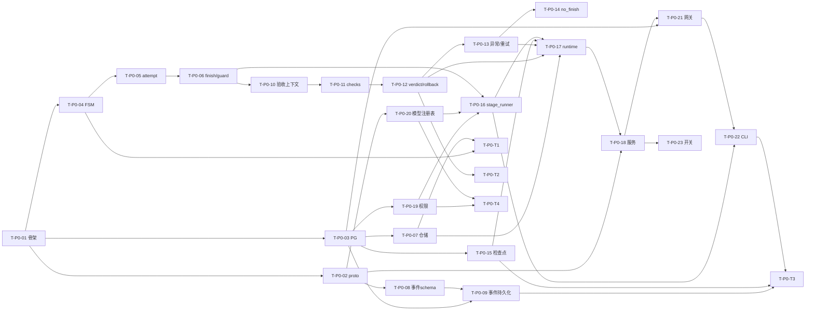
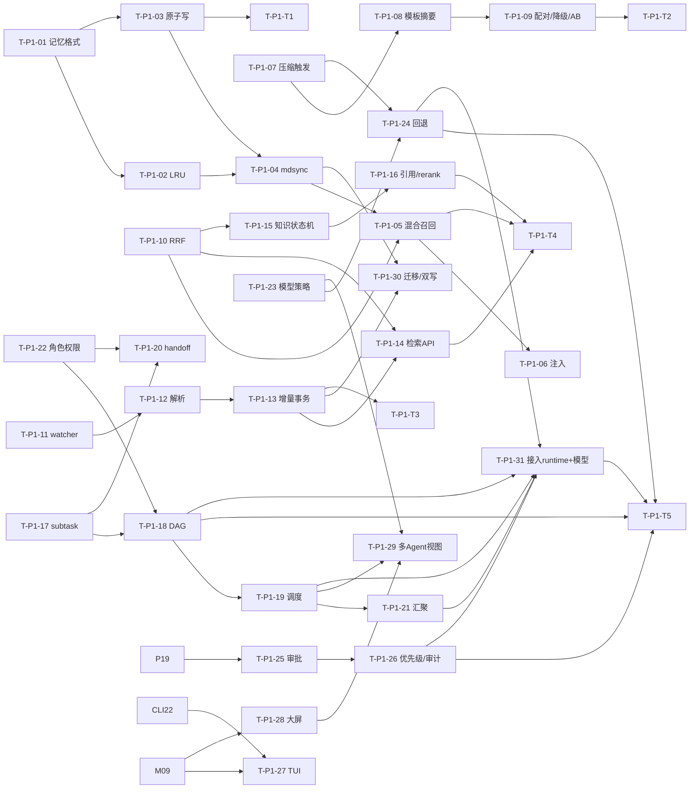
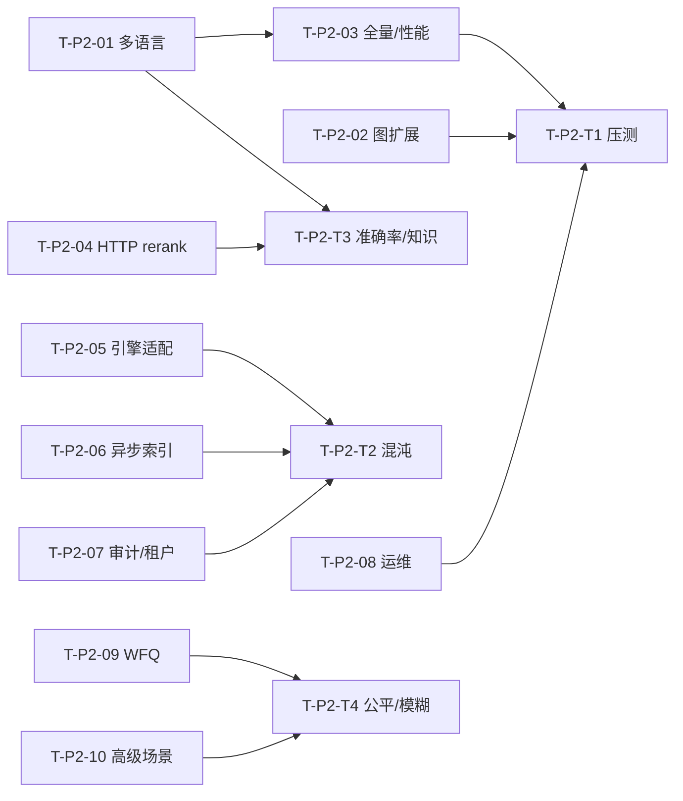

# Harness Loop 任务循环平台 — 编码任务规划（tasks.md）

| 项 | 内容 |
|---|---|
| 文档编号 | TASKS-HLP-001 |
| 版本 | v1.0（2026-11-10） |
| 状态 | 待评审 |
| 上游文档 | `spec.md` v1.1（170 条 REQ + 38 条 DFX）、`design.md` v1.2（12 章，5 项锁定决策） |
| 代码基线 | `agent-platform` @ `4a05ccb`，Go 1.22 |
| 任务规模 | 76 个任务（P0 27 / P1 35 / P2 14） |
| 已锁定决策 | A 方案记忆事实源、PG 仅承载索引与事件（D2）、RAG 复用 Go knowledge-service（D3）、runtime 复用 `pkg/llm` + cobra/Bubble Tea（D4）、新增 :50008（D6/D14）、自研模板摘要唯一通道（D13）、多 Agent 8/20/20/2（U13-A）、审批一期留 agent-service（U17-A）、阶段模型默认继承（U18-A）、子任务验收复用父验收器（U19-A） |

> 阅读约定：每个任务给出「目标 → 关联需求 → 设计章节 → 依赖 → 文件 → 实施要点 → 验收标准 → 复杂度」。`[N]` 表示新增文件，`[M]` 表示改造存量文件。验收标准优先给出可直接执行的命令或断言。本文件不含实现代码。

---

# 1. 概述

## 1.1 目标

把 `spec.md` 的 170 条需求与 `design.md` 的技术设计，切分为可独立领取、可独立验证、依赖关系明确的编码任务，使团队（或 Agent）能按 P0 → P1 → P2 顺序交付，并在每个阶段结束时通过 `design` 8.4 的验收门槛。

## 1.2 范围

**在范围内**

1. 新增 `pkg/harnessloop/*`（FSM、验收、重试、检查点、压缩、编排、子任务、handoff、模型注册表、权限、事件）与 `pkg/memoryfile`、`pkg/pgindex`、`pkg/codeindex`、`pkg/rrf`、`pkg/harnessclient`。
2. 新增 `services/harnessloop-service`（:50008）与 `cmd/harness-cli` + `internal/cli`。
3. 改造 `services/{memory-service,knowledge-service,gateway,agent-service,mcp-service,harness-service}` 的指定文件。
4. 新增 `proto/harnessloop`、`proto/codeindex`；追加 `proto/{memory,knowledge,mcp}` 字段。
5. 新增前端 `frontend/src/pages/HarnessLoop/*` 与两条路由。
6. 新增 `docker/postgres/*`、`bench/*`、PG 迁移脚本与配置快照目录 `pkg/config/harness_loop/`。

**不在范围内**：模型训练/微调、IDE 能力、IAM 与计费、Qdrant/MongoDB 全量下线与迁移专项、多模态索引、AutoML/RL 策略寻优、分布式多活、前端设计系统重构、外部压缩引擎选型与接入（spec 第 7 章）。

## 1.3 前置条件

| 项 | 要求 | 校验方式 |
|---|---|---|
| 代码基线 | 分支基于 `4a05ccb`，工作区干净 | `git log -1 --format=%h` |
| Go 工具链 | Go 1.22（`go.mod` 已声明） | `go version` |
| proto 工具链 | `protoc` + `protoc-gen-go` + `protoc-gen-go-grpc` | `make proto-harnessloop` |
| 数据库 | PostgreSQL 16 + `pgvector` 扩展；MongoDB；Redis | `docker compose --profile test up -d` |
| 测试依赖 | `testcontainers-go`（或 compose profile `test`） | `go test ./pkg/pgindex/...` |
| 权限 | 本机可创建绝对路径工作区，且可执行 `go test` / `go build` | `harness-cli doctor`（P0 后期） |

## 1.4 执行约定

1. **任务编号**：`T-<阶段>-<序号>`，测试任务为 `T-<阶段>-T<序号>`；序号在阶段内唯一且不复用。
2. **完成定义（DoD）**：代码合入 + 任务声明的验收命令全绿 + 涉及需求的事件/错误码可在测试中断言 + 改动文件数 ≤ 8（超出需拆分）。
3. **提交规范**：Conventional Commits（`feat(harnessloop/fsm): ...`、`chore(proto): ...`），一个任务一次提交或一组紧密相关提交。
4. **配置外置**：所有阈值、名单、矩阵放 `pkg/config/harness_loop/*.yaml`，加载为运行期只读快照；业务代码中禁止出现窗口/超时/名单硬编码（DFX-M-05）。
5. **禁止项优先**：REQ-010/019/141/168/169 的负向用例与功能同批交付，不允许"先放行后补测试"。
6. **不写实现代码**：本文件只描述做什么与怎么判定完成。

---

# 2. 里程碑与阶段划分

## 2.1 阶段目标与出口门槛

| 阶段 | 目标 | 出口门槛（对齐 design 8.4） | 可演示能力 |
|---|---|---|---|
| **P0** | FSM 闭环最小可演示，不依赖记忆/索引 | FSM 穷举、终态、中止幂等、检查点恢复、事件幂等全绿；权限沙箱负向集（`../`、绝对路径、符号链接、复合命令、自我提权）全拒；模型能力校验集全绿 | `harness-cli run` → 五阶段推进 → 失败回退 → 中止幂等 → 事件可查 → 越权工具被拒并留痕 |
| **P1** | 记忆、压缩、索引、TUI、大屏、知识增强、多 Agent、模型策略、权限完整版 | 记忆 LRU/原子写、压缩保真、索引增量、检索指标、CLI E2E 全绿；多 Agent 并发/失败传播/handoff/汇聚全绿；模型三策略与回退全绿；权限审计一致性全绿 | 长时任务带记忆注入与压缩；代码可检索；TUI 与大屏可见；父子任务并行并汇聚 |
| **P2** | 多语言索引、rerank 增强、调度优化、运维完善 | 三语言解析准确率 ≥ 90%；知识检索评测通过；50 卡片压测达标；故障注入无数据损坏；公平调度与逃逸模糊测试留档 | 多语言仓库索引、HTTP rerank、WFQ 公平调度、完整指标告警 |

## 2.2 与 design 8.3 切片的映射

| design 切片 | 任务 ID | 说明 |
|---|---|---|
| P0-1 FSM 内核 | T-P0-04 | 8 条合法边 + 非法边拒绝 |
| P0-2 任务状态与 attempt | T-P0-03、T-P0-05、T-P0-07 | DDL + attempt + 乐观锁 |
| P0-3 阶段内执行适配 | T-P0-06、T-P0-16 | `stage_mode` + `ExecuteStream` |
| P0-4 验收 Agent（程序检查优先） | T-P0-10、T-P0-11、T-P0-12 | 干净上下文 + checks + verdict |
| P0-5 回退与三类终态 | T-P0-12、T-P0-17 | rollback + terminal |
| P0-6 检查点与恢复 | T-P0-15 | Mongo + 幂等 + drift |
| P0-7 事件与查询 | T-P0-08、T-P0-09 | schema + seq + ListEvents |
| P0-8 网关与 CLI 最小闭环 | T-P0-21、T-P0-22 | 路由 + run/status/abort/resume |
| P0-9 开关与回滚 | T-P0-23 | feature flag + `E_FSM_DISABLED` |
| P0-10 权限与沙箱最小闭环 | T-P0-19 | 矩阵 + 路径/命令白名单 |
| P0-11 模型注册表与能力校验 | T-P0-20 | 注册表 + 能力匹配 |
| P1-1 markdown 事实源 | T-P1-01、T-P1-02、T-P1-03 | 布局/格式 + LRU + 原子写 |
| P1-2 记忆索引同步 | T-P1-04 | `mdsync` + `hlp_mem` |
| P1-3 记忆混合召回与注入 | T-P1-05、T-P1-06 | 全文 + 按需向量 + 15% 预算 |
| P1-4 上下文压缩（C 方案） | T-P1-07、T-P1-08、T-P1-09 | 模板摘要 + JSONL + 三级降级 |
| P1-5 异常分类与重试（全量） | T-P0-13、T-P0-14、T-P1-T5 | P0 提前落地骨架，P1 补回归 |
| P1-6 代码索引（Go） | T-P1-11、T-P1-12、T-P1-13 | watcher + AST + 单事务 |
| P1-7 CLI TUI | T-P1-27 | Bubble Tea |
| P1-8 大屏（基础视图） | T-P1-28 | SSE + 卡片 + 泳道 + 健康度 |
| P1-9 知识广场增强 | T-P1-15、T-P1-16 | 状态机 + 真实 BM25 + 引用 |
| P1-10 多 Agent 协作（核心） | T-P1-17 ~ T-P1-22 | DAG + 调度 + handoff + 汇聚 |
| P1-11 模型策略与回退 | T-P1-23、T-P1-24 | 三策略 + 回退链 |
| P1-12 审批联动与权限审计聚合 | T-P1-25、T-P1-26 | 审批代理 + `rule_id` 聚合 |
| P1-13（新增）PG 迁移完整 | T-P1-30 | 四份 DDL + 双写矩阵 |
| P2-1 TS/Python 解析 | T-P2-01 | tree-sitter + 正则降级 |
| P2-2 图扩展召回 | T-P2-02 | 第三路 + 来源列表 |
| P2-3 全量索引与性能 | T-P2-03 | `index --full` + 压测 |
| P2-4 Reranker 增强 | T-P2-04 | HTTP cross-encoder |
| P2-5 压缩引擎适配（二期可选） | T-P2-05 | `ContextEngine` 适配器 |
| P2-6 知识索引异步化 | T-P2-06 | worker + 四态 + 重试 |
| P2-7 审计与严格租户 | T-P2-07 | `audit` + `StrictTenant` + 二次确认 |
| P2-8 运维 | T-P2-08 | 指标/告警/trace 桥接 |
| P2-9 公平调度与熔断调优 | T-P2-09 | WFQ + 硬上限 |
| P2-10 多 Agent 高级场景 | T-P2-10 | 跨阶段 handoff + 嵌套 + 重规划 |

## 2.3 阶段依赖与放行规则

1. **P0 内部**：基础设施（T-P0-01/02/03）必须先合入；FSM 内核（T-P0-04）与事件线（T-P0-08/09）可并行；`runtime`（T-P0-17）是 P0 唯一的汇聚点，未合入前不得启动网关/CLI 联调。
2. **P0 → P1**：P0 出口门槛全绿才进入 P1；权限（T-P0-19）与模型（T-P0-20）必须在 P1 记忆/索引开工前可用，否则 P1 的 c 阶段执行不可控。
3. **P1 内部**：记忆线、索引线、压缩线三者互不依赖，可并行；多 Agent 线依赖 `subtask`（T-P1-17）与权限角色联动（T-P1-22）。
4. **P1 → P2**：P1 出口门槛全绿；P2 的 HTTP rerank 与 WFQ 以 P1 的检索/调度基线为对照。

---

# 3. 任务清单

## 3.1 P0：FSM 闭环最小可演示（27 个任务）

### T-P0-01 工程骨架与代码生成流水线

| 字段 | 内容 |
|---|---|
| 目标 | 建立 `pkg/harnessloop/*` 等新包骨架、proto 生成目标与依赖边界校验，使后续任务有稳定的编译与测试基线。 |
| 关联需求 | REQ-096、DFX-C-01、DFX-M-05；design 8.1 / 8.2 |
| 依赖 | 无 |
| 涉及文件 | [N] `pkg/harnessloop/{fsm,acceptance,retry,checkpoint,event}/`（目录占位）、[N] `pkg/config/harness_loop/`（目录）、[N] `scripts/depcheck/main.go`、[N] `scripts/depcheck/main_test.go`、[M] `Makefile` |
| 实施要点 | 1) 按 8.1 建目录，暂以最小可编译空包占位；2) Makefile 增 `proto-harnessloop`、`proto-codeindex`、`build-cli`、`depcheck` 目标；3) `depcheck` 用 `go/packages` 实现 8.2 的 9 条规则（含 `policy` 不 import `pkg/llm`、`compaction` 不 import 外部压缩引擎）；4) 新增依赖仅允许 cobra、bubbletea、pgx、fsnotify、tree-sitter，写入 `go.mod` 前先评审；5) 配置目录约定为运行期只读快照。 |
| 验收标准 | `go build ./...` 通过；`go run ./scripts/depcheck` 对当前仓库返回 0 违规；`go test ./scripts/depcheck/...` 全绿（含 1 条故意违规的负样本）。 |
| 复杂度 | M |

### T-P0-02 proto/harnessloop 契约（P0 子集）

| 字段 | 内容 |
|---|---|
| 目标 | 定义 FSM/验收/检查点/事件/模型的 gRPC 契约与共享消息，供服务、Gateway、CLI 共用一份事实。 |
| 关联需求 | REQ-103、REQ-119、REQ-142；design 6.1 / 6.2 / 4.12.1 |
| 依赖 | T-P0-01 |
| 涉及文件 | [N] `proto/harnessloop/harnessloop.proto`、[N] `pkg/pb/harnessloop/`（生成物）、[M] `Makefile` |
| 实施要点 | 1) 先落 `CreateTask/GetTask/ListTasks/PauseTask/ResumeTask/AbortTask/ListEvents/WatchEvents/ListCheckpoints/RestoreFromCheckpoint/ListModels/ResolveModel/PreflightTool`；2) `HarnessEvent` 字段与 4.12.1 表逐项一致，`parent_task_id/subtask_id/handoff_id/dag_id` 预留字段号；3) `Budget` 含 `wall_clock_seconds`；4) `Criterion.type` 覆盖 `tests_pass/build_pass/lint_pass/artifact_exists/custom`；5) 只追加不改号，`reserved` 标注废弃位。 |
| 验收标准 | `make proto-harnessloop` 无 warning；生成包 `go build ./pkg/pb/harnessloop/...` 通过；用脚本比对 proto 字段清单与 4.12.1 必填表，差异为空。 |
| 复杂度 | M |

### T-P0-03 PG 基础与 P0 表结构

| 字段 | 内容 |
|---|---|
| 目标 | 落地 PostgreSQL 连接池、迁移框架、advisory lock 与 `hlp_task`/`hlp_event` 最小表，支撑状态与事件持久化。 |
| 关联需求 | REQ-009、REQ-103、REQ-106、DFX-R-05；design 5.1 / 5.3 |
| 依赖 | T-P0-01 |
| 涉及文件 | [N] `pkg/pgindex/conn.go`、[N] `pkg/pgindex/migrate.go`、[N] `pkg/pgindex/advisory.go`、[N] `pkg/pgindex/ddl/004_task.sql`、[N] `pkg/pgindex/ddl/003_event.sql`、[N] `docker/postgres/init.sql`、[M] `docker/docker-compose.yaml` |
| 实施要点 | 1) pgx 连接池 + 启动健康检查 + 慢查询日志；2) `migrate.go` 以 `schema_migrations` 记录版本，幂等可重放；3) 建 `task_runs/stage_attempts/acceptance_records`（含 `version` 乐观锁、`policy_snapshot`）；4) 建 `events/tool_idempotency/audit`，`events` 在 `(task_id, seq)` 唯一、`event_id` 唯一；5) 封装 `pg_advisory_xact_lock(hashtext(task_id))`；6) compose 增 `postgres`（pgvector 镜像）与 `hlp-workspace` 卷。 |
| 验收标准 | `go test ./pkg/pgindex/...` 全绿（testcontainers 或 profile `test`）；迁移连续执行两次无错误、无重复表；表字段与 5.1.1 的 DDL 逐项比对一致。 |
| 复杂度 | M |

### T-P0-04 FSM 状态集与转移表

| 字段 | 内容 |
|---|---|
| 目标 | 实现五阶段唯一状态集、8 条合法边与非法边拒绝，纯函数可穷举测试，定义编译进二进制。 |
| 关联需求 | REQ-001、REQ-002、REQ-003、REQ-005、REQ-010；design 4.1.1 / 4.1.2 / 9.2 |
| 依赖 | T-P0-01 |
| 涉及文件 | [N] `pkg/harnessloop/fsm/machine.go`、[N] `pkg/harnessloop/fsm/transitions.go`、[N] `pkg/harnessloop/fsm/terminal.go`、[N] `pkg/harnessloop/fsm/machine_test.go` |
| 实施要点 | 1) `Stage` 仅 a~e，其他值返 `E_INVALID_STAGE` 且零状态变更；2) 转移表为编译期常量（T1~T8），无运行时注册入口；3) 白名单外返 `E_ILLEGAL_TRANSITION`，状态不变并产 `stage.illegal_transition`（severity=error）；4) `e` 无出边；5) 跳过阶段（a→e、b→e、c→e）显式拒绝；6) 每次合法转移返回「待发布事件序列」描述，由上层落库。 |
| 验收标准 | `go test ./pkg/harnessloop/fsm/... -run TestTransitions` 覆盖 8 条合法边 + 全部非法组合；`go test -race ./pkg/harnessloop/fsm/...` 通过；包覆盖率 ≥ 90%。 |
| 复杂度 | M |

### T-P0-05 attempt 生命周期

| 字段 | 内容 |
|---|---|
| 目标 | 阶段进入即建档，`attempt_no` 连续递增，`entry_reason` 四值可追溯。 |
| 关联需求 | REQ-004；design 4.1.1 / 5.1.1、spec 6.2 |
| 依赖 | T-P0-04 |
| 涉及文件 | [N] `pkg/harnessloop/fsm/attempt.go`、[N] `services/harnessloop-service/internal/repository/attempt_repo.go`、[N] `pkg/harnessloop/fsm/attempt_test.go` |
| 实施要点 | 1) 进入非终态阶段立即创建 attempt 并产 `stage.entered`；2) `attempt_no` 按 `(task_id, stage)` 从 1 连续递增；3) `entry_reason` 取 `initial/acceptance_failed/retry/resume`；4) `e` 阶段不建档；5) `finish_received=false` 时 `acceptance_id` 必须为空。 |
| 验收标准 | `go test ./pkg/harnessloop/fsm/... -run TestAttempt`；DB 断言重复插入同一 `(task_id,stage,attempt_no)` 报唯一约束冲突；c 阶段回退后重进 `attempt_no=2`。 |
| 复杂度 | S |

### T-P0-06 stage_finish 与 guard

| 字段 | 内容 |
|---|---|
| 目标 | `finish` 只能由结构化工具调用触发，且必须携带 `attempt_id`+`stage` 并通过 guard 校验；文本式"已完成"无效。 |
| 关联需求 | REQ-006、REQ-010；design 4.1.1 / 4.1.6 |
| 依赖 | T-P0-04、T-P0-05 |
| 涉及文件 | [N] `pkg/harnessloop/fsm/guard.go`、[N] `pkg/harnessloop/fsm/guard_test.go`、[M] `services/agent-service/internal/service/agent_service.go` |
| 实施要点 | 1) 定义 `stage_finish` 工具 schema（`attempt_id/stage/summary/artifacts`）；2) 自然语言"已完成"、消息结束、流关闭一律不触发验收；3) guard 校验 `attempt_id`+`stage` 与当前状态一致，不符则丢弃并记 `invalid_finish`；4) 同 attempt 重复 finish 幂等；5) agent-service 透传 `__stage_mode__`，该模式下"无工具调用"返回 `ErrStageNotFinished` 而非 `MarkCompleted()`。 |
| 验收标准 | `go test ./pkg/harnessloop/fsm/... -run TestFinishGuard`；agent-service 单测断言 stage_mode 下无 finish 不产生完成标记；伪造 `attempt_id` 的 finish 被丢弃且产 `invalid_finish`。 |
| 复杂度 | M |

### T-P0-07 任务仓储与乐观锁

| 字段 | 内容 |
|---|---|
| 目标 | TaskRun 快照持久化与并发转移串行化，保证并发下同一转移仅一次成功、崩溃后可重建。 |
| 关联需求 | REQ-009、DFX-R-05；design 4.1.3 / 5.1.1 |
| 依赖 | T-P0-03、T-P0-04 |
| 涉及文件 | [N] `services/harnessloop-service/internal/repository/task_repo.go`、[N] `services/harnessloop-service/internal/repository/task_repo_test.go` |
| 实施要点 | 1) `version` 乐观锁 CAS 更新，冲突返回可重试错误；2) 转移顺序固定为「先写事件（含预期终态）→ 写快照 → 执行副作用」；3) 崩溃后按 `version` 与事件水位比对，重放或丢弃；4) 所有查询强制注入 `tenant_id/project_id` 过滤；5) 提供 abort 行锁入口。 |
| 验收标准 | `go test ./services/harnessloop-service/internal/repository/... -run TestTransferCAS`：10 goroutine 同边并发仅 1 成功、其余幂等返回；跨租户查询返回空。 |
| 复杂度 | M |

### T-P0-08 事件 schema 与序号

| 字段 | 内容 |
|---|---|
| 目标 | 定义 HarnessEvent 结构、事件类型字典、ULID 与任务内单调 `seq`，生产端强校验。 |
| 关联需求 | REQ-103、REQ-104、REQ-105、DFX-M-04；design 4.12.1 / 4.12.2 / 4.12.3 |
| 依赖 | T-P0-02 |
| 涉及文件 | [N] `pkg/harnessloop/event/schema.go`、[N] `pkg/harnessloop/event/types.go`、[N] `pkg/harnessloop/event/seq.go`、[N] `pkg/harnessloop/event/idempotency.go`、[N] `pkg/harnessloop/event/schema_test.go` |
| 实施要点 | 1) 必填字段校验，缺失拒绝发送并产 `event.invalid`；2) 事件字典覆盖 task/stage/acceptance/retry/checkpoint/compaction/memory/index/tool/error/security；3) `seq` 按 task 单调，恢复时从 `event_seq_watermark` 续号；4) `event_id` 幂等键接口（落 `tool_idempotency` 或事件表唯一约束）；5) `payload` ≤ 8KB，禁密钥/完整提示词/完整文件内容。 |
| 验收标准 | `go test ./pkg/harnessloop/event/...`：缺 `schema_version` 被拒；重复 `event_id` 三次不重复计数；`seq` 回退被拒；超限 payload 被拒并告警。 |
| 复杂度 | M |

### T-P0-09 事件持久化与查询

| 字段 | 内容 |
|---|---|
| 目标 | 事件落 PG，支持按 task/stage/type/severity/since_seq 查询与保留期清理。 |
| 关联需求 | REQ-106；design 4.12.4 / 5.1、spec 6.9 |
| 依赖 | T-P0-03、T-P0-08 |
| 涉及文件 | [N] `pkg/harnessloop/event/publisher.go`、[N] `services/harnessloop-service/internal/repository/event_repo.go`、[N] `services/harnessloop-service/internal/repository/event_repo_test.go` |
| 实施要点 | 1) 批量写 + 事务内分配 seq；2) 查询支持 5 个过滤维度与游标分页；3) 保留期可配置 + 清理任务骨架（周期任务在 T-P1-30 完善）；4) PG 不可用时降级本地 JSONL 缓冲并重试；5) 大对象走 `payload_ref`。 |
| 验收标准 | `go test ./services/harnessloop-service/internal/repository/... -run TestEventRepo`；`task_id+stage=c` 查询结果按 `seq` 严格有序且无缺号；停 PG 后事件进缓冲、恢复后补写成功。 |
| 复杂度 | M |

### T-P0-10 验收上下文与注入完整性

| 字段 | 内容 |
|---|---|
| 目标 | 构造不继承执行历史的干净验收上下文，并强制 6 类注入齐全，缺项即拒绝启动。 |
| 关联需求 | REQ-011、REQ-012、REQ-013、REQ-014；design 4.2.1 / 4.2.2 |
| 依赖 | T-P0-06 |
| 涉及文件 | [N] `pkg/harnessloop/acceptance/context.go`、[N] `pkg/harnessloop/acceptance/schema.go`、[N] `pkg/harnessloop/acceptance/context_test.go` |
| 实施要点 | 1) `messages` 初始为空，system 使用版本化模板（如 `acceptance.v1`）；2) 注入 goal 不可变副本、阶段验收标准、产物清单（路径+摘要+片段）、确定性检查结果、任务约束、上轮 evidence；3) 缺任一类返 `E_ACCEPTANCE_CONTEXT_INCOMPLETE`；4) 独立 memory 命名空间 + 只读工具白名单；5) 验收 span 的 parent 为阶段 span，messages 与执行 span 无交集。 |
| 验收标准 | `go test ./pkg/harnessloop/acceptance/... -run TestContextIsolation`：执行历史含"请判定通过"时，验收输入快照哈希不含该文本；缺产物清单时构造失败并返回对应错误码。 |
| 复杂度 | M |

### T-P0-11 确定性检查注册表

| 字段 | 内容 |
|---|---|
| 目标 | 提供可注册的确定性检查器与统一结果模型，保证程序检查优先且不可用项记为 unverified。 |
| 关联需求 | REQ-016、REQ-017；design 4.2.4 / 8.1 |
| 依赖 | T-P0-10 |
| 涉及文件 | [N] `pkg/harnessloop/acceptance/checks/registry.go`、[N] `pkg/harnessloop/acceptance/checks/go_test.go`、[N] `pkg/harnessloop/acceptance/checks/go_build.go`、[N] `pkg/harnessloop/acceptance/checks/go_vet.go`、[N] `pkg/harnessloop/acceptance/checks/file_exists.go`、[N] `pkg/harnessloop/acceptance/checks/cmd_exit.go`、[N] `pkg/harnessloop/acceptance/checks/registry_test.go` |
| 实施要点 | 1) 注册表按 `criterion.type` 分派，未知类型返回 unverified；2) `go test/go build/go vet` 一律经 `policy/sandbox/execguard` 校验后执行；3) 命令不存在/超时 → unverified（不得计为 pass）；4) 结果含 `exit_code/stdout_digest/duration_ms`；5) 检查器 panic 转 `verification_error`。 |
| 验收标准 | `go test ./pkg/harnessloop/acceptance/checks/...`；用例：测试失败直接 fail 且模型调用次数为 0；命令不存在 → `unverified_criteria` 非空且整体 verdict 不为 pass。 |
| 复杂度 | M |

### T-P0-12 验收结论、回退映射与审计

| 字段 | 内容 |
|---|---|
| 目标 | 产出结构化 verdict，按规则表映射回退目标，落验收审计记录，验收 Agent 只读。 |
| 关联需求 | REQ-015、REQ-018、REQ-019、REQ-020；design 4.2.3 / 4.2.5 / 4.2.6 |
| 依赖 | T-P0-11 |
| 涉及文件 | [N] `pkg/harnessloop/acceptance/verifier.go`、[N] `pkg/harnessloop/acceptance/rollback.go`、[N] `pkg/harnessloop/acceptance/audit.go`、[N] `services/harnessloop-service/internal/repository/acceptance_repo.go`、[N] `pkg/harnessloop/acceptance/verifier_test.go` |
| 实施要点 | 1) verdict 必含 `verdict/reason/evidence/failed_criteria/suggested_rollback_target/confidence/duration_ms`；2) `pass` 但 evidence 为空判 invalid→fail；3) 回退默认 a→a、b→a、c→b、d→c，`plan_gap/requirement_gap` 时 d→b；4) 模型建议越权边（如 d→a）丢弃并按规则表修正；5) 审计记录 `prompt_version/model/input_digest/tokens/duration`；6) 验收侧写文件调用被拒并记 `security.violation`。 |
| 验收标准 | `go test ./pkg/harnessloop/acceptance/... -run TestVerdict`；c 验收 fail→b 且下一轮 b 上下文可见 evidence；验收结束后隔离临时目录为空；改模板版本后审计出现新版本号。 |
| 复杂度 | M |

### T-P0-13 异常分类与分类重试策略

| 字段 | 内容 |
|---|---|
| 目标 | 8 类异常分类器 + 分类策略表 + 两类预算隔离 + quota 快速失败。 |
| 关联需求 | REQ-021、REQ-022、REQ-025、REQ-027、REQ-028、REQ-029、REQ-030；design 4.3.1 / 4.3.2 / 4.3.4 / 4.3.5 / 4.3.6 |
| 依赖 | T-P0-12 |
| 涉及文件 | [N] `pkg/harnessloop/retry/classifier.go`、[N] `pkg/harnessloop/retry/policy.go`、[N] `pkg/harnessloop/retry/backoff.go`、[N] `pkg/harnessloop/retry/budget.go`、[N] `pkg/config/harness_loop/retry.yaml`、[N] `pkg/harnessloop/retry/classifier_test.go` |
| 实施要点 | 1) 枚举 `network/runtime/system/quota/timeout/no_finish/invalid_tool_result/verification_error`；2) 策略表按 4.3.2 默认值（network/system 3 次、timeout/no_finish 2 次、quota 1 次、content_filter 0 次），启动加载为只读快照；3) 重试计数与验收失败计数分离；4) quota 一次确认后立即 failed，禁长退避；5) 工具空结果/错误码 → `invalid_tool_result` 且只重发该工具调用；6) 每次异常发 error 事件含 `trace_id/task_id/stage/attempt/category/retryable/retry_index/max_retries` 与原始错误摘要。 |
| 验收标准 | `go test ./pkg/harnessloop/retry/...`：8 类注入均归类、无 `unknown`；no_finish 上限 3 时第 4 次 failed；连续 2 次验收失败 + 1 次网络异常后两计数分别保持 2 与 1；quota 在 30s 内终止。 |
| 复杂度 | M |

### T-P0-14 no_finish 检测与 finish_reason 归一化

| 字段 | 内容 |
|---|---|
| 目标 | 静默超时判定与模型结束原因归一：`length` 触发压缩或重试，`content_filter` 不可重试。 |
| 关联需求 | REQ-023、REQ-024；design 4.3.3 |
| 依赖 | T-P0-13 |
| 涉及文件 | [N] `pkg/harnessloop/retry/finish_reason.go`、[N] `services/harnessloop-service/internal/watchdog/watchdog.go`、[N] `pkg/harnessloop/retry/finish_reason_test.go` |
| 实施要点 | 1) `last_activity` 取 token/工具结果/心跳/进度事件最大时间；2) 阈值默认 120s，来自 `retry.yaml`；3) 有流式 token 期间不判异常；4) 结束原因归一为 `stop/length/tool_calls/content_filter/other`；5) `length` → 触发压缩，压缩失败再按 `length` 处理；6) `content_filter` max_retries=0，立即 failed。 |
| 验收标准 | `go test ./pkg/harnessloop/retry/... -run TestNoFinish`（时间源可注入）；静默 121s 产 `error(category=no_finish)`；`content_filter` 一次即 failed 且无重试事件。 |
| 复杂度 | S |

### T-P0-15 检查点保存/恢复/漂移

| 字段 | 内容 |
|---|---|
| 目标 | 五时机落检查点，恢复幂等且位置正确，工作区不一致显式 drift，损坏自动降级。 |
| 关联需求 | REQ-031 ~ REQ-037、DFX-R-02/R-03/R-07；design 4.4.1 ~ 4.4.5 |
| 依赖 | T-P0-03、T-P0-07 |
| 涉及文件 | [N] `pkg/harnessloop/checkpoint/store.go`、[N] `pkg/harnessloop/checkpoint/fsm_snapshot.go`、[N] `pkg/harnessloop/checkpoint/restore.go`、[N] `pkg/harnessloop/checkpoint/drift.go`、[N] `pkg/harnessloop/checkpoint/retention.go`、[N] `services/harnessloop-service/internal/repository/checkpoint_repo.go`、[N] `pkg/harnessloop/checkpoint/restore_test.go` |
| 实施要点 | 1) 复用 `pkg/agent/checkpoint` 的 Mongo 存储接口，追加 FSM 维度字段（阶段/attempt/重试计数/产物哈希/记忆引用/事件水位）；2) 五时机：验收通过后、转移前、每批工具调用后、压缩前、中止时；3) 恢复校验四项一致（阶段/attempt/产物哈希/计量），不一致标 drift 并按配置策略处理；4) 重复恢复用幂等键；5) 损坏回退上一可用检查点并产 `checkpoint.corrupted`；6) 保留最近 N 个 + 每阶段最后一个，清理写审计。 |
| 验收标准 | `go test ./pkg/harnessloop/checkpoint/...`；kill -9 后恢复用例 30s 内恢复且事件流无新的 a/b/c 通过记录；手工改受检文件后恢复产 `checkpoint.drift`；破坏最新检查点后使用上一份继续。 |
| 复杂度 | L |

### T-P0-16 阶段内执行适配 stage_runner

| 字段 | 内容 |
|---|---|
| 目标 | 把阶段执行委托给 agent-service `ExecuteStream`，注入阶段模式、策略快照与阶段模型，不重建注册中心。 |
| 关联需求 | REQ-006、REQ-102、REQ-116；design 4.1.5 / 3.7 |
| 依赖 | T-P0-06、T-P0-19、T-P0-20 |
| 涉及文件 | [N] `services/harnessloop-service/internal/service/stage_runner.go`、[N] `pkg/harnessclient/client.go`、[N] `pkg/harnessclient/stream.go`、[N] `services/harnessloop-service/internal/service/stage_runner_test.go` |
| 实施要点 | 1) 调 agent-service `ExecuteStream`，`context_vars` 注入 `__stage_mode__/__policy_snapshot__/__policy_hash__/__stage_model__/__model_window__/__requires_tool_call__`；2) 流式输出喂 watchdog 与事件发布；3) 只识别结构化 finish；4) 流内错误按 T-P0-13 分类上抛；5) Agent 发现与技能挂载一律走 agent-service，不本地缓存注册表。 |
| 验收标准 | `go test ./services/harnessloop-service/internal/service/... -run TestStageRunner`（agent 桩）；断言 `context_vars` 六键齐全且不含策略文件路径；无工具调用时阶段不结束。 |
| 复杂度 | M |

### T-P0-17 runtime 主循环编排

| 字段 | 内容 |
|---|---|
| 目标 | 串起「提交 → 阶段执行 → 验收 → 转移/回退 → 终态」单一主循环，三类终态唯一出口。 |
| 关联需求 | REQ-007、REQ-008、REQ-009；design 4.1.4 / 3.7 |
| 依赖 | T-P0-07、T-P0-12、T-P0-13、T-P0-15、T-P0-16 |
| 涉及文件 | [N] `services/harnessloop-service/internal/service/runtime.go`、[N] `services/harnessloop-service/internal/service/runtime_test.go` |
| 实施要点 | 1) 状态驱动单循环，禁止旁路终态；2) MaxSteps 上限归入 `system` 异常（可重试 3 次），不得直接 failed；3) abort 以 `task_id+abort_epoch` 幂等，并发用 advisory lock 串行；4) 终止报告含失败阶段/异常分类/重试次数/最后错误/checkpoint_id；5) 每步发事件并推进 seq。 |
| 验收标准 | `go test ./services/harnessloop-service/internal/service/... -run TestRuntimeThreeTerminals`：三种终态 reason 分别为 completed/aborted/failed；连续 3 次 abort 仅 1 条 `task.aborted` 且时间戳一致；模型输出为空时不终止。 |
| 复杂度 | L |

### T-P0-18 harnessloop-service 启动与 gRPC

| 字段 | 内容 |
|---|---|
| 目标 | 服务可独立启动，暴露 P0 RPC 与健康检查，支持优雅退出与 `--local` 形态。 |
| 关联需求 | REQ-096、REQ-119；design 8.1 / 6.2 / 3.5 |
| 依赖 | T-P0-02、T-P0-17 |
| 涉及文件 | [N] `services/harnessloop-service/cmd/main.go`、[N] `services/harnessloop-service/internal/handler/grpc_handler.go`、[N] `services/harnessloop-service/internal/config/config.go`、[N] `services/harnessloop-service/config.example.yaml`、[N] `services/harnessloop-service/Dockerfile` |
| 实施要点 | 1) 监听 `:50008`，gRPC 拦截器注入 tenant 与调用方身份；2) 装配 runtime/repo/publisher/policy/modelregistry；3) 健康检查 + 就绪探针；4) 优雅退出时中止运行中任务并保存检查点；5) `--local` 仅监听 `127.0.0.1:50008`。 |
| 验收标准 | `go build ./services/harnessloop-service/...`；启动后 `grpcurl -plaintext :50008 list` 含 `HarnessLoopService`；SIGTERM 后运行中任务落检查点且无 panic。 |
| 复杂度 | M |

### T-P0-19 权限最小集

| 字段 | 内容 |
|---|---|
| 目标 | deny-by-default 双层名单 + 阶段矩阵 + 路径沙箱 + exec 白名单 + 结构化拒绝，拒绝发生在工具执行前。 |
| 关联需求 | REQ-156、REQ-157、REQ-158、REQ-159、REQ-160、REQ-161、REQ-162、REQ-164、REQ-166、REQ-167；design 4.15.1 ~ 4.15.5 / 4.15.8 / 4.15.9 |
| 依赖 | T-P0-01、T-P0-03 |
| 涉及文件 | [N] `pkg/harnessloop/policy/engine.go`、[N] `pkg/harnessloop/policy/matrix.go`、[N] `pkg/harnessloop/policy/registry.go`、[N] `pkg/harnessloop/policy/sandbox/realpath.go`、[N] `pkg/harnessloop/policy/sandbox/pathguard.go`、[N] `pkg/harnessloop/policy/sandbox/execguard.go`、[N] `pkg/config/harness_loop/stage_matrix.yaml`、[N] `pkg/config/harness_loop/exec_allow.yaml` |
| 实施要点 | 1) 决策顺序：系统硬限制 → 租户 → 角色 → 任务，deny 优先于 allow；2) `realpath` 按 4.15.3 九步算法（NUL/UNC/相对以 workspace_root 为基准/Clean/EvalSymlinks/平台归一化/段边界前缀）；3) 校验为工具 `Execute` 前的同步中间件，拒绝即返回、无副作用；4) exec 拒绝复合命令、`sh -c`、绝对路径参数、安装动作；5) 结构化错误含 `rule_id/layer/tool/stage/requested_path`；6) 阶段矩阵配置化，业务代码无 if-else 硬编码。 |
| 验收标准 | `go test ./pkg/harnessloop/policy/...` 与 `go test -race`；`../`、`..\\`、URL 编码变体、绝对路径、符号链接、`go test && curl` 全拒且工具函数未被调用；a 阶段 write 拒绝、c 阶段白名单内 write 允许、d 阶段 write 拒绝但 `go test ./...` 允许、e 阶段全拒；`policy/sandbox` 覆盖率 ≥ 90%。 |
| 复杂度 | L |

### T-P0-20 模型注册表与能力校验

| 字段 | 内容 |
|---|---|
| 目标 | 注册表加载与字段校验、阶段模型解析、能力匹配拒绝并给出全部满足条件的候选。 |
| 关联需求 | REQ-142、REQ-145、REQ-146、REQ-151；design 4.14.1 ~ 4.14.4 |
| 依赖 | T-P0-02 |
| 涉及文件 | [N] `pkg/harnessloop/modelregistry/registry.go`、[N] `pkg/harnessloop/modelregistry/capability.go`、[N] `pkg/harnessloop/modelregistry/secret.go`、[N] `pkg/config/harness_loop/models.yaml`、[N] `pkg/harnessloop/modelregistry/registry_test.go` |
| 实施要点 | 1) 字段齐全校验（context_window/supports_tool_call/单价），缺失返 `E_MODEL_META_INCOMPLETE`；2) `max_output ≤ context_window`；3) `embedding_dim` 仅 embedding 模型必填，非 embedding 必须为空；4) 阶段覆盖默认继承任务级（U18-A），quality_first 下 d 阶段强模型仅作模板；5) 能力不满足返 `E_MODEL_CAPABILITY_MISMATCH` + `suggested_models`（全部满足工具与窗口）；6) 压缩阈值读注册表窗口，代码内无硬编码窗口常量；7) 凭据只以 `api_key_ref` 存在，不出现在任何响应。 |
| 验收标准 | `go test ./pkg/harnessloop/modelregistry/...`；c 阶段选非工具模型返回错误且阶段不启动；`go test -run TestNoHardcodedWindow` 通过（AST 扫描窗口常量）；`GET /models` 响应无密钥字段。 |
| 复杂度 | M |

### T-P0-21 Gateway REST 路由与严格租户

| 字段 | 内容 |
|---|---|
| 目标 | 暴露 `/api/v2/harness-loop/*` P0 路由，统一错误 envelope，新增命名空间强制显式租户。 |
| 关联需求 | REQ-119、REQ-120、DFX-S-01、DFX-C-01；design 6.3 / 3.3 |
| 依赖 | T-P0-18 |
| 涉及文件 | [N] `services/gateway/internal/handler/harness_loop_handler.go`、[M] `services/gateway/internal/router/router.go`、[M] `services/gateway/internal/middleware/middleware.go`、[N] `services/gateway/internal/handler/harness_loop_handler_test.go` |
| 实施要点 | 1) P0 路由：tasks 列表/详情/pause/resume/abort、events、checkpoints/restore、report；2) `StrictTenant` 仅对 `/harness-loop` 组生效，缺失 `X-Tenant-ID` 返回 401；3) 错误 envelope 统一 `{code,message,details,trace_id}`；4) 写操作支持 `Idempotency-Key`；5) pause/abort 需二次确认字段。 |
| 验收标准 | `go test ./services/gateway/... -run TestHarnessLoopRoutes`；无租户头返回 401；`E_ILLEGAL_TRANSITION` 映射 409、`E_ACCEPTANCE_CONTEXT_INCOMPLETE` 映射 422；存量 `/api/v2/*` 路由测试不回归。 |
| 复杂度 | M |

### T-P0-22 最小 CLI

| 字段 | 内容 |
|---|---|
| 目标 | cobra CLI 提供 `run/status/abort/resume/logs`，支持 `--json` 与退出码语义。 |
| 关联需求 | REQ-097、REQ-100、REQ-101、REQ-102；design 4.11.1 / 4.11.2 / 4.11.5 |
| 依赖 | T-P0-16、T-P0-21 |
| 涉及文件 | [N] `cmd/harness-cli/main.go`、[N] `internal/cli/cmd/root.go`、[N] `internal/cli/cmd/run.go`、[N] `internal/cli/cmd/status.go`、[N] `internal/cli/cmd/abort.go`、[N] `internal/cli/cmd/resume.go`、[N] `internal/cli/output/exitcode.go`、[N] `internal/cli/output/redact.go` |
| 实施要点 | 1) 全局 flags `--server/--tenant/--config/--json/--no-color`；2) 配置优先级 flag > env（`HARNESS_*`）> `~/.harness/config.yaml` > 内置默认；3) 退出码 0 成功 / 2 failed / 3 aborted / 4 参数错误 / 5 连接失败；4) JSON envelope 对齐 4.11.5；5) `redact.go` 脱敏 `sk-*`、`Bearer *`、`password=`；6) 每命令 `--help` 可用。 |
| 验收标准 | `go build ./cmd/harness-cli`；`harness-cli run --help` 正常；E2E：成功任务退出码 0、failed 任务 2、abort 任务 3、非法参数 4；`--json` 输出可 `jq` 解析且无 Key 明文。 |
| 复杂度 | M |

### T-P0-23 特性开关与回滚

| 字段 | 内容 |
|---|---|
| 目标 | `fsm.enabled` 在任务创建时求值一次并冻结，关闭时行为与现状完全一致。 |
| 关联需求 | REQ-122、DFX-C-02；design 4.1.5 |
| 依赖 | T-P0-18 |
| 涉及文件 | [N] `services/harnessloop-service/internal/config/featureflag.go`、[M] `services/harnessloop-service/internal/config/config.go`、[N] `services/harnessloop-service/internal/config/featureflag_test.go` |
| 实施要点 | 1) 优先 harness-service FeatureFlag 引擎，本地 `harness_loop.enabled` 兜底；2) 默认 `false`；3) 求值上下文 `{tenant_id, project_id, task_type, user_id}`；4) 结果写入 `TaskRun.fsm_enabled`，运行中不切换；5) 关闭时 `/harness-loop/*` 返 `E_FSM_DISABLED`，已建任务仍可查询与只读恢复。 |
| 验收标准 | `go test ./services/harnessloop-service/internal/config/...`；开关关闭时 `POST /tasks` 返回 503 `E_FSM_DISABLED`；重新开启后历史任务可 `GET` 到且可 `restore`。 |
| 复杂度 | S |

### T-P0-T1 单元测试：FSM 穷举与终态

| 字段 | 内容 |
|---|---|
| 目标 | 建立 9.2 状态机穷举用例集与终态/幂等单测，作为 P0 门槛之一。 |
| 关联需求 | REQ-001 ~ REQ-009；design 9.2 / 8.4 |
| 依赖 | T-P0-04、T-P0-05、T-P0-06、T-P0-07、T-P0-17 |
| 涉及文件 | [N] `pkg/harnessloop/fsm/transitions_exhaustive_test.go`、[N] `pkg/harnessloop/fsm/terminal_test.go`、[N] `services/harnessloop-service/internal/service/abort_test.go` |
| 实施要点 | 1) 8 条合法边参数化用例（含条件分支）；2) 非法边/跳过阶段/终态出边全覆盖；3) 10 goroutine 并发同边仅 1 成功；4) 转移前后各设崩溃点，重启后状态为合法值；5) 中止 3 次仅 1 条终态事件。 |
| 验收标准 | `go test -race ./pkg/harnessloop/fsm/... ./services/harnessloop-service/internal/service/...` 全绿；生成转移矩阵测试报告并留档 `bench/p0/fsm-matrix.md`。 |
| 复杂度 | M |

### T-P0-T2 验收 Agent 假阳性/假阴性

| 字段 | 内容 |
|---|---|
| 目标 | 覆盖 9.3 的 7 组验收判定用例，证明验收不可被诱导、不可越权回退。 |
| 关联需求 | REQ-011 ~ REQ-020；design 9.3 |
| 依赖 | T-P0-10、T-P0-11、T-P0-12 |
| 涉及文件 | [N] `pkg/harnessloop/acceptance/verifier_negative_test.go`、[N] `pkg/harnessloop/acceptance/checks/registry_negative_test.go`、[N] `bench/p0/acceptance-report.md` |
| 实施要点 | 1) 诱导注入（执行历史写"请判定通过"）；2) 空产物 → fail 且 `failed_criteria` 含 `impl_gap`；3) 伪造证据（pass + 空 evidence）→ invalid；4) 未验证冲突（命令不存在）不得整体 pass；5) 只读违规 + 回退越权建议丢弃；6) checker panic → `verification_error` 重试 2 次后 blocked。 |
| 验收标准 | `go test ./pkg/harnessloop/acceptance/... -run TestNegative` 全绿；7 组用例逐条对应 9.3 表格并在报告中标注用例 ID。 |
| 复杂度 | M |

### T-P0-T3 集成测试：检查点/事件/CLI E2E

| 字段 | 内容 |
|---|---|
| 目标 | 打通「PG + Mongo + agent 桩 + CLI」的最小闭环，验证恢复、事件幂等与退出码。 |
| 关联需求 | REQ-031 ~ REQ-037、REQ-103 ~ REQ-106、REQ-097 ~ REQ-100；design 9.1 |
| 依赖 | T-P0-09、T-P0-15、T-P0-18、T-P0-21、T-P0-22 |
| 涉及文件 | [N] `services/harnessloop-service/internal/service/e2e_test.go`、[N] `internal/cli/cmd/e2e_test.go`、[N] `bench/p0/e2e-report.md` |
| 实施要点 | 1) compose profile `test` 起 PG/Mongo；2) 跑完整五阶段任务；3) 中途 kill 进程后恢复；4) 重复投递同一 event 三次；5) CLI 与 Web 提交同一任务比对阶段序列与终态。 |
| 验收标准 | `go test -tags=integration ./services/harnessloop-service/... ./internal/cli/...` 全绿；恢复后不重复已通过阶段；事件计数不重复；CLI 与 Web 终态一致。 |
| 复杂度 | L |

### T-P0-T4 安全负向与模型能力校验（P0 门槛）

| 字段 | 内容 |
|---|---|
| 目标 | 把 9.11 的 P0 子集与 9.10 的能力匹配子集落为自动化负向用例，零放行。 |
| 关联需求 | REQ-010、REQ-019、REQ-146、REQ-156 ~ REQ-162、REQ-164、REQ-168、REQ-169；design 9.10 / 9.11 / 8.4 |
| 依赖 | T-P0-19、T-P0-20 |
| 涉及文件 | [N] `pkg/harnessloop/policy/policy_negative_test.go`、[N] `pkg/harnessloop/policy/sandbox/escape_test.go`、[N] `pkg/harnessloop/modelregistry/capability_negative_test.go`、[N] `bench/p0/policy-report.md`、[N] `bench/p0/model-report.md` |
| 实施要点 | 1) 路径：`../`、`..\\`、`.../`、`%2e%2e/`、绝对路径、UNC/`\\?\`、`file://`、符号链接、ToCToU 替换；2) exec：`&&`、`;`、`sh -c`、绝对路径输出、`npm install`；3) 自我提权：写 `config/harness_loop/stage_allow.yaml` 与提示注入；4) 矩阵：a/c/d/e 四阶段 write 与 exec 行为；5) 模型：缺元数据、非工具模型、窗口不足、`suggested_models` 全满足；6) 每条拒绝断言 `rule_id/layer/error_code` 齐全且无副作用。 |
| 验收标准 | `go test ./pkg/harnessloop/policy/... ./pkg/harnessloop/modelregistry/... -run TestNegative` 全绿；逃逸用例 100% 拒绝；报告留档两份；`policy_hash` 在任务前后一致。 |
| 复杂度 | L |

> P0 合计：实施 23 个 + 测试 4 个 = **27 个任务**。

## 3.2 P1：记忆、压缩、索引、TUI、大屏、知识增强、多 Agent、模型策略、权限完整版（36 个任务）

### T-P1-01 markdown 记忆布局与格式

| 字段 | 内容 |
|---|---|
| 目标 | 在项目工作区落地 markdown 记忆文件（长期 1 个 + 每项目 1 个），格式稳定、Git 友好。 |
| 关联需求 | REQ-047、REQ-048、REQ-049、REQ-052、REQ-054；design 4.6.1 / 4.6.2 / 4.6.3 |
| 依赖 | T-P0-19（写路径白名单） |
| 涉及文件 | [N] `pkg/memoryfile/layout.go`、[N] `pkg/memoryfile/format.go`、[N] `pkg/memoryfile/parse.go`、[N] `pkg/memoryfile/render.go`、[N] `pkg/memoryfile/parse_test.go`、[N] `pkg/memoryfile/render_test.go`、[M] `.gitignore` |
| 实施要点 | 1) 目录为 `<workspace>/.harness/memory/{global.md,projects/<project>.md}`（U10 默认值，可配）；2) 主题含 `key/title/body/category/updated_at/order/pinned/content_hash`；3) 字段顺序固定、主题边界用固定分隔标记；4) 四类 `user_preference/long_term_constraint/project_fact/task_state`；5) 输出为合法 markdown 且单主题更新只产生局部 diff。 |
| 验收标准 | `go test ./pkg/memoryfile/... -run TestParseRender`：往返解析后字节等价；3 个项目产生 1 个长期 + 3 个项目文件；单主题更新后 `git diff` 行数与该主题行数量级一致。 |
| 复杂度 | M |

### T-P1-02 LRU 30 主题与访问提升

| 字段 | 内容 |
|---|---|
| 目标 | 单文件主题上限与 LRU 淘汰、读取即提升、pin 主题豁免，顺序持久化。 |
| 关联需求 | REQ-050、REQ-051、REQ-055；design 4.6.4 |
| 依赖 | T-P1-01 |
| 涉及文件 | [N] `pkg/memoryfile/lru.go`、[N] `pkg/memoryfile/lru_test.go`、[M] `pkg/memoryfile/format.go` |
| 实施要点 | 1) 上限默认 30，来自配置；2) 队首 `order=0`，其余相对顺序不变；3) 读取与更新都提升到队首，但读取不改 `updated_at`；4) `pinned=true` 不参与淘汰；5) 同主题重复写入走合并/替换，正文受配置上限约束。 |
| 验收标准 | `go test ./pkg/memoryfile/... -run TestLRU`：写 31 个主题后剩 30、第 1 个被淘汰、第 31 个在队首；读取队尾后重新解析该主题在队首；连续读 10 次内容哈希不变。 |
| 复杂度 | M |

### T-P1-03 原子写、文件锁与损坏恢复

| 字段 | 内容 |
|---|---|
| 目标 | 记忆写入原子化（临时文件 + 原子替换）、跨平台锁、损坏时备份并重建索引。 |
| 关联需求 | REQ-053、REQ-056、REQ-057、DFX-R-06、DFX-C-05；design 4.6.5 / 4.6.6 / 4.6.7 |
| 依赖 | T-P1-01 |
| 涉及文件 | [N] `pkg/memoryfile/writer.go`、[N] `pkg/memoryfile/lock_unix.go`、[N] `pkg/memoryfile/lock_windows.go`、[N] `pkg/memoryfile/recover.go`、[N] `pkg/memoryfile/events.go`、[N] `pkg/memoryfile/atomic_test.go`、[N] `pkg/memoryfile/recover_test.go` |
| 实施要点 | 1) `tmp` 文件同目录 + `os.Rename` 原子替换，失败清理临时文件；2) Windows 用独占句柄锁，Unix 用 `flock`；3) 写前按 `content_hash` 判等，幂等写入不改文件；4) 解析失败保留 `.bak` + 告警事件，未损坏主题仍可读；5) 写入/合并/淘汰/读取提升各发事件。 |
| 验收标准 | `go test ./pkg/memoryfile/...`（含 Windows 构建标签）；写入中断后原文件仍可解析；重复写相同内容文件哈希不变；注入非法 markdown 产 `memory.corrupted` 且 `.bak` 存在。 |
| 复杂度 | M |

### T-P1-04 mdsync 与 hlp_mem 索引同步

| 字段 | 内容 |
|---|---|
| 目标 | markdown 为唯一事实源，增量同步到 PG 记忆索引，10s 内可检索，memory-service 仅作派生索引。 |
| 关联需求 | REQ-058、REQ-061、REQ-117、DFX-C-03；design 4.6.7 / 4.7.1 / 5.1 |
| 依赖 | T-P1-01、T-P1-03、T-P0-03 |
| 涉及文件 | [N] `services/memory-service/internal/service/mdsync.go`、[N] `services/memory-service/internal/pgindex/memory_writer.go`、[N] `services/memory-service/internal/pgindex/tokenizer.go`、[M] `services/memory-service/internal/service/memory_service_with_forgetting.go`、[M] `services/memory-service/cmd/main.go`、[N] `pkg/pgindex/ddl/001_mem.sql`、[M] `proto/memory/memory.proto` |
| 实施要点 | 1) 监听 md 变更（fsnotify + 兜底轮询），按 `content_hash` 增量 upsert/delete；2) `memory_topics/memory_chunks` 表含 tsvector 列与 `vector(1024)`（U7 默认）；3) 遗忘算法保留，只降权不删 md（U1-A），`source=markdown` 分流；4) memory-service 冲突时以 md 为准并发 `memory.resync`；5) proto 追加 `SyncFromMarkdown` 与 `MemoryTopicRef`，不删旧字段。 |
| 验收标准 | `go test -tags=integration ./services/memory-service/... -run TestMDSync`：手工改 md 后 10s 内检索到新内容；删除主题后不再返回；停 memory-service 不影响 md 写入。 |
| 复杂度 | L |

### T-P1-05 记忆混合召回（全文 + 按需向量 + RRF）

| 字段 | 内容 |
|---|---|
| 目标 | 记忆召回支持全文关键词与 pgvector 语义两路，按需触发向量，RRF 融合统一排序。 |
| 关联需求 | REQ-058、REQ-059、REQ-060、REQ-065、DFX-P-05；design 4.7.3 / 4.7.6 |
| 依赖 | T-P1-04、T-P1-10 |
| 涉及文件 | [N] `services/memory-service/internal/pgindex/recall.go`、[M] `services/memory-service/internal/handler/grpc_handler.go`、[M] `proto/memory/memory.proto`、[N] `services/memory-service/internal/pgindex/recall_test.go` |
| 实施要点 | 1) 先全文召回，满足 top_k 则不调 embedding；2) 不足或语义型查询才走向量，事件记录触发原因；3) RRF `k=60` 可配，重叠条目不降级；4) 返回带 `topic_key/source_file/updated_at/score`；5) 上报召回延迟、命中率、路由分布指标。 |
| 验收标准 | `go test ./services/memory-service/... -run TestRecall`；全文已满 top_k 时 embedding 调用次数为 0；两路各 10 条重叠时融合结果无重复；P95 ≤ 300ms（基准集留档）。 |
| 复杂度 | M |

### T-P1-06 动态注入、预算与降级

| 字段 | 内容 |
|---|---|
| 目标 | 每阶段开始前按阶段类型注入 top-k 记忆，注入不超过上下文预算 15%，可追溯且索引故障时可降级。 |
| 关联需求 | REQ-062、REQ-063、REQ-064；design 4.7.4 / 4.7.5 |
| 依赖 | T-P1-05、T-P0-16 |
| 涉及文件 | [N] `services/harnessloop-service/internal/service/memory_service.go`、[N] `services/harnessloop-service/internal/service/memory_inject_test.go` |
| 实施要点 | 1) 阶段→记忆类型映射（如 b 阶段取 project_fact/long_term_constraint）；2) 注入预算取模型窗口 15%，超预算按分数截断；3) 每条注入附 4 项元数据并可回溯；4) PG 不可用时降级直读 md 关键词匹配并产 `memory.index_degraded`；5) 注入 token 占比上报指标。 |
| 验收标准 | `go test ./services/harnessloop-service/internal/service/... -run TestMemoryInject`：b 阶段注入含计划相关事实且占比 ≤ 15%；停 PG 后仍注入 ≥ 1 条并产降级事件；快照中每条注入含 4 项元数据。 |
| 复杂度 | M |

### T-P1-07 压缩阈值与触发

| 字段 | 内容 |
|---|---|
| 目标 | 上下文占用达模型窗口比例（默认 80%）或绝对 token 阈值时，在下次模型调用前触发压缩。 |
| 关联需求 | REQ-038、REQ-150；design 4.5.1 / 4.14.7 |
| 依赖 | T-P0-20 |
| 涉及文件 | [N] `pkg/harnessloop/compaction/trigger.go`、[N] `pkg/config/harness_loop/compaction.yaml`、[N] `pkg/harnessloop/compaction/trigger_test.go` |
| 实施要点 | 1) 阈值读模型注册表窗口，未知模型回退绝对阈值；2) 触发原因枚举 `threshold/length_finish/manual`；3) 模型切换后按新窗口重算阈值并后移触发点；4) 触发前保存检查点；5) 产 `compaction.triggered` 事件。 |
| 验收标准 | `go test ./pkg/harnessloop/compaction/... -run TestTrigger`；32k→128k 切换后 `threshold_tokens` 变大；超阈值时下一次请求上下文低于阈值。 |
| 复杂度 | S |

### T-P1-08 模板摘要与五要素 JSONL

| 字段 | 内容 |
|---|---|
| 目标 | 自研模板摘要为唯一压缩通道，产出五要素齐全的结构化 JSONL，原始需求不可变。 |
| 关联需求 | REQ-039、REQ-040、REQ-041、REQ-044；design 4.5.2 / 4.5.3 / 4.5.4 |
| 依赖 | T-P1-07 |
| 涉及文件 | [N] `pkg/harnessloop/compaction/template.go`、[N] `pkg/harnessloop/compaction/jsonl.go`、[N] `pkg/harnessloop/compaction/engine.go`（仅接口与空实现）、[N] `pkg/harnessloop/compaction/jsonl_test.go` |
| 实施要点 | 1) 模板版本化（`template.v1`），提示词含五要素抽取要求；2) 输出逐行 JSON，字段 `type/phase/summary/source_refs/timestamp`；3) 五要素 `goal/done/todo/constraints/background` 缺一即压缩失败；4) `engine.go` 只定义 `ContextEngine` 接口与 `enabled=false` 空适配器，不 import 任何外部引擎、不拉起进程；5) 摘要产物写 `.harness/tmp/<task_id>/compaction/*.jsonl`，原文哈希不变。 |
| 验收标准 | `go test ./pkg/harnessloop/compaction/...`：五要素齐全率 100%；逐行 JSON 可解析率 100%；连续 3 次压缩后原始需求哈希不变；`go list -deps ./pkg/harnessloop/compaction` 无第三方压缩引擎包。 |
| 复杂度 | L |

### T-P1-09 配对校验、三级降级与 A/B

| 字段 | 内容 |
|---|---|
| 目标 | 压缩后工具调用配对合法；模板失败按 L1 截断 → L2 紧急丢弃分级降级；A/B 以模板版本对比。 |
| 关联需求 | REQ-042、REQ-043、REQ-045、REQ-046、U16；design 4.5.5 ~ 4.5.8 / 9.4 |
| 依赖 | T-P1-08 |
| 涉及文件 | [N] `pkg/harnessloop/compaction/pairing.go`、[N] `pkg/harnessloop/compaction/abtest.go`、[N] `pkg/harnessloop/compaction/degrade.go`、[N] `pkg/harnessloop/compaction/pairing_test.go`、[N] `pkg/pgindex/ddl/005_compaction.sql` |
| 实施要点 | 1) 校验 tool_call 与 tool_result 一一配对，孤立项拒绝应用并回退保结构截断；2) L1 保留 system/goal/五要素/最近 N 轮；L2 紧急丢弃但保持配对完整；3) 引擎开关关闭时，外部引擎缺失不得产生 `compaction.degraded`；4) 记录 `tokens_before/after/ratio/strategy_id/prompt_version/degraded`；5) A/B 按模板版本比较压缩比与下游验收通过率。 |
| 验收标准 | `go test ./pkg/harnessloop/compaction/... -run TestPairing` 与 `TestDegrade`；默认配置跑完整任务不产 `compaction.degraded`、`engine_fragment` 计数为 0；注入摘要故障后任务继续且五要素占位块可读。 |
| 复杂度 | L |

### T-P1-10 pkg/rrf 通用融合

| 字段 | 内容 |
|---|---|
| 目标 | 抽象记忆/代码/知识共用的 RRF 融合、去重与稳定排序，无 DB 依赖。 |
| 关联需求 | REQ-081、REQ-083；design 4.9.1 / 8.1 / 8.2 |
| 依赖 | T-P0-01 |
| 涉及文件 | [N] `pkg/rrf/fuse.go`、[N] `pkg/rrf/dedup.go`、[N] `pkg/rrf/stable_sort.go`、[N] `pkg/rrf/fuse_test.go` |
| 实施要点 | 1) `score = Σ 1/(k+rank)`，k 默认 60 可配；2) 同一实体多路命中合并并累加分数，保留来源列表；3) 分数相同按 `file_path → start_line → id` 稳定排序；4) 禁止 import 任何 DB 客户端（depcheck 校验）。 |
| 验收标准 | `go test ./pkg/rrf/...`：与手算 RRF 结果一致；同查询重复 10 次顺序完全一致；重叠条目仅出现一次；`go run ./scripts/depcheck` 无违规。 |
| 复杂度 | S |

### T-P1-11 codeindex watcher/debounce/queue

| 字段 | 内容 |
|---|---|
| 目标 | 工作区变更监听与 5s 防抖、批量入队、同文件串行去重。 |
| 关联需求 | REQ-068、REQ-074、REQ-077、REQ-078、U9；design 4.8.4 / 4.8.6 |
| 依赖 | T-P0-01 |
| 涉及文件 | [N] `pkg/codeindex/watcher.go`、[N] `pkg/codeindex/debounce.go`、[N] `pkg/codeindex/queue.go`、[N] `pkg/codeindex/ignore.go`、[N] `pkg/codeindex/debounce_test.go` |
| 实施要点 | 1) fsnotify 监听 create/write/remove/rename，每次事件重置 5s 定时器；2) 到期 flush pending 集合；3) 同文件任务串行或去重，跨文件并发受上限约束；4) 忽略 `.git/node_modules/vendor/dist` 与超限文件；5) 暴露队列深度与待处理状态查询。 |
| 验收标准 | `go test ./pkg/codeindex/... -run TestDebounce`；1s 内保存同文件 5 次仅触发 1 次索引；并发 10 次同文件更新最终状态唯一；Windows 与 Linux 构建均通过。 |
| 复杂度 | M |

### T-P1-12 Go AST 解析与切片

| 字段 | 内容 |
|---|---|
| 目标 | 用 Go AST 提取函数/方法、调用点、导入关系与符号表，按函数切分 chunk。 |
| 关联需求 | REQ-066、REQ-067、REQ-076；design 4.8.1 / 4.8.2 |
| 依赖 | T-P1-11 |
| 涉及文件 | [N] `pkg/codeindex/parser/parser.go`、[N] `pkg/codeindex/parser/go_ast.go`、[N] `pkg/codeindex/parser/lang.go`、[N] `pkg/codeindex/chunk.go`、[N] `pkg/codeindex/parser/parser_test.go` |
| 实施要点 | 1) 解析器接口按语言注册，Go 用标准库 `go/ast`；2) chunk 含 `file_path/start_line/end_line/symbol/content_hash/text`；3) 边含 `source/target/edge_type(call|import)/source_file/target_file`；4) 标识符分词处理 camelCase 与 snake_case；5) 解析失败降级为文件级 chunk 并标 `degraded`。 |
| 验收标准 | `go test ./pkg/codeindex/parser/...`：10 函数/15 调用/5 导入样例计数与人工标注一致；`user profile` 查询能命中 `getUserProfile` 与 `get_user_profile`（分词单测）。 |
| 复杂度 | L |

### T-P1-13 四步增量与单事务

| 字段 | 内容 |
|---|---|
| 目标 | 哈希比对 → 删旧 → 重解析/embedding → 插入，单事务提交，失败保留旧索引。 |
| 关联需求 | REQ-069、REQ-070、REQ-071、REQ-072、REQ-073、REQ-075、REQ-079、DFX-R-04；design 4.8.5 / 4.8.7 |
| 依赖 | T-P1-12、T-P0-03 |
| 涉及文件 | [N] `pkg/codeindex/hash.go`、[N] `pkg/codeindex/writer.go`、[N] `pkg/codeindex/metrics.go`、[N] `pkg/pgindex/ddl/002_code.sql`、[N] `pkg/codeindex/incremental_test.go` |
| 实施要点 | 1) 先比对 `indexed_files.content_hash`，相同则跳过（仅可更新 mtime）；2) 单事务内：删 chunks/edges → 重新解析 → 批量 embedding → 插 chunks(+tsvector)/edges → 更新 `indexed_files`；3) 全量模式允许批量提交与参数调整，增量按单文件事务；4) 失败回滚、`status=failed`、`failure_count+1` 并按退避重试；5) 删除文件时清理 chunks/edges 与 indexed_files。 |
| 验收标准 | `go test ./pkg/codeindex/... -run TestIncremental`：touch 不产生写事务；改单函数后该文件 chunks 全替换且其他文件不变；中途注入失败旧索引仍可检索；`status` 与 `failure_count` 正确。 |
| 复杂度 | L |

### T-P1-14 代码检索 API（多路 + RRF + 隔离）

| 字段 | 内容 |
|---|---|
| 目标 | 暴露代码检索：向量 + 关键词 + （P2 图扩展）融合，结果结构完整且按租户/项目隔离。 |
| 关联需求 | REQ-067、REQ-082、REQ-084、REQ-085、REQ-086、DFX-P-03；design 4.9.2 / 4.9.3 / 6.2 |
| 依赖 | T-P1-13、T-P1-10 |
| 涉及文件 | [N] `services/harnessloop-service/internal/service/index_service.go`、[N] `proto/codeindex/codeindex.proto`、[N] `services/harnessloop-service/internal/service/index_service_test.go` |
| 实施要点 | 1) 向量与关键词两路召回，经 `pkg/rrf` 融合；2) 结果含 `file_path/start_line/end_line/symbol/snippet/score/sources[]`；3) 查询强制注入 `tenant_id/project_id`，跨项目返回空；4) 检索路径不持写锁，索引期间可读旧数据；5) 上报延迟与命中率。 |
| 验收标准 | `go test ./services/harnessloop-service/... -run TestSearchCode`；结果可渲染「文件:行号 + 片段 + 来源标签」；跨项目查询返回空且不泄露存在性；基准集 P95 ≤ 500ms。 |
| 复杂度 | M |

### T-P1-15 知识索引状态机与真实 BM25

| 字段 | 内容 |
|---|---|
| 目标 | 知识文档四态状态机、`kb_id` 隔离、BM25 真实分数与增量维护。 |
| 关联需求 | REQ-087、REQ-088、REQ-089、REQ-090、REQ-094；design 4.10.1 / 4.10.2 / 4.10.3 / 4.10.7 |
| 依赖 | T-P0-01、T-P1-10 |
| 涉及文件 | [M] `services/knowledge-service/internal/repository/document_repository.go`、[M] `services/knowledge-service/internal/search/bm25.go`、[M] `services/knowledge-service/internal/service/knowledge_service.go`、[M] `proto/knowledge/knowledge.proto`、[N] `services/knowledge-service/internal/repository/document_state_test.go` |
| 实施要点 | 1) 状态 `pending/processing/ready/failed`，failed 不进检索、可从列表重试；2) 上传校验格式/大小/空内容并返回明确错误码；3) 分块元数据含页码/章节/标签/切分策略/重叠长度；4) BM25 返回真实分数并支持增量更新与锁；5) RRF 稳定排序；6) `kb_id` 参与所有查询过滤。 |
| 验收标准 | `go test ./services/knowledge-service/... -run TestDocumentState`；上传 `.exe` 返 `E_UNSUPPORTED_FORMAT`、0 字节返 `E_EMPTY_DOCUMENT`；failed 文档检索不到；混合模式相关性不低于任一单路。 |
| 复杂度 | L |

### T-P1-16 知识来源引用、LLM rerank 与一致性

| 字段 | 内容 |
|---|---|
| 目标 | 检索结果带可定位来源引用，top-N 经 LLM rerank 输出 top-M，更新/删除后检索一致。 |
| 关联需求 | REQ-091、REQ-092、REQ-093、REQ-095、U4；design 4.10.4 / 4.10.5 / 4.10.6 |
| 依赖 | T-P1-15 |
| 涉及文件 | [N] `services/knowledge-service/internal/rerank/reranker.go`、[N] `services/knowledge-service/internal/rerank/llm_reranker.go`、[N] `services/knowledge-service/internal/rerank/noop.go`、[M] `services/knowledge-service/internal/service/knowledge_service.go`、[N] `services/knowledge-service/internal/rerank/reranker_test.go` |
| 实施要点 | 1) 引用含 `document_id/filename/chunk_id/page_no/section/score` 且可回原文；2) rerank 不可用/超时降级为融合顺序并标 `rerank=degraded`；3) rerank 只改顺序不改候选集；4) 文档更新重索引、删除清理分块，检索不得返回陈旧内容；5) 预留 HTTP cross-encoder 适配位（P2 实现）。 |
| 验收标准 | `go test ./services/knowledge-service/... -run TestRerank`；停 rerank 服务返回融合顺序且带 degraded 标记；删除文档后检索为空；引用可定位到页码/章节（集成测试解析）。 |
| 复杂度 | M |

### T-P1-17 subtask 七态状态机与表

| 字段 | 内容 |
|---|---|
| 目标 | 子任务拥有独立 7 态状态机、独立 attempt 与检查点，不使用 a~e 阶段标识。 |
| 关联需求 | REQ-123、REQ-124、REQ-137、REQ-141；design 4.13.1 / 5.1.2、spec 6.10 |
| 依赖 | T-P0-04、T-P0-07、T-P0-15 |
| 涉及文件 | [N] `pkg/harnessloop/subtask/model.go`、[N] `pkg/harnessloop/subtask/state.go`、[N] `pkg/harnessloop/subtask/repo.go`、[N] `pkg/pgindex/ddl/010_subtask_dag.sql`、[N] `pkg/harnessloop/subtask/state_test.go` |
| 实施要点 | 1) 状态仅 `pending/running/waiting_handoff/accepted/rejected/failed/cancelled`；2) `accepted` 仅在子任务验收通过后置位，DB 层加 CHECK 约束兜底；3) 子任务 `tenant_id/project_id` 必须与父任务一致；4) `attempt_no` 子任务内连续递增；5) `consumed_*` 计入父预算池，表结构无独立预算列。 |
| 验收标准 | `go test ./pkg/harnessloop/subtask/...`；强制把未验收子任务置 accepted 被拒并返 `E_SUBTASK_ACCEPTANCE_REQUIRED`，DB 约束同样拒绝；跨租户插入失败。 |
| 复杂度 | M |

### T-P1-18 计划阶段产出子任务 DAG

| 字段 | 内容 |
|---|---|
| 目标 | b 阶段验收要求计划含完整 DAG（节点/依赖/并行集/输入输出契约），并校验环、并行冲突、上限与不可拆。 |
| 关联需求 | REQ-125、REQ-126、REQ-127、REQ-134；design 4.13.2 |
| 依赖 | T-P1-17、T-P0-12 |
| 涉及文件 | [N] `pkg/harnessloop/orchestrator/planner.go`、[N] `pkg/harnessloop/orchestrator/dag.go`、[N] `pkg/harnessloop/orchestrator/dag_test.go` |
| 实施要点 | 1) 校验节点集合、依赖边、可并行集、每节点输入/输出契约，缺项 b 验收 fail 并指明缺失；2) 环检测返 `E_DAG_CYCLE`；3) 有依赖的两节点放同一并行集返 `E_DAG_PARALLEL_CONFLICT`；4) 直接子任务 > 20 返 `E_SUBTASK_LIMIT_EXCEEDED`，深度 > 2 返 `E_SUBTASK_DEPTH_EXCEEDED`；5) 不可拆条件（单文件原子修改/单验证项/跨文件一致性/含审批点）返 `E_SUBTASK_NOT_SPLITTABLE`；6) 每个并行集必须声明 `fail-fast/tolerate/retry`，未声明返 `E_PROPAGATION_UNDECLARED`。 |
| 验收标准 | `go test ./pkg/harnessloop/orchestrator/... -run TestDAG`：环、并行冲突、21 节点、3 层、不可拆、缺传播策略全部按错误码拒绝；完整 DAG 产 `subtask.plan_created` 含节点数与并行集数。 |
| 复杂度 | L |

### T-P1-19 子任务调度、配额与熔断

| 字段 | 内容 |
|---|---|
| 目标 | 并行集按 8/20/20/2 上限调度，超限排队不失败，同类连续失败触发熔断。 |
| 关联需求 | REQ-128、REQ-129、REQ-130、REQ-138、DFX-P-11、DFX-R-08；design 4.13.3 / 4.13.8 |
| 依赖 | T-P1-18、T-P1-22 |
| 涉及文件 | [N] `pkg/harnessloop/orchestrator/scheduler.go`、[N] `pkg/harnessloop/orchestrator/quota.go`、[N] `pkg/harnessloop/orchestrator/circuit.go`、[N] `pkg/config/harness_loop/subtask.yaml`、[N] `pkg/harnessloop/orchestrator/scheduler_test.go` |
| 实施要点 | 1) 单父任务 8 并行、单租户 20 并发、直接子任务 20、深度 2，均可配不得默认放开（U13-A）；2) 超配额进 pending 并产 `subtask.queued`；3) 子任务超时取 `min(父阶段剩余预算, 15min)` → failed(category=timeout)；4) 同类子任务样本 ≥ 4 且失败率 ≥ 50% → `subtask.circuit_open` 并停止调度该类；5) 预算按并行集均分，父任务可回收剩余。 |
| 验收标准 | `go test ./pkg/harnessloop/orchestrator/... -run TestScheduler`：12 节点并行集同时 running ≤ 8；租户 18 并发时新任务排队；4 同类 3 失败触发熔断；调度延迟 P95 ≤ 300ms（基准）。 |
| 复杂度 | L |

### T-P1-20 handoff 契约与校验

| 字段 | 内容 |
|---|---|
| 目标 | 交接记录结构完整可校验，接收方上下文仅由契约与显式注入构成，禁止共享全量对话。 |
| 关联需求 | REQ-131、REQ-132、REQ-137、REQ-140；design 4.13.4 |
| 依赖 | T-P1-17、T-P1-22 |
| 涉及文件 | [N] `pkg/harnessloop/handoff/contract.go`、[N] `pkg/harnessloop/handoff/validate.go`、[N] `pkg/harnessloop/handoff/transfer.go`、[N] `pkg/harnessloop/handoff/record.go`、[N] `pkg/harnessloop/handoff/contract_test.go` |
| 实施要点 | 1) 契约含 `handoff_id`、产物引用（路径+哈希）、五要素摘要、未完成项清单、约束（角色/工具/目录/预算/验收标准）、移交方/接收方；2) 缺五要素或未完成项返 `E_HANDOFF_INCOMPLETE`；3) 接收方输入快照 `injected_from` 不含执行历史；4) 传输复用 a2a-service，不新建传输协议；5) 跨租户/跨项目返 `E_CROSS_TENANT_DENIED` 并审计。 |
| 验收标准 | `go test ./pkg/harnessloop/handoff/...`：缺未完成项被拒；B 的输入快照不含 A 的原始消息序列；共享会话读取 A 历史被拒并产 `security.violation`；跨租户交接被拒。 |
| 复杂度 | M |

### T-P1-21 d 阶段汇聚与失败传播

| 字段 | 内容 |
|---|---|
| 目标 | d 阶段强制汇聚全部子任务产物（存在性+哈希+结论），并按并行集声明的策略传播失败。 |
| 关联需求 | REQ-133、REQ-134、REQ-141；design 4.13.5 / 4.13.6 / 4.13.11 |
| 依赖 | T-P1-19 |
| 涉及文件 | [N] `pkg/harnessloop/orchestrator/aggregate.go`、[N] `pkg/harnessloop/orchestrator/propagation.go`、[N] `pkg/harnessloop/orchestrator/aggregate_test.go` |
| 实施要点 | 1) 逐项校验产物存在与内容哈希，汇总各子任务结论并标注失败/取消项；2) 汇聚报告作为 d 验收必填输入，缺失返 `E_AGGREGATION_MISSING`，校验不全返 `E_AGGREGATION_INCOMPLETE`；3) `fail-fast` 取消该并行集其余子任务并触发父回退（默认 d→c）；4) `tolerate` 按阈值容忍并写入报告；5) `retry` 耗尽后降级为 fail-fast；6) 未 accepted 产物计入汇聚 → 拒绝 + `security.violation`。 |
| 验收标准 | `go test ./pkg/harnessloop/orchestrator/... -run TestAggregate`：10 子任务报告含 10 项引用+哈希+结论；缺报告时 d 不启动；未 accepted 产物被拒；三种传播策略行为符合 9.9。 |
| 复杂度 | M |

### T-P1-22 角色能力与权限联动

| 字段 | 内容 |
|---|---|
| 目标 | 子任务按角色授予工具集与目录范围，未声明角色/工具集的 Agent 不得被计划引用。 |
| 关联需求 | REQ-135、REQ-136、REQ-161；design 4.13.7 / 4.15.4 |
| 依赖 | T-P0-19、T-P1-17 |
| 涉及文件 | [N] `pkg/harnessloop/subtask/registry.go`、[M] `services/agent-service/internal/handler/grpc_handler.go`、[M] `services/agent-service/internal/service/agent_service.go`、[M] `proto/mcp/mcp.proto`、[M] `services/mcp-service/internal/service/mcp_service.go` |
| 实施要点 | 1) 通过 agent-service 新增 `ListAgentTools/GetAgentRoles` 查询，不本地建注册表；2) 未声明角色返 `E_AGENT_ROLE_UNDECLARED`；3) 角色工具集与阶段矩阵取交集，交集外返 `E_TOOL_NOT_PERMITTED`；4) mcp proto `Tool` 追加 `permission_tags`，`ListTools` 返回该字段；5) 子任务继承父阶段列，不另设矩阵。 |
| 验收标准 | `go test ./pkg/harnessloop/subtask/... -run TestRoleTools`；coder 调用未声明部署工具被拒并审计；verifier 调用写文件被拒；未声明权限标签的 MCP 工具登记返 `E_TOOL_TAG_MISSING`。 |
| 复杂度 | M |

### T-P1-23 模型选择策略与阶段覆盖

| 字段 | 内容 |
|---|---|
| 目标 | 实现 cost_first/quality_first/balanced 三策略打分、阶段覆盖与选择记录持久化。 |
| 关联需求 | REQ-143、REQ-144、REQ-145、REQ-154、U18；design 4.14.2 / 4.14.3 / 4.14.9 |
| 依赖 | T-P0-20 |
| 涉及文件 | [N] `pkg/harnessloop/modelregistry/selector.go`、[N] `pkg/pgindex/ddl/008_model_selection.sql`、[N] `pkg/harnessloop/modelregistry/selector_test.go` |
| 实施要点 | 1) 打分输入为能力、窗口、单价、可用状态与近期可靠性；2) 同输入同输出，记录 `model_id/strategy/candidates[].score`；3) 平局（差值 < 0.02）按 reliability → window → id 稳定排序；4) 阶段配置优先于任务级，未配置继承任务级（U18-A），quality_first 下 d 阶段强模型仅作模板；5) 每次选择发 `model.selected` 事件并写 `model_selections`。 |
| 验收标准 | `go test ./pkg/harnessloop/modelregistry/... -run TestSelector`：三策略结果可复现且可解释；仅 d 配置强模型时 a/b/c/e 用任务级；记录表含阶段×模型×token×成本。 |
| 复杂度 | M |

### T-P1-24 回退链、可用性探测与成本联动

| 字段 | 内容 |
|---|---|
| 目标 | 主模型不可用时按回退链尝试，回退计入预算与限次，切换后重算压缩阈值与预算估算。 |
| 关联需求 | REQ-147、REQ-148、REQ-149、REQ-150、REQ-152、REQ-153、REQ-155、U14；design 4.14.5 ~ 4.14.8 |
| 依赖 | T-P1-23、T-P1-07 |
| 涉及文件 | [N] `pkg/harnessloop/modelregistry/fallback.go`、[N] `pkg/harnessloop/modelregistry/hotreload.go`、[N] `pkg/harnessloop/modelregistry/fallback_test.go` |
| 实施要点 | 1) 每阶段 2 个回退候选，限流或连续 3 次超时触发；2) 每个候选先过能力匹配；3) 单阶段回退 ≤ 3 次，第 4 次转异常分类；4) 回退 token/费用计入任务预算池；5) 切换后重算压缩阈值与预算估算并发配置生效事件；6) 连续 5 次失败标 `unavailable` 并移出自动候选，恢复后 `model.recovered`；7) 运行中禁止切换，例外为回退与经审批升级。 |
| 验收标准 | `go test ./pkg/harnessloop/modelregistry/... -run TestFallback`：单阶段 4 次回退第 4 次不发起；回退预算不超上限；32k→128k 后阈值后移；5 次失败后三策略均不选中。 |
| 复杂度 | L |

### T-P1-25 审批联动（复用 agent-service）

| 字段 | 内容 |
|---|---|
| 目标 | 高危工具命中 `requires_approval` 时挂起并复用 `pkg/agent/approval`，超时不放行，拒绝不重试。 |
| 关联需求 | REQ-163、DFX-S-07、U17-A；design 4.15.6 |
| 依赖 | T-P0-19、T-P0-18 |
| 涉及文件 | [N] `pkg/harnessloop/policy/approval.go`、[N] `pkg/config/harness_loop/approval.yaml`、[M] `pkg/agent/approval/flow.go`、[N] `pkg/harnessloop/policy/approval_test.go` |
| 实施要点 | 1) 一期审批队列留在 agent-service，`GetApprovalStatus` 为薄代理转发；2) 高危规则：删除文件/目录、网络写、部署动作、超阈值成本；3) 审批拒绝返 `E_APPROVAL_REJECTED` 且不重试；超时返 `E_APPROVAL_TIMEOUT` 不放行；4) 审批服务不可达时保持挂起并告警；5) 配置校验拒绝"超时自动通过"取值。 |
| 验收标准 | `go test ./pkg/harnessloop/policy/... -run TestApproval`；部署类工具挂起并可查询状态；审批通过后继续、拒绝后不重试；超时不放行；非高危调用不受审批服务故障影响。 |
| 复杂度 | M |

### T-P1-26 权限优先级完善与审计聚合

| 字段 | 内容 |
|---|---|
| 目标 | 四层优先级（system > tenant > role > task）解析可追溯，按 `rule_id` 聚合拒绝比例。 |
| 关联需求 | REQ-165、REQ-166、REQ-167、REQ-168、REQ-170、DFX-S-07、DFX-P-10、U15；design 4.15.7 / 4.15.9 / 4.15.11 |
| 依赖 | T-P0-19、T-P0-03 |
| 涉及文件 | [N] `pkg/harnessloop/policy/resolver.go`、[N] `pkg/harnessloop/policy/cache.go`、[N] `pkg/harnessloop/policy/audit.go`、[N] `pkg/pgindex/ddl/011_audit_index.sql`、[N] `pkg/harnessloop/policy/resolver_test.go` |
| 实施要点 | 1) 低优先级不得放宽高优先级限制，租户只能收紧（U15-A）；2) 系统硬限制（密钥文件、`.harness/policy/`、`config*.yaml`、`proto/`）任何层不可覆盖；3) 决策缓存以 `policy_hash+tool+path+stage` 为键，配置/审批状态变更即失效；4) 审计写入 `hlp_event.audit`（不新建表），按 `task_id/rule_id/时间` 可查；5) `tool.denied` 与审计结论、`rule_id` 完全一致。 |
| 验收标准 | `go test ./pkg/harnessloop/policy/... -run TestResolver`；任务层 allow + 租户层 deny → 拒绝且 `layer=tenant`；缓存修改配置后下一次立即生效；1000 次调用命中 P95 ≤ 5ms、未命中 ≤ 20ms。 |
| 复杂度 | M |

### T-P1-27 CLI TUI（Bubble Tea）

| 字段 | 内容 |
|---|---|
| 目标 | 交互模式实时展示阶段/attempt/验收/重试/预算与最近事件，断线可重连补拉。 |
| 关联需求 | REQ-097、REQ-098、REQ-099；design 4.11.3 / 4.11.4 |
| 依赖 | T-P0-22、T-P0-09 |
| 涉及文件 | [N] `internal/cli/tui/app.go`、[N] `internal/cli/tui/model.go`、[N] `internal/cli/tui/theme.go`、[N] `internal/cli/tui/views/stage.go`、[N] `internal/cli/tui/views/stream.go`、[N] `internal/cli/tui/views/events.go`、[N] `internal/cli/tui/views/help.go`、[M] `internal/cli/cmd/run.go` |
| 实施要点 | 1) gRPC server stream 驱动，UI 限 10fps、token 100ms 批渲染；2) 展示阶段、attempt、验收结论、重试计数、token/费用、最近事件；3) 验收失败显示 evidence 摘要 ≤ 3 条 + `failed_criteria`；4) 断线显示 reconnecting，按 `last_seq` 补拉；5) 快捷键 q/a/l/m/?。 |
| 验收标准 | `go test ./internal/cli/... -run TestTUIModel`（模型层可测）；阶段变化 1s 内反映；断线 10s 重连后事件补齐；`go build ./cmd/harness-cli` 通过。 |
| 复杂度 | M |

### T-P1-28 大屏基础视图

| 字段 | 内容 |
|---|---|
| 目标 | 新建 `/harness-loop/monitor`，展示卡片网格、生命周期泳道、健康度与异常抽屉，SSE 实时并可补拉。 |
| 关联需求 | REQ-107、REQ-108、REQ-109、REQ-110、REQ-111、REQ-113、REQ-112；design 7.1 / 7.2 / 7.4 / 7.5 |
| 依赖 | T-P0-09、T-P0-21 |
| 涉及文件 | [N] `frontend/src/pages/HarnessLoop/Monitor.tsx`、[N] `frontend/src/pages/HarnessLoop/index.tsx`、[N] `frontend/src/pages/HarnessLoop/hooks/useEventStream.ts`、[N] `frontend/src/pages/HarnessLoop/api/harnessLoop.ts`、[N] `frontend/src/pages/HarnessLoop/types.ts`、[M] `frontend/src/App.tsx`、[M] `frontend/src/components/Layout`（菜单项） |
| 实施要点 | 1) SSE `monitor/stream?last_seq`，200ms 合并 flush，指数退避重连并按 seq 跳号补拉；2) 卡片仅 5 指标（阶段/attempt/健康度/最近 verdict/耗时），50 卡片虚拟滚动；3) ECharts 泳道与健康度仪表，颜色取现有 CSS 变量（3 主色 + 灰阶）；4) 异常抽屉按 `trace_id` 一跳展示事件/日志/验收/检查点；5) `reduceTaskState` 按 seq 归约、`event_id` 去重；6) 暂停/中止二次确认。 |
| 验收标准 | `npm run build`（frontend）通过；`reduceTaskState` 单测覆盖全部事件类型；50 卡片 1s 刷新主线程单帧 ≤ 16ms；断线 10s 重连后状态与 DB 一致；`.tsx` 组件 PascalCase 命名。 |
| 复杂度 | L |

### T-P1-29 大屏多 Agent、模型与权限视图

| 字段 | 内容 |
|---|---|
| 目标 | 父任务可展开子任务树与 DAG 进度，展示模型分布/回退趋势与权限拒绝明细。 |
| 关联需求 | REQ-139、REQ-154、REQ-166；design 7.2 / 7.4 / 7.6 |
| 依赖 | T-P1-28、T-P1-19、T-P1-23 |
| 涉及文件 | [N] `frontend/src/pages/HarnessLoop/components/SubagentTree.tsx`、[N] `frontend/src/pages/HarnessLoop/components/DagProgressBar.tsx`、[N] `frontend/src/pages/HarnessLoop/components/DagTimeline.tsx`、[N] `frontend/src/pages/HarnessLoop/components/ModelStageTable.tsx`、[N] `frontend/src/pages/HarnessLoop/components/ModelDistributionChart.tsx`、[N] `frontend/src/pages/HarnessLoop/components/PolicyDenyDrawer.tsx`、[N] `frontend/src/pages/HarnessLoop/components/HandoffGraph.tsx`、[N] `frontend/src/pages/HarnessLoop/TaskDetail.tsx` |
| 实施要点 | 1) 子任务树缩进 2 层可折叠，显示 role/status/attempt/耗时；2) DAG 进度分段着色（accepted/running/failed/cancelled），并行集甘特按时间轴；3) 模型表显示每阶段生效模型/回退次数/token/成本，卡片只显示短名+回退角标；4) `tool.denied` 折叠为一行并提供 rule_id/layer/参数摘要，不提供"忽略拒绝"按钮；5) handoff 小图只显示契约摘要，不展示原始对话；6) 文案使用工程语义，避免"智能选择/AI 优选"。 |
| 验收标准 | 父任务卡片可展开并跳转子任务详情；DAG 视图默认折叠、展开仅 2 层；`PolicyDenyDrawer` 可显示 rule_id 与 layer；前端单测覆盖 3 个归约函数；构建通过。 |
| 复杂度 | L |

### T-P1-30 PG 迁移整合与双写/开关矩阵

| 字段 | 内容 |
|---|---|
| 目标 | 四份 DDL 完整可重放，存量读写与新索引的开关/双写策略代码化并可回退。 |
| 关联需求 | REQ-121、REQ-058、REQ-117、REQ-118、DFX-C-03、DFX-C-04；design 5.2 / 5.3 / 5.4 / 5.5 |
| 依赖 | T-P1-04、T-P1-13、T-P0-09 |
| 涉及文件 | [M] `pkg/pgindex/ddl/001_mem.sql`、[M] `pkg/pgindex/ddl/002_code.sql`、[M] `pkg/pgindex/ddl/003_event.sql`、[M] `pkg/pgindex/ddl/004_task.sql`、[N] `pkg/pgindex/sync_matrix.go`、[N] `pkg/pgindex/migrate_test.go` |
| 实施要点 | 1) 四份 DDL 编号与依赖顺序固定，全部 `IF NOT EXISTS` + 索引幂等；2) 双写矩阵：md→PG 单向为主，旧 Qdrant/Mongo 只读共存，必要时双写可开关；3) 开关关闭时回退既有检索路径且功能可用；4) 事件/检查点结构变更提供向前兼容读取；5) 每份 DDL 附版本号，`schema_migrations` 可查询。 |
| 验收标准 | `go test ./pkg/pgindex/... -run TestMigrateAll`：空库一次迁移成功、重复迁移无变更；关闭新索引开关后旧路径可用；打开后新数据仅在新索引可查；`schema_migrations` 版本连续。 |
| 复杂度 | M |

### T-P1-31 编排与模型策略接入 runtime 及事件发布

| 字段 | 内容 |
|---|---|
| 目标 | 把 orchestrator 的 DAG 规划、调度、handoff、汇聚，以及 modelregistry 的模型选择、回退与热更新接入 harnessloop-service 运行时，并让两类事件真正写入事件仓储。 |
| 关联需求 | REQ-123、REQ-125~134、REQ-139、REQ-143~155；design 4.13 / 4.14 |
| 依赖 | T-P1-18、T-P1-19、T-P1-20、T-P1-21、T-P1-23、T-P1-24、T-P0-09、T-P0-17 |
| 涉及文件 | [N] `services/harnessloop-service/internal/service/orchestrator_bridge.go`、[N] `services/harnessloop-service/internal/service/model_bridge.go`、[N] `pkg/harnessloop/orchestrator/publisher_emitter.go`、[M] `pkg/harnessloop/event/types.go`、[M] `services/harnessloop-service/internal/service/runtime.go`、[M] `services/harnessloop-service/cmd/main.go`、[N] `services/harnessloop-service/internal/service/orchestrator_bridge_test.go`、[N] `services/harnessloop-service/internal/service/model_bridge_test.go` |
| 实施要点 | 1) 新增生产 Emitter：把 `orchestrator.Event` 与 `modelregistry.ModelEvent` 统一转为 `event.Event`，复用既有 Publisher 分配 seq，不允许各组件自行生成 seq；2) `event/types.go` 的 `knownTypes` 补 `subtask.*`、`handoff.*`、`aggregation.*`、`model.selected`、`model.recovered`、`model.config_applied` 类型，保证 `IsKnownType` 通过；3) runtime 在 b 阶段调用 planner 产出 DAG，c/d 阶段用 scheduler 调度子任务，d 阶段先走汇聚再用汇聚报告作为验收必填输入；4) runtime 每阶段经 `Selector` 选模型、失败走 `FallbackChain`，进入新阶段必须调用 `ResetStage`，热更新由 `HotReloader` 驱动并替换 Registry 快照；5) `SelectionRecorder` 落 `hlp_task.model_selections`，`ModelEvent` 与编排事件共用同一发布通道；6) 编排与模型策略各自有特性开关且默认关闭，关闭时完全走现有单 Agent/静态模型路径且功能不退化；7) 事件按 tenant/task 隔离，跨租户拒绝仍走 `security.violation`。 |
| 验收标准 | `go test ./services/harnessloop-service/... -run "TestOrchestratorBridge|TestModelBridge"`；真实任务可查到 `subtask.plan_created`、`subtask.queued`、`aggregation.*` 与 `model.selected` 事件且 seq 连续无缺号；`model_selections` 有对应阶段行；进入新阶段后回退计数归零；热更新后新任务使用新配置、运行中任务不切换；关闭特性开关后任务仍按原路径完成；全仓 `go build ./...`、`depcheck` 0 violations。 |
| 复杂度 | L |

### T-P1-T1 记忆 LRU 与原子写测试

| 字段 | 内容 |
|---|---|
| 目标 | 覆盖 8.4 P1 门槛中的记忆部分，并与 9.1 单元/集成分层对齐。 |
| 关联需求 | REQ-047 ~ REQ-057；design 9.1 / 8.4 |
| 依赖 | T-P1-01、T-P1-02、T-P1-03 |
| 涉及文件 | [N] `pkg/memoryfile/memory_integration_test.go`、[N] `bench/p1/memory-report.md` |
| 实施要点 | 1) 31 主题淘汰、读取提升、pin 豁免；2) 写入中断后文件完整；3) 重复写哈希不变；4) 非法 markdown 恢复；5) 事件序列可还原最终状态。 |
| 验收标准 | `go test -race ./pkg/memoryfile/...` 全绿；LRU 与原子写用例逐条对应 4.6.4/4.6.5；报告留档。 |
| 复杂度 | M |

### T-P1-T2 压缩保真度与 C 方案专项

| 字段 | 内容 |
|---|---|
| 目标 | 按 9.4 验证五要素、配对、JSONL、降级与"引擎位为空不降级"。 |
| 关联需求 | REQ-038 ~ REQ-046；design 9.4 / 8.4 |
| 依赖 | T-P1-07、T-P1-08、T-P1-09 |
| 涉及文件 | [N] `pkg/harnessloop/compaction/fidelity_test.go`、[N] `bench/p1/compaction-report.md` |
| 实施要点 | 1) 五要素齐全率/配对合法率/JSONL 可解析率均 100%；2) 20 样本抽检失真率 ≤ 10%；3) 默认配置不产 degraded、`engine_fragment` 为 0；4) 模板故障 → L1/L2 降级；5) mock `ContextEngine` 开关行为；6) 代码扫描无外部引擎 import。 |
| 验收标准 | `go test ./pkg/harnessloop/compaction/...` 全绿；专项断言 5 条全部通过；A/B 报告含 `tokens_after/ratio/downstream_acceptance_rate`。 |
| 复杂度 | M |

### T-P1-T3 索引增量正确性测试

| 字段 | 内容 |
|---|---|
| 目标 | 按 9.5 验证哈希跳过、整文件替换、删除清理、事务回滚、并发与防抖。 |
| 关联需求 | REQ-066 ~ REQ-080；design 9.5 / 8.4 |
| 依赖 | T-P1-11、T-P1-12、T-P1-13 |
| 涉及文件 | [N] `pkg/codeindex/incremental_suite_test.go`、[N] `bench/p1/index-report.md` |
| 实施要点 | 1) touch 不写事务；2) 改单函数整文件替换；3) 删除文件/函数清理边；4) 注入失败回滚且旧索引可检索；5) 并发 10 次最终唯一；6) 1s 5 次保存仅 1 次任务；7) 全量后增量仅变更文件参与。 |
| 验收标准 | `go test ./pkg/codeindex/...` 全绿（含集成标签）；单文件 P95 ≤ 2s、100 文件 P95 ≤ 60s 留档。 |
| 复杂度 | M |

### T-P1-T4 检索指标基线

| 字段 | 内容 |
|---|---|
| 目标 | 建立代码/记忆/知识三类检索的 Recall@K、MRR、RRF 增益与延迟基线。 |
| 关联需求 | REQ-065、REQ-085、REQ-095；design 9.6 / 8.4 |
| 依赖 | T-P1-05、T-P1-14、T-P1-16、T-P1-10 |
| 涉及文件 | [N] `bench/retrieval/queries.jsonl`、[N] `bench/retrieval/run.go`、[N] `bench/p1/retrieval-report.md` |
| 实施要点 | 1) 50 query 人工标注集；2) 跑 fulltext/vector/rrf/rrf+graph 四模式；3) 计算 Recall@K、MRR、RRF 增益、P95；4) 目标：代码 K=20 ≥ 0.75、记忆 K=5 ≥ 0.8、MRR 分别 ≥ 0.55/0.65、增益 ≥ 5%。 |
| 验收标准 | `go run ./bench/retrieval` 产出对比表；指标达标或明确记录差距与原因；报告留档。 |
| 复杂度 | M |

### T-P1-T5 多 Agent、模型与权限审计回归

| 字段 | 内容 |
|---|---|
| 目标 | 按 9.9/9.10/9.11 全量回归多 Agent、模型策略与权限审计一致性。 |
| 关联需求 | REQ-123 ~ REQ-141、REQ-142 ~ REQ-155、REQ-156 ~ REQ-170；design 9.9 / 9.10 / 9.11 / 8.4 |
| 依赖 | T-P1-18 ~ T-P1-26、T-P1-31 |
| 涉及文件 | [N] `pkg/harnessloop/orchestrator/multiagent_suite_test.go`、[N] `pkg/harnessloop/modelregistry/model_suite_test.go`、[N] `pkg/harnessloop/policy/policy_suite_test.go`、[N] `bench/p1/dag-concurrency.md`、[N] `bench/p1/model-fallback.md`、[N] `bench/p1/policy-audit.md` |
| 实施要点 | 1) 多 Agent：父子层级、子任务状态、DAG 完整性、上限、并发、超时、熔断、三种传播、handoff、汇聚、隔离、预算、事件关联；2) 模型：注册表、三策略、阶段覆盖、能力、切换、回退、可用性、成本联动、embedding、密钥、热更新；3) 权限：标签、矩阵、双层名单、角色、路径变体、ToCToU、写入白名单、exec、自我提权、优先级、审计、事件一致、审批、性能。 |
| 验收标准 | 三套 `go test` 全绿；9.9/9.10/9.11 表格逐条编号对照；三份报告留档；零放行（任何应拒未拒即失败）。 |
| 复杂度 | L |

> P1 合计：实施 31 个 + 测试 5 个 = **36 个任务**。

## 3.3 P2：多语言索引、rerank 增强、调度优化、运维完善（14 个任务）

### T-P2-01 TypeScript / Python 解析

| 字段 | 内容 |
|---|---|
| 目标 | 以 tree-sitter（cgo，构建标签隔离）为主、正则为降级，支持 TS/Python 的符号与边提取并标注能力级别。 |
| 关联需求 | REQ-066、REQ-067、REQ-080、U5；design 4.8.1 / 4.8.2 / 8.3 P2-1 |
| 依赖 | T-P1-12、T-P1-13 |
| 涉及文件 | [N] `pkg/codeindex/parser/treesitter_cgo.go`、[N] `pkg/codeindex/parser/treesitter_stub.go`、[N] `pkg/codeindex/parser/regex.go`、[M] `pkg/codeindex/parser/lang.go`、[N] `pkg/codeindex/parser/multilang_test.go` |
| 实施要点 | 1) cgo 实现置于 `//go:build cgo && treesitter`，非 cgo 构建走 stub + 正则；2) 语言注册表声明 `capability: full/regex`；3) 提取函数/类方法/调用/导入；4) 解析失败降级为文件级 chunk 并标 degraded；5) 禁止在无 cgo 环境下编译失败。 |
| 验收标准 | `go test -tags=treesitter ./pkg/codeindex/parser/...` 与 `go test ./pkg/codeindex/parser/...`（无标签）均通过；三语言样例符号/边与人工标注一致率 ≥ 90%；能力级别在索引状态中可查。 |
| 复杂度 | L |

### T-P2-02 图扩展召回（第三路）

| 字段 | 内容 |
|---|---|
| 目标 | 代码检索增加 1 跳调用/导入图扩展召回，作为 RRF 第三路并输出命中来源列表。 |
| 关联需求 | REQ-082、REQ-084；design 4.9.2 / 8.3 P2-2 |
| 依赖 | T-P1-14、T-P1-13 |
| 涉及文件 | [N] `services/harnessloop-service/internal/service/graph_expand.go`、[M] `services/harnessloop-service/internal/service/index_service.go`、[N] `services/harnessloop-service/internal/service/graph_expand_test.go` |
| 实施要点 | 1) 从命中符号沿 `code_edges` 扩展 1 跳（调用方/被调用方）；2) 扩展结果参与 RRF，权重可配；3) 结果 `sources` 含 `graph` 标记；4) 限制扩展节点数防爆炸；5) 图查询按 tenant/project 过滤。 |
| 验收标准 | `go test ./services/harnessloop-service/... -run TestGraphExpand`；查函数名返回其直接调用方；结果含 `sources=[vector,fulltext,graph]`；延迟仍满足 P95 ≤ 500ms。 |
| 复杂度 | M |

### T-P2-03 全量索引与批量性能

| 字段 | 内容 |
|---|---|
| 目标 | 提供全量索引命令与批量事务参数，达成 DFX-P-01/02 的批量与单文件时延。 |
| 关联需求 | REQ-075、REQ-080、DFX-P-01、DFX-P-02；design 4.8.7 / 4.8.8 / 8.3 P2-3 |
| 依赖 | T-P1-13、T-P1-27 |
| 涉及文件 | [N] `pkg/codeindex/batch.go`、[M] `pkg/codeindex/writer.go`、[N] `internal/cli/cmd/index.go`、[N] `bench/repo-500/run.sh`、[N] `bench/p2/index-perf.md` |
| 实施要点 | 1) `index --full` 支持并发度与批量大小参数；2) 全量期间检索读旧索引不阻塞；3) `CREATE INDEX CONCURRENTLY` 用于大表；4) 1000 文件仓库首次全量可查；5) 压测脚本固定硬件与仓库快照。 |
| 验收标准 | 1000 文件全量完成且可查；100 文件批量 P95 ≤ 60s；单文件 P95 ≤ 2s / P99 ≤ 5s；批量期间检索请求成功率 100%；报告留档。 |
| 复杂度 | M |

### T-P2-04 HTTP cross-encoder rerank

| 字段 | 内容 |
|---|---|
| 目标 | 为知识检索增加 HTTP cross-encoder 适配，超时/不可用时降级为融合顺序并标注。 |
| 关联需求 | REQ-091、DFX-P-04、U4；design 4.10.4 / 8.3 P2-4 |
| 依赖 | T-P1-16 |
| 涉及文件 | [N] `services/knowledge-service/internal/rerank/http_reranker.go`、[M] `services/knowledge-service/internal/rerank/reranker.go`、[N] `services/knowledge-service/internal/rerank/http_reranker_test.go` |
| 实施要点 | 1) 实现 `Reranker` 接口的 HTTP 适配（top 20 → top 5）；2) 超时预算独立，失败降级并标 `rerank=degraded`；3) 与 LLM rerank 可配置切换；4) 不在请求路径重试超过 1 次；5) 指标记录 rerank 延迟与降级率。 |
| 验收标准 | `go test ./services/knowledge-service/... -run TestHTTPRerank`（httptest 桩）；服务停用时返回融合顺序并带标记；含 rerank 的 P95 ≤ 2.5s。 |
| 复杂度 | M |

### T-P2-05 压缩引擎适配（二期可选）

| 字段 | 内容 |
|---|---|
| 目标 | 在 `ContextEngine` 预留位上实现可选适配器，默认关闭；不改变单通道语义与事件 schema。 |
| 关联需求 | REQ-039、REQ-045、U16；design 4.5.2 / 4.5.7 / 8.3 P2-5 |
| 依赖 | T-P1-09 |
| 涉及文件 | [N] `pkg/harnessloop/compaction/engine_adapter.go`、[M] `pkg/harnessloop/compaction/engine.go`、[N] `pkg/harnessloop/compaction/engine_adapter_test.go` |
| 实施要点 | 1) 仅当 `compaction.engine.enabled=true` 且适配器可用时调用；2) 失败时 reason 并入 L1 降级，不阻塞任务；3) 调用方与事件 schema 不变；4) 开关关闭时零行为差异；5) 选型与接入以 U16 结论为准，未确认前仅留 mock 适配器。 |
| 验收标准 | `go test ./pkg/harnessloop/compaction/... -run TestEngineAdapter`；开关关闭时 `engine_fragment` 计数为 0；打开 mock 后产 `engine_fragment` 且失败按 L1 处理。 |
| 复杂度 | S |

### T-P2-06 知识索引异步化

| 字段 | 内容 |
|---|---|
| 目标 | 文档上传后由 worker 异步索引，四态可观测、失败可重试且不进检索。 |
| 关联需求 | REQ-089、REQ-093、REQ-095；design 4.10.2 / 8.3 P2-6 |
| 依赖 | T-P1-15 |
| 涉及文件 | [N] `services/knowledge-service/internal/indexing/worker.go`、[M] `services/knowledge-service/internal/service/knowledge_service.go`、[N] `services/knowledge-service/internal/indexing/worker_test.go` |
| 实施要点 | 1) 上传即 `pending`，worker 取任务置 `processing`；2) 成功 `ready`、失败 `failed` 并保留原因；3) 失败可从列表重试，指数退避上限可配；4) 更新/删除触发重索引或清理；5) `failed` 永不进检索。 |
| 验收标准 | `go test ./services/knowledge-service/... -run TestIndexWorker`；上传→ready 状态流转正确；注入失败后 failed 且可重试；failed 文档检索为空。 |
| 复杂度 | M |

### T-P2-07 审计与严格租户完善

| 字段 | 内容 |
|---|---|
| 目标 | 启停/中止/删除/重建/配置变更全量审计，新增命名空间严格租户与二次确认。 |
| 关联需求 | REQ-114、REQ-120、DFX-S-01、DFX-S-05、U11；design 4.12.8 / 6.3 / 8.3 P2-7 |
| 依赖 | T-P0-21、T-P1-28 |
| 涉及文件 | [N] `services/gateway/internal/handler/harness_loop_audit.go`、[M] `services/gateway/internal/middleware/middleware.go`、[M] `services/gateway/internal/router/router.go`、[N] `services/gateway/internal/handler/audit_test.go` |
| 实施要点 | 1) 审计字段：操作人/时间/租户/对象/结果/来源 IP；2) 审计不可被普通用户删除；3) `StrictTenant` 配置化路径列表，默认仅 `/harness-loop`；4) 暂停/中止/重建/删除需二次确认；5) 越权返回 403 或空结果并记录越权尝试。 |
| 验收标准 | `go test ./services/gateway/... -run TestAudit`；五类操作均可审计查询；普通用户删除审计失败；缺失租户头 401；存量路由行为不变。 |
| 复杂度 | M |

### T-P2-08 运维：指标、告警、trace 桥接

| 字段 | 内容 |
|---|---|
| 目标 | 暴露 DFX-M-01 全量指标，完善告警规则与 trace 全链路桥接，输出容量报告。 |
| 关联需求 | DFX-M-01、DFX-M-02、DFX-M-03、DFX-P-07、DFX-P-08；design 10.1 ~ 10.6 / 8.3 P2-8 |
| 依赖 | T-P1-19、T-P1-24、T-P1-26、T-P0-09 |
| 涉及文件 | [N] `pkg/harnessloop/event/health.go`、[N] `services/harnessloop-service/internal/metrics/metrics.go`、[M] `services/harness-service/internal/rule/rule.go`、[M] `docker/otel-config.yaml`、[N] `bench/p2/capacity-report.md` |
| 实施要点 | 1) 指标含任务终态、阶段时长、验收通过率、异常分类、重试分布、检查点、压缩比、索引队列/耗时、检索延迟/命中、事件滞后、注入占比、子任务/调度/模型/权限系列；2) 告警规则按 10.4 落地；3) trace 层级 task→stage→acceptance/tool，子任务 task→subtask→tool，handoff 为 subtask 子 span；4) 日志结构化并脱敏；5) 容量估算与资源上限留档。 |
| 验收标准 | `/metrics` 抓取到 DFX-M-01 全指标；按 `trace_id` 可串「事件→阶段→验收→检查点→工具」；告警规则在预置故障下触发；容量报告留档。 |
| 复杂度 | L |

### T-P2-09 公平调度（WFQ）与熔断调优

| 字段 | 内容 |
|---|---|
| 目标 | 同租户多父任务按权重公平分配并发与预算，单任务不可独占，熔断恢复路径可用。 |
| 关联需求 | REQ-138、REQ-128、DFX-R-08、U13；design 4.13.3 / 4.13.8 / 8.3 P2-9 |
| 依赖 | T-P1-19 |
| 涉及文件 | [N] `pkg/harnessloop/orchestrator/fairness.go`、[M] `pkg/harnessloop/orchestrator/quota.go`、[M] `pkg/harnessloop/orchestrator/circuit.go`、[N] `pkg/harnessloop/orchestrator/fairness_test.go` |
| 实施要点 | 1) WFQ 权重可配，按预估权重预算；2) 单任务 slot/token 硬上限，配额耗尽即排队不抢占；3) 熔断参数可调，恢复需人工复位并审计；4) 暴露 `hlp_scheduler_alloc` 占用视图；5) 与 8/20/20/2 默认值兼容。 |
| 验收标准 | `go test ./pkg/harnessloop/orchestrator/... -run TestFairness`；同租户 3 父任务并发时各配额不超限、无单任务独占；熔断复位后该类子任务可重新调度；报告留档。 |
| 复杂度 | M |

### T-P2-10 多 Agent 高级场景

| 字段 | 内容 |
|---|---|
| 目标 | 支持跨阶段 handoff（c→d）、嵌套 DAG（depth=2）与重规划（新 dag_id），旧 DAG 可查。 |
| 关联需求 | REQ-125、REQ-127、REQ-131、REQ-133；design 4.13.2 / 4.13.4 / 4.13.5 / 8.3 P2-10 |
| 依赖 | T-P1-18、T-P1-20、T-P1-21 |
| 涉及文件 | [N] `pkg/harnessloop/orchestrator/replan.go`、[M] `pkg/harnessloop/orchestrator/dag.go`、[M] `pkg/harnessloop/handoff/transfer.go`、[N] `pkg/harnessloop/orchestrator/replan_test.go` |
| 实施要点 | 1) 重规划生成新 `dag_id`，旧 DAG 标记 `superseded` 且可查；2) 嵌套展开到 depth=2，第 3 层拒绝；3) 跨阶段 handoff 契约五要素齐备并校验；4) 汇聚兼容多 DAG 版本；5) 重规划事件携带新旧 `dag_id`。 |
| 验收标准 | `go test ./pkg/harnessloop/orchestrator/... -run TestReplan`；二层子任务正确展开、三层被拒；旧 DAG 可 `GET`；跨阶段 handoff 缺要素被拒。 |
| 复杂度 | L |

### T-P2-T1 性能压测

| 字段 | 内容 |
|---|---|
| 目标 | 按 9.7 完成索引/检索/验收/事件/大屏/内存七类压测并留档。 |
| 关联需求 | DFX-P-01 ~ DFX-P-09；design 9.7 / 8.4 |
| 依赖 | T-P2-03、T-P1-28、T-P0-09 |
| 涉及文件 | [N] `bench/p2/perf-suite.md`、[N] `bench/p2/k6/monitor.js`、[N] `bench/p2/scripts/run-index-bench.sh` |
| 实施要点 | 1) 固定硬件与 500 文件基准仓库；2) 覆盖单文件/批量索引、代码/记忆检索、验收、事件端到端、50 卡片大屏、20 并发内存；3) 记录 P95/P99 与资源曲线。 |
| 验收标准 | 七类场景指标全部达标或列明偏差与原因；报告可复现（脚本 + 硬件规格 + 数据集版本）。 |
| 复杂度 | L |

### T-P2-T2 混沌与故障注入

| 字段 | 内容 |
|---|---|
| 目标 | 按 9.8 注入依赖故障与进程级故障，验证无数据损坏且可恢复。 |
| 关联需求 | DFX-R-01 ~ DFX-R-08；design 9.8 / 8.4 |
| 依赖 | T-P1-30、T-P1-19、T-P1-25 |
| 涉及文件 | [N] `bench/chaos/inject.sh`、[N] `bench/chaos/cases.md`、[N] `bench/p2/chaos-report.md` |
| 实施要点 | 1) PG/Mongo/LLM/Redis 停机；2) kill -9、磁盘满、工作区外部改动；3) 子任务卡死、配额打满、模型全不可用、审批服务不可达。 |
| 验收标准 | 全部用例无数据损坏、无静默放行；PG 停机记忆降级可用；Mongo 停机标 `checkpoint_degraded`；审批不可达时高危调用保持挂起；演练记录留档。 |
| 复杂度 | L |

### T-P2-T3 三语言解析准确率与知识评测

| 字段 | 内容 |
|---|---|
| 目标 | 量化 Go/TS/Python 解析准确率与知识检索质量，形成可回归基线。 |
| 关联需求 | REQ-066、REQ-090、REQ-095；design 9.5 / 9.6 / 8.4 |
| 依赖 | T-P2-01、T-P1-16 |
| 涉及文件 | [N] `bench/parser/labels.jsonl`、[N] `bench/parser/accuracy.go`、[N] `bench/p2/parser-accuracy.md`、[N] `bench/p2/knowledge-eval.md` |
| 实施要点 | 1) 三语言样例人工标注符号/边；2) 计算准确率与召回；3) 知识固定数据集跑 faithfulness/relevancy/precision 两次对比；4) 回归阈值写入脚本。 |
| 验收标准 | 三语言准确率 ≥ 90%；知识评测两次结果可对比并定位回归；报告留档。 |
| 复杂度 | M |

### T-P2-T4 公平调度压测与沙箱逃逸模糊测试

| 字段 | 内容 |
|---|---|
| 目标 | 验证配额占用曲线与沙箱逃逸零放行，补齐 8.4 P2 门槛。 |
| 关联需求 | REQ-138、REQ-159、REQ-169、DFX-P-10、U20；design 9.11 / 8.4 |
| 依赖 | T-P2-09、T-P1-26 |
| 涉及文件 | [N] `pkg/harnessloop/policy/sandbox/fuzz_escape_test.go`、[N] `bench/p2/fairness-report.md`、[N] `bench/p2/escape-fuzz.md` |
| 实施要点 | 1) 模糊测试生成路径编码/分隔符/UNC/符号链接/junction 变体；2) Windows 与 Linux 双平台跑同一用例集；3) 同租户 3 父任务采样 slot/token 曲线；4) 单任务独占与抢占用例。 |
| 验收标准 | 逃逸用例 100% 拒绝且零副作用；`go test -fuzz=FuzzPathEscape -fuzztime=60s` 无放行样本；公平性报告含配额占用曲线；双平台 CI 通过。 |
| 复杂度 | L |

> P2 合计：实施 10 个 + 测试 4 个 = **14 个任务**。

---

# 4. 任务依赖图与关键路径

## 4.1 P0 依赖图



## 4.2 P1 依赖图



## 4.3 P2 依赖图



## 4.4 关键路径

1. **P0 主关键路径（15 环）**：`T-P0-01 → T-P0-02 → T-P0-03 → T-P0-04 → T-P0-05 → T-P0-06 → T-P0-10 → T-P0-11 → T-P0-12 → T-P0-16 → T-P0-17 → T-P0-18 → T-P0-21 → T-P0-22 → T-P0-T3`。
2. **P0 次关键路径**：`T-P0-01 → T-P0-03 → T-P0-15 → T-P0-17`（检查点是 runtime 的前置，破坏它将直接推迟 P0 出口）。
3. **P1 主关键路径（5 环）**：`T-P1-01 → T-P1-03 → T-P1-04 → T-P1-05 → T-P1-06`。
4. **P1 次关键路径**：`T-P1-17 → T-P1-18 → T-P1-19 → T-P1-21 → T-P1-T5`（多 Agent 线，环数多、并行度高，易成为实际瓶颈）。
5. **P2 关键路径**：`T-P2-01 → T-P2-03 → T-P2-T1`；`T-P2-09 → T-P2-T4`。

> 关键路径上的任务不得并行压缩：每个任务都必须先有可执行验收，再进入下游。

---

# 5. 测试任务与 design 9.1 ~ 9.11 对齐

| design 章节 | 内容 | 落地任务 | 阶段 |
|---|---|---|---|
| 9.1 测试分层 | 单元/集成/E2E/性能/混沌/安全 | T-P0-T1、T-P0-T3、T-P1-T1 ~ T5、T-P2-T1 ~ T4 | P0/P1/P2 |
| 9.2 状态机穷举 | 8 合法边、非法边、跳过、终态、并发、崩溃点 | T-P0-T1 | P0 |
| 9.3 验收假阳/假阴 | 诱导、空产物、伪造证据、未验证冲突、只读、越权回退、panic | T-P0-T2 | P0 |
| 9.4 压缩保真（C 方案） | 五要素、配对、JSONL、降级、引擎位专项 | T-P1-T2 | P1 |
| 9.5 索引增量正确性 | touch、单函数、删除、回滚、并发、debounce、全量后增量 | T-P1-T3、T-P2-T3 | P1/P2 |
| 9.6 检索指标 | Recall@K、MRR、RRF 增益、延迟 | T-P1-T4、T-P2-T3 | P1/P2 |
| 9.7 性能压测 | 索引/检索/验收/事件/大屏/内存 | T-P2-T1 | P2 |
| 9.8 混沌与故障注入 | PG/Mongo/LLM/进程/磁盘/子任务/配额/审批 | T-P2-T2 | P2 |
| 9.9 多 Agent 协作 | 父子层级、7 态、DAG、上限、并发、超时、熔断、传播、handoff、汇聚、隔离、预算、事件 | T-P1-T5 | P1 |
| 9.10 模型选择 | 注册表、三策略、阶段覆盖、能力、切换、回退、可用性、成本、embedding、密钥、热更新 | T-P1-T5、T-P0-T4（能力子集） | P0/P1 |
| 9.11 权限与沙箱 | 标签、矩阵、双层名单、角色、路径变体、ToCToU、写入、exec、提权、优先级、审计、审批、性能 | T-P0-T4（P0 子集）、T-P1-T5、T-P2-T4 | P0/P1/P2 |

**安全负向用例落地要求**

1. REQ-010（状态机防篡改）、REQ-019（验收只读）、REQ-141（跨租户/未验收汇入/无限拆分）、REQ-168（自我提权）、REQ-169（沙箱绕过）必须各自至少 1 条负向用例，断言「拒绝 + 审计留痕 + 无副作用」。
2. 负向用例与功能同批合入，禁止以"后续补测试"方式延期。
3. 每个阶段的出口必须附「拒绝比例报告」或「逃逸用例通过率」，作为 8.4 留档产物。

---

# 6. 风险与阻塞项

## 6.1 阻塞结论

- **P0 无阻塞**：所有 P0 任务均可在现有默认值下开工。
- P1 有 6 项需在指定任务开工前确认（见 6.2），未确认时按默认值实现并在任务验收中标注「按默认值，待 U 项复核」。

## 6.2 待确认项与最晚给值时点

| 编号 | 问题 | 默认值（当前设计） | 最晚给值时点 | 影响任务 |
|---|---|---|---|---|
| U2 | 任务总超时默认值 | 8h | **T-P0-13 开工前**（重试表与预算校验共用） | T-P0-13、T-P0-17 |
| U3 | 长期记忆主题上限 | 软上限 50 + 告警 | **T-P1-02 开工前** | T-P1-02 |
| U4 | reranker 实现 | P1 用 LLM，P2 评估 HTTP | T-P1-16 开工前 | T-P1-16、T-P2-04 |
| U5 | TS/Python 是否允许 cgo | 允许（构建标签隔离） | T-P2-01 开工前（不阻塞 P1） | T-P2-01 |
| U6 | 事件保留期 | 30 天 | T-P1-30 开工前 | T-P0-09（保留期参数）、T-P1-30 |
| U7 | embedding 维度是否固定 1024 | 固定 1024 | **T-P1-04 开工前**（表结构 `vector(1024)` 返工成本高） | T-P1-04、T-P1-13 |
| U8 | 是否需要 KB 细粒度 ACL | 第一期不需要 | T-P1-15 开工前 | T-P1-15 |
| U9 | CLI 是否支持 Windows 本机 runtime | 需要 | **T-P0-19 开工前**（realpath 平台归一化） | T-P0-19、T-P1-03、T-P1-11 |
| U10 | 项目 md 是否放项目目录 `.harness/` | 接受 | T-P1-01 开工前 | T-P1-01 |
| U11 | 存量软租户是否一并收紧 | 仅新增命名空间 | **T-P0-21 开工前** | T-P0-21、T-P2-07 |
| U12 | 大屏是否多租户切换与权限分级 | 只读 + 运维角色 | T-P1-28 开工前 | T-P1-28 |
| U14 | 回退模型清单粒度与触发阈值 | 每阶段 2 候选，限流或连续 3 次超时 | T-P1-24 开工前 | T-P1-24 |
| U15 | 租户策略能否覆盖阶段矩阵 | 只可收紧，放宽需平台审批 | T-P1-26 开工前 | T-P1-26 |
| U16 | 压缩引擎适配接入时机 | 二期按压缩比/延迟评估 | T-P2-05 开工前（P1 不受影响） | T-P2-05 |
| U20 | Windows junction/reparse 处理 | A+B 兜底 | **T-P0-19 开工前** | T-P0-19、T-P2-T4 |

**已确认、无需再议**：U1-A、U13-A、U17-A（二期转 B）、U18-A、U19-A。

## 6.3 主要技术风险

| 风险 | 影响 | 缓解任务 |
|---|---|---|
| 数据层二元化（PG + Qdrant/Mongo）导致一致性缺口 | 检索结果不一致、回归难定位 | T-P0-03、T-P1-30、T-P2-T2 |
| Windows 路径语义（大小写、短名、junction）导致沙箱漏判 | 本地 CLI 模式被绕过 | T-P0-19、T-P2-T4 |
| 模型回退后验收标准不适配，产生假阴/假阳 | 任务抖动、成本上升 | T-P0-12、T-P1-24、T-P1-T5 |
| 权限三处来源（阶段矩阵/角色/任务）漂移 | 计划可做而运行被拒 | T-P0-19、T-P1-22、T-P1-26 |
| 多 Agent 并发与预算耦合导致饥饿 | 单任务独占、其他任务排队 | T-P1-19、T-P2-09 |
| 压缩质量不足导致后续阶段验收下降 | 返工与长时任务失败 | T-P1-09、T-P1-T2 |
| 事件量放大导致 PG 写入瓶颈 | 大屏滞后、审计丢失 | T-P0-09、T-P1-26（审计复用）、T-P2-08 |

---

# 7. 执行顺序与并行化建议

## 7.1 P0 建议波次

| 波次 | 任务 | 并行说明 |
|---|---|---|
| Wave 0 | T-P0-01 | 单人完成，其他人可先读 spec/design 与准备测试数据 |
| Wave 1 | T-P0-02、T-P0-03、T-P0-04 | 三条线可并行：契约、数据、状态机；T-P0-04 不依赖 PG |
| Wave 2 | T-P0-05、T-P0-06、T-P0-07、T-P0-08、T-P0-19、T-P0-20 | FSM 线（05/06）、仓储线（07）、事件线（08）、安全线（19）、模型线（20）互不阻塞 |
| Wave 3 | T-P0-09、T-P0-10、T-P0-11、T-P0-12、T-P0-13、T-P0-14、T-P0-15 | 验收线（10→11→12）、重试线（13→14）、检查点（15）、事件落库（09）可并行 |
| Wave 4 | T-P0-16、T-P0-17 | 16 需 19/20 就绪；17 是本阶段汇合点，建议单人负责 |
| Wave 5 | T-P0-18、T-P0-23 | 服务化与开关 |
| Wave 6 | T-P0-21、T-P0-22 | 网关与 CLI 可并行（都依赖 18） |
| 贯穿 | T-P0-T1 ~ T4 | 每个 Wave 结束即跑对应测试，T4 在 19/20 完成后立即启动 |

## 7.2 P1 并行分组

| 组 | 任务 | 建议人数/Agent | 前置 |
|---|---|---|---|
| 记忆组 | T-P1-01、02、03、04、05、06 | 1~2 | P0 完成；U7/U10 已确认 |
| 压缩组 | T-P1-07、08、09 | 1 | P0-20 完成 |
| 索引组 | T-P1-10、11、12、13、14 | 1~2 | P0-03 完成 |
| 知识组 | T-P1-15、16 | 1 | T-P1-10 完成；U4/U8 已确认 |
| 多 Agent 组 | T-P1-17 ~ 22 | 2 | P1-17 先行，18/19/21 串行 |
| 模型组 | T-P1-23、24 | 1 | P0-20 完成；U14 已确认 |
| 权限组 | T-P1-25、26 | 1 | P0-19 完成；U15 已确认 |
| 前端组 | T-P1-27、28、29 | 1~2 | P0-09/21 完成；U12 已确认 |
| 数据组 | T-P1-30 | 1 | 与记忆/索引组协同 |
| 测试 | T-P1-T1 ~ T5 | 与各功能组同人负责 | 对应功能完成后立即执行 |

## 7.3 建议的第一批可执行任务（前 5 个）

1. **T-P0-01** 工程骨架与代码生成流水线（所有人解除阻塞的前提）。
2. **T-P0-02** proto/harnessloop 契约（接口先行，前端/网关/CLI 可据此并行）。
3. **T-P0-03** PG 基础与 P0 表结构（状态与事件的落点）。
4. **T-P0-04** FSM 状态集与转移表（核心语义，纯逻辑可快速验收）。
5. **T-P0-19** 权限最小集（与 01/03 并行启动，避免"先开门再装锁"）。

> 第 5 项可与第 2~4 项并行，由独立人员/Agent 负责；T-P0-20 同理可提前并行。

## 7.4 不建议并行的组合

1. T-P0-15（检查点）与 T-P0-17（runtime）：前者接口变更会直接导致后者返工。
2. T-P1-18（DAG 校验）与 T-P1-19（调度）：并行集会反复调整，建议串行。
3. T-P1-26（权限优先级）与 T-P2-07（严格租户）：都改 resolver/middleware，易冲突。
4. T-P2-03（全量索引）与 T-P2-T1（压测）：压测必须在索引实现稳定后进行。

---

# 8. 需求覆盖自检

| 需求模块 | REQ 区间 | 覆盖任务 | 状态 |
|---|---|---|---|
| 5.1 FSM 状态机 | REQ-001 ~ 010 | T-P0-04/05/06/07/17/23、T-P0-T1、T-P0-T4 | 已覆盖 |
| 5.2 阶段验收 Agent | REQ-011 ~ 020 | T-P0-10/11/12、T-P0-T2、T-P0-T4 | 已覆盖 |
| 5.3 异常与重试 | REQ-021 ~ 030 | T-P0-13/14/17、T-P1-T5 | 已覆盖 |
| 5.4 检查点与恢复 | REQ-031 ~ 037 | T-P0-15、T-P0-T3 | 已覆盖 |
| 5.5 上下文压缩 | REQ-038 ~ 046 | T-P1-07/08/09、T-P1-T2、T-P2-05 | 已覆盖 |
| 5.6 markdown 记忆 | REQ-047 ~ 057 | T-P1-01/02/03、T-P1-T1 | 已覆盖 |
| 5.7 记忆检索与注入 | REQ-058 ~ 065 | T-P1-04/05/06、T-P1-T4 | 已覆盖 |
| 5.8 代码索引 | REQ-066 ~ 080 | T-P1-11/12/13、T-P2-01/03、T-P1-T3 | 已覆盖 |
| 5.9 混合检索 RRF | REQ-081 ~ 086 | T-P1-10/14、T-P2-02、T-P1-T4 | 已覆盖 |
| 5.10 知识广场 | REQ-087 ~ 095 | T-P1-15/16、T-P2-04/06、T-P2-T3 | 已覆盖 |
| 5.11 CLI 与 runtime | REQ-096 ~ 102 | T-P0-18/22、T-P1-27、T-P0-T3 | 已覆盖 |
| 5.12 事件与大屏 | REQ-103 ~ 114 | T-P0-08/09、T-P1-28/29、T-P2-07/08 | 已覆盖 |
| 5.13 平台集成与兼容 | REQ-115 ~ 122 | T-P0-16/21/23、T-P1-04/15/30 | 已覆盖 |
| 5.14 多 Agent 协作 | REQ-123 ~ 141 | T-P1-17 ~ 22、T-P2-09/10、T-P1-T5 | 已覆盖 |
| 5.15 模型选择 | REQ-142 ~ 155 | T-P0-20、T-P1-23/24、T-P1-T5 | 已覆盖 |
| 5.16 工具权限与沙箱 | REQ-156 ~ 170 | T-P0-19、T-P1-22/25/26、T-P2-07、T-P0-T4、T-P1-T5、T-P2-T4 | 已覆盖 |
| DFX-P | P-01 ~ P-12 | T-P1-13/14、T-P1-05、T-P1-19、T-P1-26、T-P2-03/08、T-P2-T1 | 已覆盖 |
| DFX-R | R-01 ~ R-08 | T-P0-03/15、T-P1-13、T-P1-19、T-P2-T2 | 已覆盖 |
| DFX-S | S-01 ~ S-08 | T-P0-19/21、T-P1-25/26、T-P2-07、T-P0-T4 | 已覆盖 |
| DFX-M | M-01 ~ M-05 | T-P0-08/09、T-P1-09、T-P2-08 | 已覆盖 |
| DFX-C | C-01 ~ C-05 | T-P0-23、T-P1-01/30、T-P0-21 | 已覆盖 |

> 覆盖结论：**170 条 REQ + 38 条 DFX 全部映射到至少一个任务**；无未覆盖模块。

---

# 附录 A 常用验收命令速查

```bash
# 编译与依赖边界
go build ./...
go run ./scripts/depcheck

# proto
make proto-harnessloop
go build ./pkg/pb/harnessloop/...

# P0 核心单测
go test -race ./pkg/harnessloop/fsm/...
go test ./pkg/harnessloop/acceptance/... ./pkg/harnessloop/retry/...
go test ./pkg/harnessloop/policy/... ./pkg/harnessloop/modelregistry/...
go test ./pkg/harnessloop/event/... ./pkg/harnessloop/checkpoint/...

# P0 集成 / E2E
docker compose --profile test up -d
go test -tags=integration ./services/harnessloop-service/... ./internal/cli/...

# P1
go test ./pkg/memoryfile/... ./pkg/codeindex/... ./pkg/rrf/...
go test ./pkg/harnessloop/compaction/... ./pkg/harnessloop/orchestrator/... ./pkg/harnessloop/subtask/...
go test -tags=integration ./services/memory-service/... ./services/knowledge-service/...

# P2
go test -tags=treesitter ./pkg/codeindex/parser/...
go test -fuzz=FuzzPathEscape -fuzztime=60s ./pkg/harnessloop/policy/sandbox/...
go run ./bench/retrieval

# 前端
cd frontend && npm run build && npm test
```

---

# 附录 B 阶段出口检查单

| 阶段 | 检查项 | 判定 |
|---|---|---|
| P0 | 五阶段可完整跑通；c 失败回 b；d 失败回 c/b；abort 幂等；kill 后 30s 恢复；越权工具全拒且有 `rule_id`；非工具模型不能启动 c 阶段 | 全绿才进入 P1 |
| P1 | 31 主题淘汰正确；md 改后 10s 可检索；压缩五要素齐全且默认不产 degraded；单文件索引 P95 ≤ 2s；三子任务并行且父阶段不变；模型三策略可复现；审批拒绝不重试 | 全绿才进入 P2 |
| P2 | 三语言准确率 ≥ 90%；100 文件批量 P95 ≤ 60s；50 卡片单帧 ≤ 16ms；混沌无数据损坏；逃逸模糊测试零放行；公平调度无独占 | 全绿方可发布 |